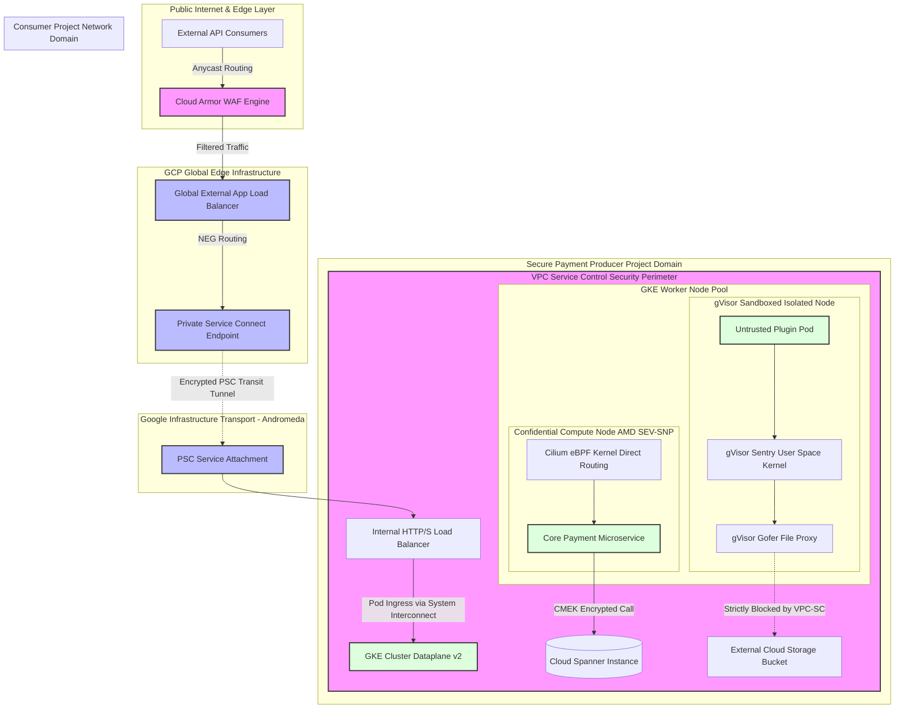

# GCP - Part 2 - Technical Study Guide & Notes

# GCP Enterprise Architecture Study Guide (Part 2/3)
## Advanced Networking, Edge Security, Runtime Sandboxing & Enterprise Scale

---

## 1. Part Introduction and Scope

This study guide focuses on the production mechanics of Google Cloud Platform (GCP) networking, enterprise perimeter controls, workload isolation sandboxing, and edge-security engineering. 

Designed for Senior Cloud Architects and Lead SREs, this guide moves past entry-level concepts to analyze the internals of Google’s global network infrastructure, runtime sandboxing engines, and security perimeters.

### Core Scope
* **Global Network Topology & Advanced Routing:** Private Service Connect (PSC) internal mechanics, BGP tuning with Cloud Router, TCP BBR congestion control, and zero-trust service networking.
* **Perimeter Defense & Data Loss Prevention:** Deep dive into VPC Service Controls (VPC-SC) architecture, Access Context Manager, and perimeter access flows.
* **Edge Application Security:** Cloud Armor WAF architecture, Layer 7 DDoS mitigation, custom CEL (Common Expression Language) security policies, and rate limiting engines.
* **Advanced Workload Sandboxing & Node Security:** GKE Dataplane v2 (Cilium eBPF architecture), gVisor (GKE Sandbox) syscall interception, and AMD SEV-based Confidential Compute VMs.
* **Scale Boundaries & High-Throughput Engineering:** Network Endpoint Groups (NEGs), Maglev load-balancing mechanics, and quota management for ultra-scale enterprise systems.

---

## 2. Why These Concepts Are Critical for High-Availability Systems

High-availability (HA) systems operating at cloud scale fail primarily due to **cascading blast radiuses**, **network path congestion**, **noisy-neighbor hardware attacks**, and **uncontrolled data exfiltration**. Standard multi-zone deployments are insufficient against these threat vectors.

```
+-----------------------------------------------------------------------------------+
|                            ENTERPRISE RESILIENCE LAYER                            |
+-----------------------------------------------------------------------------------+
|  Perimeter Security (VPC-SC)       --> Prevents Unauthorized Data Exfiltration    |
|  Edge Protection (Cloud Armor)     --> Shields Workloads from L4/L7 Volumetric Attacks |
|  Network Fabric (PSC + eBPF)       --> Decouples IP Routing & Bypasses iptables   |
|  Runtime Isolation (gVisor/gKE)    --> Prevents Container Breaches at Syscall Level|
+-----------------------------------------------------------------------------------+
```

1. **Deterministic Network Performance (GKE Dataplane v2 & BBR):** Standard Linux Kernel `iptables` rules evaluate sequentially at $O(N)$ complexity. In a cluster with 10,000 services, packet evaluation incurs microsecond latencies that degrade tail latencies ($p99$). GKE Dataplane v2 uses Cilium and eBPF to execute direct $O(1)$ BPF map lookups in kernel space, while TCP BBR maximizes throughput across long-haul fiber without packet drop-based congestion triggers.
2. **Blast Radius Minimization (VPC-SC):** IAM controls identity, but identity can be compromised via leaked service account keys. VPC Service Controls establishes a non-bypassable cryptographic boundary at the Google API layer, blocking data exfiltration even if an attacker gains full `roles/owner` IAM permissions.
3. **Network Overlap Abstraction (Private Service Connect):** Multi-tenant VPC Peering hits scale limits (maximum 25–100 peerings per VPC) and causes IP address collision issues across business units. PSC leverages network address translation at the Andromeda SDN layer, enabling non-routable, overlapping IP subnets to securely expose services via internal endpoints.
4. **Zero-Day Container Escape Defense (gVisor/GKE Sandbox):** Microservice multi-tenancy on shared Linux kernels exposes the system to local privilege escalations (LPE). gVisor intercepts applications' Ring 3 system calls, re-implementing the kernel interface in user-space (Sentry process) to protect the underlying host Linux kernel.

---

## 3. Real-World Enterprise Use Case

### Scenario: Multi-Tenant Financial Payment Processing Gateway
* **Transaction Throughput:** 85,000 Transactions Per Second (TPS) peak.
* **Compliance Requirement:** PCI-DSS v4.0 Level 1, SOC2 Type II, ISO 27001.
* **Target Availability:** 99.995% uptime (< 26.3 minutes downtime per year).

### Architecture Requirements
* Untrusted tenant code execution (custom settlement plug-ins) must run on isolated nodes using gVisor sandbox runtimes.
* Payment Card Industry (PCI) data boundaries must be enforced via VPC Service Controls to prevent cardholder data exfiltration to non-approved storage buckets or public networks.
* External API ingress must pass through a multi-region Anycast Edge protected by Cloud Armor WAF with OWASP Top 10 mitigation and dynamic client fingerprinting.
* Microservices across Producer (Payment Engine) and Consumer (Merchant Gateways) VPCs must communicate over Private Service Connect (PSC), avoiding classical VPC Peering to eliminate cross-organizational subnet exposure.

```
                                GLOBAL ANYCAST IP
                                        │
                             ┌──────────▼──────────┐
                             │ Cloud Armor Edge    │ (OWASP L7 WAF, DDoS Rate Limiting)
                             └──────────┬──────────┘
                                        │
                         ┌──────────────▼──────────────┐
                         │  Global Ext Application LB  │ (Maglev + Envoy Proxy)
                         └──────────────┬──────────────┘
                                        │
                         ┌──────────────▼──────────────┐
                         │ Private Service Connect Endpt│
                         └──────────────┬──────────────┘
                                        │ [Andromeda SDN Transport - Encrypted]
                                        │
             ┌──────────────────────────▼──────────────────────────┐
             │            PAYMENT PRODUCER VPC (SHARED)            │
             │                                                     │
             │  ┌───────────────────────────────────────────────┐  │
             │  │ VPC SERVICE CONTROLS PERIMETER                │  │
             │  │                                               │  │
             │  │  ┌─────────────────────────────────────────┐  │  │
             │  │  │ GKE ENTERPRISE CLUSTER                  │  │  │
             │  │  │ Dataplane v2 (Cilium eBPF)              │  │  │
             │  │  │                                         │  │  │
             │  │  │  ┌──────────────────┐ ┌──────────────┐  │  │  │
             │  │  │  │ gVisor Sandbox   │ │ Confidential │  │  │  │
             │  │  │  │ Tenant Code Pods │ │ Compute Nodes│  │  │  │
             │  │  │  └────────┬─────────┘ └──────┬───────┘  │  │  │
             │  │  └───────────┼──────────────────┼──────────┘  │  │
             │  │              │                  │             │  │
             │  │              ▼                  ▼             │  │
             │  │    ┌──────────────────────────────────┐       │  │
             │  │    │ Cloud Spanner / KMS (Restricted) │       │  │
             │  │    └──────────────────────────────────┘       │  │
             │  └───────────────────────────────────────────────┘  │
             └─────────────────────────────────────────────────────┘
```

---

## 4. Comprehensive Architecture Explanation



### Flow Breakdown
1. **Edge Entry & Filtering:** Incoming TCP/HTTP requests hit Google Anycast IPs. Cloud Armor executes L7 filtering (evaluating custom HTTP headers, OWASP signatures, dynamic threat intelligence, and client GEO-IPs) directly at Google’s edge point-of-presence (PoP).
2. **Global Load Balancing (Maglev):** Validated requests are ingested by the Global Application Load Balancer. Maglev consistent-hashing nodes distribute traffic over Google's backbone network directly to Network Endpoint Groups (NEGs).
3. **Zero-Trust Network Transit (Private Service Connect):** Traffic transitions from the Load Balancer to a Private Service Connect (PSC) Endpoint. The packet payload is encapsulated using Google’s internal network virtualization protocol (Andromeda) and forwarded to the Producer Service Attachment. Cross-tenant IP space overlaps are handled via high-throughput line-rate Network Address Translation (NAT).
4. **Control Perimeter Enforcement (VPC-SC):** Inside the Service Producer VPC, the target resources reside inside an explicit VPC Service Control perimeter. Requests attempted outside this boundary (e.g., trying to read an un-approved external GCS bucket or execute unauthorized API calls) fail instantly with an HTTP `403 Forbidden` (`VPC_SERVICE_CONTROLS_VIOLATION`), irrespective of IAM privilege level.
5. **Node Level Data Processing & Sandboxing:**
   * **Core Microservices:** Deployed on GKE Confidential Nodes (leveraging AMD SEV-SNP hardware memory encryption). Network packet processing bypasses `iptables` via GKE Dataplane v2 (Cilium eBPF), routing traffic directly from the virtual veth interface to socket buffers.
   * **Untrusted Microservices:** Executed inside gVisor (`runsc`) sandboxes. Ring 3 system calls are trapped by the `Sentry` process, preventing direct interaction with the host Linux kernel. Any file I/O operations are proxied through a sandboxed file-system daemon (`Gofer`).

---

## 5. Components, Classifications & Technical Specifications

### A. Networking & Ingress Mechanics

| Component | Technical Mechanism | Key Scale Limits / Specifications | Production Recommendation |
| :--- | :--- | :--- | :--- |
| **Global Ext App Load Balancer** | Proxy-based (Envoy Layer 7 architecture). Maglev Anycast edge routing. | - Max header size: 64 KB<br>- Max connection timeout: 86,400s<br>- HTTP/2 & HTTP/3 (QUIC) native support | Enforce HTTP/3 for mobile edge clients; leverage Zonal Network Endpoint Groups (NEGs) for direct pod routing. |
| **Private Service Connect (PSC)** | Decoupled Private IP mapping using internal Google Andromeda SDN translation. | - 10,000 PSC Endpoints per VPC<br>- Throughput scales dynamically with ILB throughput (up to 100Gbps+) | Use PSC over VPC Peering for enterprise multi-tenant architectures to prevent IP exhaustion and peer limit caps. |
| **Cloud Router & BGP** | Software-defined dynamic control plane managing GCP VPC route tables. | - Max 100 BGP sessions per router<br>- 10,000 learned routes max<br>- Hold timer: 30s default (supports BFD down to 300ms) | Enable Bidirectional Forwarding Detection (BFD) on Cloud Interconnect paths for fast link failover detection (<1s). |

### B. Security Perimeters & Edge Security

| Feature | Enforcement Point | Technical Operations | Performance Impact |
| :--- | :--- | :--- | :--- |
| **VPC Service Controls** | Google Cloud API Frontend Layer (`*.googleapis.com`) | Intercepts HTTP/gRPC requests to Google service control plane; validates project identity against Context Manager policies. | Negligible (~1–2ms added to Google API control plane requests). Zero impact on data path. |
| **Cloud Armor Adaptive Protection** | Cloud Edge / Anycast Network Infrastructure | Operates inline machine learning models tracking historical traffic baselines; automatically generates custom dynamic L7 rules under attack. | Microsecond evaluation time at Google PoP edge nodes. |
| **Cloud Armor Rate Limiting** | Edge Envoy Proxies | Maintains sliding window counters based on Client IP, HTTP headers, or JA3/JA4 TLS fingerprints. | Insignificant footprint; dropped requests fail fast at the edge with `429 Too Many Requests`. |

### C. Sandboxing & Node Isolation Mechanics

| Isolation Level | Engine / Technology | Kernel & Hardware Boundary | Ideal Use Case |
| :--- | :--- | :--- | :--- |
| **Standard Container** | `runc` (Linux cgroups v2, namespaces) | Shared Linux Kernel. Vulnerable to kernel-level zero-day privilege escalations. | High-performance, fully trusted internal services with low security risk profiling. |
| **GKE Sandbox** | `runsc` (gVisor engine) | Intercepts Ring 3 system calls via `ptrace` or KVM virtualization. Implements system calls in user-space Go binary. | Untrusted multi-tenant execution, customer-submitted script engine, untrusted code parsers. |
| **Confidential Nodes** | AMD SEV / SEV-SNP | Hardware-based main memory encryption using dynamic per-VM AES keys generated by the Secure Processor. | Processing sensitive payload data (PCI-DSS, PII, PHI) where host OS memory exposure must be blocked. |

---

## 6. Step-by-Step Production Implementation Guide

The following sequence provisions a production-grade infrastructure containing a GKE Cluster running Dataplane v2, gVisor Sandboxing, Cloud Armor Edge WAF, and VPC Service Controls.

### Prerequisites & Variable Definitions
```bash
export PROJECT_ID="prd-pay-engine-01"
export REGION="us-central1"
export ZONE="us-central1-a"
export VPC_NAME="vpc-pay-prod-uscentral1"
export SUBNET_NAME="sb-pay-core-uscentral1"
export CLUSTER_NAME="gke-pay-prod-main"
export POLICY_NAME="ca_policy_pay_edge"
export POLICY_ID="accessPolicies/849204820194"
```

### Step 1: Create Custom Dual-Region VPC Network with Private Access
```bash
# Create custom VPC with explicit routing mode
gcloud compute networks create ${VPC_NAME} \
    --project=${PROJECT_ID} \
    --subnet-mode=custom \
    --bgp-routing-mode=global

# Create primary subnet with explicit secondary ranges for GKE Pods and Services
gcloud compute networks subnets create ${SUBNET_NAME} \
    --project=${PROJECT_ID} \
    --network=${VPC_NAME} \
    --region=${REGION} \
    --range=10.100.0.0/20 \
    --secondary-range=gke-pods=10.101.0.0/16,gke-services=10.102.0.0/20 \
    --enable-private-ip-google-access \
    --enable-flow-logs \
    --logging-aggregation-interval=interval-5-sec \
    --logging-flow-sampling=0.5 \
    --logging-metadata=include-all-metadata
```

### Step 2: Provision Hardened GKE Cluster with Dataplane v2 & Sandboxing Enabled
```bash
gcloud container clusters create ${CLUSTER_NAME} \
    --project=${PROJECT_ID} \
    --region=${REGION} \
    --node-locations=${ZONE} \
    --network=${VPC_NAME} \
    --subnetwork=${SUBNET_NAME} \
    --cluster-ipv4-cidr=- \
    --services-ipv4-cidr=- \
    --cluster-secondary-range-name=gke-pods \
    --services-secondary-range-name=gke-services \
    --enable-ip-alias \
    --enable-private-nodes \
    --master-ipv4-cidr=172.16.0.0/28 \
    --enable-master-global-access \
    --enable-dataplane-v2 \
    --enable-sandbox-provider=gvisor \
    --workload-pool=${PROJECT_ID}.svc.id.goog \
    --enable-shielded-nodes \
    --database-encryption-key=projects/${PROJECT_ID}/locations/${REGION}/keyRings/gke-kr/cryptoKeys/gke-etcd-key \
    --addons=HorizontalPodAutoscaling,HttpLoadBalancing,GcePersistentDiskCsiDriver \
    --no-enable-basic-auth \
    --no-issue-client-certificate

# Create a Confidential Node Pool for untrusted code running under gVisor
gcloud container node-pools create np-sandboxed-confidential \
    --project=${PROJECT_ID} \
    --cluster=${CLUSTER_NAME} \
    --region=${REGION} \
    --machine-type=n2d-standard-8 \
    --num-nodes=3 \
    --enable-confidential-nodes \
    --sandbox type=gvisor \
    --workload-metadata=GKE_METADATA \
    --enable-autoupgrade \
    --enable-autorepair \
    --max-surge-upgrade=1 \
    --max-unavailable-upgrade=0 \
    --node-labels=security.zone/sandbox=true,confidential=true \
    --node-taints=sandbox.gke.io/runtime=gvisor:NoSchedule
```

### Step 3: Deploy Cloud Armor Enterprise Protection Engine
```bash
# Initialize Security Policy
gcloud compute security-policies create ${POLICY_NAME} \
    --project=${PROJECT_ID} \
    --description="Production Edge Security Policy for Payment Ingress"

# Attach OWASP Top 10 SQL Injection rule (SQLi)
gcloud compute security-policies rules create 1000 \
    --security-policy=${POLICY_NAME} \
    --expression="evaluatePreconfiguredExpr('sqli-v33-stable')" \
    --action="deny-403" \
    --description="Block SQL Injection Attacks"

# Attach OWASP Cross-Site Scripting rule (XSS)
gcloud compute security-policies rules create 1001 \
    --security-policy=${POLICY_NAME} \
    --expression="evaluatePreconfiguredExpr('xss-v33-stable')" \
    --action="deny-403" \
    --description="Block XSS Attacks"

# Implement Rate Limiting Rule (Max 100 requests per 1-minute window per IP)
gcloud compute security-policies rules create 2000 \
    --security-policy=${POLICY_NAME} \
    --expression="true" \
    --action="rate-based-ban" \
    --rate-limit-threshold-count=100 \
    --rate-limit-threshold-interval-sec=60 \
    --ban-duration-sec=300 \
    --conform-action="allow" \
    --exceed-action="deny(429)" \
    --enforce-on-key="IP" \
    --description="Enforce IP Rate Limiting"
```

### Step 4: Provision VPC Service Controls Access Level and Perimeter
```bash
# Create Access Level based on IP Subnet criteria
cat <<EOF > access_level.yaml
- ipSubnetworks:
  - "203.0.113.0/24"
  - "198.51.100.0/24"
EOF

gcloud access-context-manager levels create corporate_trusted_access \
    --title="Corporate Trusted Subnets" \
    --basic-level-spec=access_level.yaml \
    --policy=${POLICY_ID}

# Enforce VPC Service Control Perimeter around storage and database layers
gcloud access-context-manager perimeters create pay_spanner_perimeter \
    --title="Payment Spanner Data Perimeter" \
    --resources=projects/849204820194 \
    --restricted-services=spanner.googleapis.com,storage.googleapis.com,kms.googleapis.com \
    --access-levels=corporate_trusted_access \
    --policy=${POLICY_ID}
```

---

## 7. Standard CLI Commands with Deep Technical Explanations

### Command 1: GKE Dataplane v2 Network Policy & Observability Inspection
```bash
gcloud container fleet mesh describe --project=${PROJECT_ID}
```
* **Deep Technical Breakdown:**
  * Dataplane v2 integrates directly with Cloud Monitoring to log eBPF routing events. This command inspects the Service Mesh status linked via Dataplane v2's local agent (`cilium-agent`).
  * In Dataplane v2, network policies bypass standard Linux bridge mechanisms and write directly to eBPF lookup tables attached to the `tc` (traffic control) ingress/egress hooks on the virtual interface.

### Command 2: Cloud Armor Complex Expression Layer (CEL) Evaluation
```bash
gcloud compute security-policies rules create 3000 \
    --security-policy=${POLICY_NAME} \
    --expression="inIpRange(origin.ip, '1.2.3.4/32') && request.headers['x-payment-token'].contains('test')" \
    --action="deny(403)" \
    --project=${PROJECT_ID}
```
* **Deep Technical Breakdown:**
  * `--expression`: Evaluates an expression using Common Expression Language (CEL) syntax in real-time at the edge Envoy proxy.
  * `inIpRange`: Performs an $O(1)$ IP prefix match.
  * `request.headers`: Extracts string metadata from the HTTP stream prior to payload execution.
  * `--action="deny(403)"`: Sends an immediate system abort response from the Google Edge cache node, preventing the request from traversing backend infrastructure.

### Command 3: VPC Service Controls Dry-Run Operations
```bash
gcloud access-context-manager perimeters update pay_spanner_perimeter \
    --policy=${POLICY_ID} \
    --set-dry-run-services=spanner.googleapis.com \
    --enable-dry-run-logging
```
* **Deep Technical Breakdown:**
  * `--set-dry-run-services`: Enables dry-run enforcement mode on specified API services. Request paths are evaluated against policy rules, but non-compliant requests are still allowed through to the backend.
  * `--enable-dry-run-logging`: Emits detailed audit logs (`protoPayload.metadata.vpcServiceControlsUniqueId`) to Cloud Logging. This allows security engineers to validate perimeter policies and catch accidental service disruptions prior to full enforcement.

---

## 8. Production Configuration Examples

### 1. Hardened GKE Sandbox Deployment Manifest (`deployment-sandbox.yaml`)
```yaml
apiVersion: apps/v1
kind: Deployment
metadata:
  name: untrusted-payment-parser
  namespace: payment-processing
  labels:
    app.kubernetes.io/name: payment-parser
    security.tier: sandboxed
spec:
  replicas: 5
  selector:
    matchLabels:
      app: untrusted-payment-parser
  template:
    metadata:
      labels:
        app: untrusted-payment-parser
    spec:
      # Direct execution into gVisor user-space kernel
      runtimeClassName: gvisor
      affinity:
        nodeAffinity:
          requiredDuringSchedulingIgnoredDuringExecution:
            nodeSelectorTerms:
            - matchExpressions:
              - key: sandbox.gke.io/runtime
                operator: In
                values:
                - gvisor
      tolerations:
      - key: "sandbox.gke.io/runtime"
        operator: "Equal"
        value: "gvisor"
        effect: "NoSchedule"
      securityContext:
        runAsNonRoot: true
        runAsUser: 10001
        runAsGroup: 10001
        fsGroup: 10001
        seccompProfile:
          type: RuntimeDefault
      containers:
      - name: parser-engine
        image: gcr.io/prd-pay-engine-01/parser:v2.1.0
        imagePullPolicy: Always
        securityContext:
          allowPrivilegeEscalation: false
          readOnlyRootFilesystem: true
          capabilities:
            drop:
            - ALL
        resources:
          limits:
            cpu: "2"
            memory: "2Gi"
          requests:
            cpu: "500m"
            memory: "512Mi"
```

### 2. Private Service Connect Service Attachment Definition (`psc-producer.yaml`)
```yaml
apiVersion: networking.gke.io/v1
kind: ServiceAttachment
metadata:
  name: psc-payment-attachment
  namespace: payment-processing
spec:
  connectionPreference: ACCEPT_EXPLICIT
  consumerAcceptList:
  - project: consumer-merchant-project-01
    connectionLimit: 50
  producerForwardingRule: payment-ilb-forwarding-rule
  natSubnets:
  - psc-nat-subnet-01
```

### 3. Terraform Production VPC-SC Perimeter with Egress Rule (`vpc-sc.tf`)
```hcl
resource "google_access_context_manager_service_perimeter" "secure_data_perimeter" {
  provider = google-beta
  parent   = "accessPolicies/${var.access_policy_id}"
  name     = "accessPolicies/${var.access_policy_id}/servicePerimeters/pay_data_perimeter"
  title    = "PCI-DSS Data Core Perimeter"
  
  status {
    restricted_services = [
      "spanner.googleapis.com",
      "storage.googleapis.com"
    ]

    access_levels = [
      google_access_context_manager_access_level.corp_access.name
    ]

    ingress_policies {
      ingress_from {
        identity_type = "ANY_IDENTITY"
        sources {
          access_level = google_access_context_manager_access_level.corp_access.name
        }
      }
      ingress_to {
        resources = ["*"]
        operations {
          service_name = "spanner.googleapis.com"
          method_selectors {
            method = "google.spanner.v1.Spanner.Read"
          }
        }
      }
    }

    egress_policies {
      egress_from {
        identity_type = "IDENTITY_SERVICE_ACCOUNT"
        identities    = ["serviceAccount:${var.gke_sa_email}"]
      }
      egress_to {
        resources = ["projects/987654321012"] # Permitted Analytics Project
        operations {
          service_name = "storage.googleapis.com"
          method_selectors {
            method = "google.storage.objects.create"
          }
        }
      }
    }
  }
}
```

---

## 9. Security Considerations & Hardening Best Practices

### Network Zoning Infrastructure
```
+-------------------------------------------------------------------------------+
| UNTRUSTED EXTERNAL EDGE                                                       |
| Cloud Armor Engine --> TLS Termination Layer --> Dynamic Rate Limiter        |
+-------------------------------------------------------------------------------+
                                     │
                                     ▼
+-------------------------------------------------------------------------------+
| DMZINGRESS ZONE (PSC Transit Network)                                         |
| Explicit Ingress Rules Only --> No Public IPs --> Intermittent Internal NAT    |
+-------------------------------------------------------------------------------+
                                     │
                                     ▼
+-------------------------------------------------------------------------------+
| TRUSTED CORE DATA ZONE (VPC Service Controls Perimeter)                       |
| GKE Dataplane v2 eBPF Policies --> gVisor User Runtimes --> CMEK Spanner      |
+-------------------------------------------------------------------------------+
```

1. **Identity & Access Management (IAM):**
   * Rely entirely on **Workload Identity Federation** for Kubernetes-to-GCP access. Do not create or download static service account JSON keys.
   * Restrict access to `roles/iam.serviceAccountTokenCreator` to ensure tokens are issued dynamically with maximum 1-hour lifespans.

2. **Encryption Standards:**
   * **In-Transit:** Force TLS 1.3 across external Application Load Balancers. Internal service mesh traffic must enforce mTLS via Envoy proxies or Dataplane v2's native SPIFFE/SPIRE integrations with hardware cryptographic root key rotation.
   * **At-Rest:** Enforce Customer-Managed Encryption Keys (CMEK) via Cloud KMS backed by Cloud HSM (FIPS 140-2 Level 3 protection). Enable dynamic rotation intervals (30-day target maximum).

3. **Runtime & Perimeter Hardening:**
   * Run containers on **Shielded GKE Nodes** with Secure Boot, vTPM attestation, and Integrity Monitoring enabled to block rootkits and unauthorized kernel module loading.
   * Force all untrusted or tenant-controlled code payloads into `runtimeClassName: gvisor`. gVisor restricts system access by blocking unsafe syscalls like `ptrace`, `kexec_load`, and complex raw socket initializations.

---

## 10. Observability & Monitoring Considerations

Enterprise deployments require distinct, observable telemetry across the edge security layer, internal packet pathways, and kernel execution states.

```
                    EDGE TO KERNEL TELEMETRY MATRIX
                    
  [Edge: Cloud Armor]       [Transport: eBPF Engine]      [Kernel: gVisor]
  - Denial Count            - Drop Count                  - Syscall Latency
  - Rate-limit Drops        - Map Memory Capacity         - Sentry Traps
  - Adaptive Protection     - Network Policy Verdicts     - File Proxy Overheads
```

### Key Metrics to Monitor

| System Subcomponent | Prometheus/Cloud Monitoring Metric Name | Alert Threshold | Architectural Significance |
| :--- | :--- | :--- | :--- |
| **VPC-SC Violations** | `accesscontextmanager.googleapis.com/visor/violation_count` | `> 0` | Triggers when an operation violates a security perimeter rule; potential ongoing data exfiltration attempt or misconfigured service endpoint. |
| **Cloud Armor Edge** | `loadbalancing.googleapis.com/https/request_count` (Filtered by `response_code_class=4xx`) | Surge `> 150%` over 5m baseline | Signifies L7 volumetric flood or ongoing OWASP exploit execution being blocked at edge. |
| **Dataplane v2 (Cilium)**| `cilium_drop_count_total` | `> 50 drops/sec` continuous | Network drop metric evaluated at kernel eBPF layer. Indicates policy denial or corrupted packet structures. |
| **gVisor Engine** | `container_cpu_cgroup_atomic_memory_failed_events` | `> 0` | Memory allocations failing within the gVisor `Sentry` user-space kernel sandbox execution bounds. |

### Structured Log Filter for Perimeter Denials (Cloud Logging Filter)
```logql
resource.type="audited_resource"
resource.labels.service="spanner.googleapis.com"
protoPayload.status.code=7
protoPayload.status.message=~"VPC_SERVICE_CONTROLS_VIOLATION"
```
*Executes immediate security notification parsing when a Spanner read/write call is blocked by a VPC-SC boundary.*

---

## 11. Troubleshooting Scenarios with Root Cause Analysis (RCA)

### Scenario 1: VPC-SC Perimeter Denial on Cross-Project API Execution

```
[ GKE Pod (Project A) ] ──( Cloud Storage Call )──> [ VPC-SC Boundary ] ──X ( Denied: Code 7 )
                                                            │
                                                Check Ingress/Egress Logs
                                                            │
                                                Missing Project B Entry
```

* **Symptom:** Microservices running in Project A fail to write objects to a Cloud Storage bucket in Project B, receiving an `HTTP 403 Forbidden` error with the error detail `VPC_SERVICE_CONTROLS_VIOLATION`.
* **Root Cause Analysis (RCA):**
  1. Inspect Cloud Logging using the query `protoPayload.status.message="VPC_SERVICE_CONTROLS_VIOLATION"`.
  2. Extract `protoPayload.metadata.vpcServiceControlsUniqueId`.
  3. The audit log confirms that Project B enforces a VPC-SC perimeter that excludes Project A, and lacks an explicit Ingress/Egress policy rule permitting the IAM service account identity assigned to Project A's Workload Identity mapping.
* **Resolution Steps:**
  1. Add an explicit **Ingress Policy** to Project B's perimeter spec: Define `ingress_from` specifying Project A's project number and Workload Identity SA.
  2. Define `ingress_to` authorizing the `storage.googleapis.com` API service with execution methods `google.storage.objects.create`.

---

### Scenario 2: eBPF Map Capacity Exhaustion in Dataplane v2 Cluster

```
[ New Pod Creation ] ──> [ Dataplane v2 (Cilium Engine) ] ──> [ eBPF Map Full ]
                                                                      │
                                                            Kernel Drops Packet
                                                                      │
                                                            Pod Pending / Unreachable
```

* **Symptom:** GKE Pods suddenly fail to communicate with newly provisioned internal cluster services. Network latency spikes to timeouts ($>30,000\text{ms}$), and `kubectl logs` reports connection failure timeouts.
* **Root Cause Analysis (RCA):**
  1. Execute SSH terminal access to a worker node via `gcloud compute ssh`.
  2. Run the Cilium diagnostic tool: `cilium monitor --type drop`.
  3. Log output reveals: `BPF map allocation failed: Map BPF_MAP_TYPE_HASH full`.
  4. Dataplane v2’s eBPF map sizing reached max dynamic capacity due to high pod churn and an excessively high volume of short-lived, transient Network Policy definitions.
* **Resolution Steps:**
  1. Optimize Kubernetes NetworkPolicies by grouping pod selectors, replacing granular single-pod policies with broader CIDR/namespace selector definitions.
  2. Update node pool parameters to increase Cilium eBPF map limits via GKE Cluster Config limits tuning, or initiate dynamic node pool recycling to purge stale socket allocations in kernel space.

---

### Scenario 3: High Latency and I/O Bottlenecks Under gVisor (`runsc`) Runtime

```
[ Pod Container ] ──( Syscall: read/write )──> [ gVisor Sentry ] ──( File I/O )──> [ Gofer Proxy ]
                                                                                         │
                                                                                 High I/O Stalling
```

* **Symptom:** An untrusted file-parsing service transferred to gVisor sandbox runtimes (`runtimeClassName: gvisor`) suffers an 800% degradation in write performance compared to standard `runc` execution.
* **Root Cause Analysis (RCA):**
  1. Analyze application system call execution patterns using `strace` or gVisor debug logs (`--debug-log`).
  2. The service performs millions of high-frequency micro-read/write calls to the local disk file system.
  3. In gVisor, system calls like `read()` and `write()` are trapped by the `Sentry` kernel emulation process and proxied via RPC calls to the `Gofer` container file system daemon, creating significant IPC context switching overhead per call.
* **Resolution Steps:**
  1. Modify application code to buffer file operations in memory, writing larger data blocks instead of unbuffered single-byte writes.
  2. Change filesystem mount options: Mount ephemeral, non-persistent working directories using `tmpfs` (in-memory execution), which allows gVisor to satisfy I/O calls entirely in memory within the `Sentry` process, bypassing `Gofer` daemon IPC calls entirely.

---

## 12. Common Mistakes and Prevention Strategies

### 1. Direct VPC Peering at Scale Instead of Private Service Connect
* **The Mistake:** Using VPC Network Peering to connect multiple internal projects or multi-tenant business units.
* **The Failure:** Reaches IP space exhaustion due to non-overlapping subnets requirements; hits hard GCP VPC Peering limits (max 25-100 peerings); causes transitive routing failures.
* **Prevention Strategy:** Mandate Private Service Connect (PSC) for cross-boundary internal platform endpoints. PSC uses private endpoints mapped to internal IP addresses via Andromeda NAT, eliminating non-overlapping IP restrictions and transitive routing caps.

### 2. Immediate Active Enforcement of VPC-SC Perimeters Without Dry-Run Testing
* **The Mistake:** Deploying a VPC Service Controls perimeter directly in enforced mode using Terraform or standard CLI commands.
* **The Failure:** Instantly blocks legitimate internal automation, CI/CD runners, monitoring agents, and cross-project batch jobs, causing critical operational disruptions.
* **Prevention Strategy:** Always create perimeters in `dry-run` mode first. Stream logs to BigQuery for a minimum of 7 to 14 days, executing analytical SQL queries against `protoPayload.metadata.vpcServiceControlsUniqueId` to discover and validate all benign traffic paths before setting the status to Enforced.

### 3. Misconfiguring Network Endpoint Groups (NEGs) with L7 Load Balancers
* **The Mistake:** Targeting GKE cluster Instance Groups instead of dynamic Zonal NEGs in Global Load Balancer configurations.
* **The Failure:** Incurs double-hop routing latencies. Traffic hits a random node via Instance Group load balancing, then traverses `kube-proxy` / `iptables` rules to reach the actual target pod on a different node.
* **Prevention Strategy:** Use container-native load balancing by specifying container NEGs via the `cloud.google.com/neg: '{"ingress": true}'` annotation on Kubernetes Service specs. This routes HTTP/S LB connections directly to the individual container pod IP address.

---

## 13. Advanced Enterprise Recommendations

### Performance Tuning: Congestion Control with BBR and Socket Optimization
Enable Google’s BBR (Bottleneck Bandwidth and RTT) congestion control algorithm across all base Linux worker nodes. Unlike traditional TCP Loss-based algorithms (CUBIC/Reno), BBR calculates maximum throughput and minimum round-trip time, preventing queue-bloat latency on high-bandwidth, multi-region backbones.

Add sysctl adjustments to standard compute node startup scripts:
```bash
cat <<EOF >> /etc/sysctl.d/99-gcp-performance.conf
net.core.default_qdisc = fq
net.ipv4.tcp_congestion_control = bbr
net.ipv4.tcp_rmem = 4096 87380 16777216
net.ipv4.tcp_wmem = 4096 65536 16777216
net.core.somaxconn = 8192
net.ipv4.tcp_max_syn_backlog = 8192
EOF
sysctl --system
```

### Advanced Connection Pooling via Envoy Load Balancing
When deploying microservices on GKE utilizing gRPC/HTTP2 protocols, enforce explicit connection keep-alives and MAX_CONCURRENT_STREAMS parameters via Envoy proxies or Dataplane v2 mesh rules. This avoids backend socket exhaustion under rapid scaling events.

---

## 14. Advanced Deep-Dive Architecture Concepts

### A. BBR Congestion Control vs CUBIC Mechanics
CUBIC interprets dropped packets as network congestion, cutting the transmission window size exponentially. On modern long-haul optical fiber paths, random drops occur without congestion. 

BBR continually measures pacing rate and round-trip time (RTT). It drives the connection at maximum bandwidth while maintaining minimal queue depth, reducing tail latency ($p99$) by up to $10\times$ across cross-region network backbones.

```
TCP CUBIC:    [Increase Rate] --> [Packet Drop Occurs] --> [Drastic Rate Drop] (Sawtooth Pattern)
TCP BBR:      [Paces Based on Real Capacity & RTT]       --> [Max Rate, Minimal Buffer Latency]
```

### B. Maglev Load Balancing Internals
Google’s Maglev is a distributed, software-defined network load balancer operating on commodity Linux servers. Key mechanics include:
* **Consistent Hashing:** Uses a specialized lookup table algorithm that distributes connections uniformly while minimizing connection churn when backend nodes are added or removed.
* **Kernel Bypass via Packet Processing Systems:** Maglev nodes steer packets directly from the NIC into user-space memory buffers, completely bypassing standard Linux socket layer overheads to deliver line-rate L4 packet steering.

### C. gVisor Internals: Sentry and Gofer System Architecture
gVisor re-architects container security by running an isolated application layer inside a user-space kernel environment written in Go.

```
+-------------------------------------------------------------------------+
| UNTRUSTED APPLICATION POD (Ring 3 Execution)                            |
+-------------------------------------------------------------------------+
                                     │
                        (Traps Trapped System Calls)
                                     │
                                     ▼
+-------------------------------------------------------------------------+
| SENTRY (User-Space Kernel Engine)                                       |
| - Emulates 300+ Linux syscalls locally                                  |
| - Implements internal virtual memory allocation and network stacks      |
+-------------------------------------------------------------------------+
                                     │
                          (Delegates File System I/O)
                                     │
                                     ▼
+-------------------------------------------------------------------------+
| GOFER (Isolated File System Proxy Daemon)                               |
| - Communicates with Sentry via 9P Protocol over UNIX Sockets            |
| - Controls and limits direct Host File System Operations                |
+-------------------------------------------------------------------------+
                                     │
                                     ▼
+-------------------------------------------------------------------------+
| HOST LINUX KERNEL (Protected from Untrusted Executables)                 |
+-------------------------------------------------------------------------+
```

---

## 15. Integration with Enterprise DevOps Ecosystem Tools

### 1. Infrastructure-as-Code via Terraform (Google-Beta)
Automate edge rules and perimeters through standardized, version-controlled Infrastructure-as-Code pipelines.
```hcl
# Automated Cloud Armor Custom Security Rule Provisioning
resource "google_compute_security_policy_rule" "block_bad_ja3" {
  project         = var.project_id
  security_policy = var.security_policy_name
  priority        = 500
  action          = "deny(403)"
  preview         = false
  
  match {
    expr {
      expression = "evaluateAttribute('tls.client.ja3_fingerprint') == 'e7d705a3286e19ea42f587b344ee6865'"
    }
  }
  description = "Block malicious HTTP client fingerprinting pattern"
}
```

### 2. Declarative Network Policies via ArgoCD and Kubernetes Dataplane v2
Manage security policies via GitOps principles, using ArgoCD to enforce Cilium-native NetworkPolicies (`CiliumNetworkPolicy` custom resource definitions) directly across GKE Dataplane v2 clusters.

```yaml
apiVersion: "cilium.io/v2"
kind: CiliumNetworkPolicy
metadata:
  name: "restrict-spanner-access"
  namespace: "payment-processing"
spec:
  endpointSelector:
    matchLabels:
      app: payment-engine
  egress:
  - toServices:
    - k8sService:
        serviceName: spanner-proxy
        namespace: payment-processing
  - toCIDRSet:
    - cidr: "10.100.0.0/20"
```

---

## 16. Comprehensive Tooling Comparison Matrix

| Technical Metric / Feature | GCP Enterprise Stack | AWS Equivalent Stack | Azure Equivalent Stack | Architectural Winner / Rationale |
| :--- | :--- | :--- | :--- | :--- |
| **Edge WAF & DDoS Engine** | **Cloud Armor** (Global Anycast, CEL engine, ML Adaptive Protection) | **AWS WAF** + Shield Advanced | **Azure Front Door** WAF | **GCP (Cloud Armor)**: Global single-IP Anycast integration provides superior L7 DDoS mitigation without DNS redirection latency. |
| **Private Cross-Tenant Connectivity** | **Private Service Connect (PSC)** (Andromeda NAT) | AWS PrivateLink | Azure Private Endpoint | **GCP / AWS (Tie)**: Both leverage SDN translation layers to support seamless scale without IP overlap. |
| **Cluster Networking Engine** | **GKE Dataplane v2** (eBPF / Cilium native) | Amazon EKS VPC CNI (AWS IPAM) | Azure CNI with Cilium | **GCP**: Native eBPF implementation in Dataplane v2 eliminates `iptables` bottlenecks out-of-the-box. |
| **Runtime Container Isolation** | **gVisor** (GKE Sandbox user-space kernel) | AWS Fargate (MicroVM / Firecracker) | Azure Container Instances (Hyper-V) | **GCP (gVisor)**: Lower memory overhead for transient workloads; execution happens within standard GKE node pools. |
| **Perimeter Boundary Control** | **VPC Service Controls** (Google API Interceptor Layer) | AWS Service Catalog / Resource Policies | Azure Purview / Private Link Boundaries | **GCP**: VPC-SC provides unmatched protection at the API layer, blocking data exfiltration even against compromised IAM keys. |

---

## 17. Visual Architecture Cheat Sheet

```
+----------------------------------------------------------------------------------------------------+
|                                    GCP ENTERPRISE SECURE FLOW                                      |
+----------------------------------------------------------------------------------------------------+
 [ INGRESS ]  --> Anycast Edge (Cloud Armor WAF: OWASP + Rate Limiting + CEL Rules)
                      │
                      ▼
 [ ROUTING ]  --> Global Ext App LB (Maglev + Envoy Proxies) ──> Container NEGs (Direct Pod Route)
                      │
                      ▼
 [ TRANSIT ]  --> Private Service Connect Endpoint ──[Andromeda SDN Layer]──> PSC Service Attachment
                      │
                      ▼
 [ PERIMETER] --> VPC Service Controls (Intercepts Google API calls; Blocks Exfiltration Attempts)
                      │
                      ▼
 [ KERNEL ]   --> GKE Dataplane v2 (Cilium eBPF Kernel Routing; Bypasses iptables O(1) Lookups)
                      │
                      ├─► Core Workloads: Confidential Compute Nodes (AMD SEV-SNP Encrypted Memory)
                      └─► Untrusted Workloads: gVisor Sandbox (runsc Syscall Interception via Sentry)
+----------------------------------------------------------------------------------------------------+
```

### Production Rules of Thumb
* **When to choose gVisor:** Any untrusted, user-submitted, or dynamic code execution (e.g., custom webhooks, scripting runtimes, file parsers).
* **When to choose Private Service Connect over Peering:** Multi-tenant infrastructures, multi-org connections, overlapping CIDR spaces, or when VPC Peering scale boundaries ($>25$ peers) are hit.
* **When to choose Dataplane v2:** All production GKE deployments. Enables advanced Cilium network policies, eBPF performance tuning, and deep network observability out of the box.

---

## 18. Comprehensive Final Learning Summary

Mastering advanced GCP enterprise architecture requires moving beyond compute management to mastering **system boundaries**, **edge-to-kernel routing pipelines**, and **zero-trust security execution layers**. 

```
                                  MASTERY ROADMAP
                                         │
        ┌────────────────────────────────┴────────────────────────────────┐
        │                                                                 │
        ▼                                                                 ▼
[ Network Path ]                                                [ Isolation & Boundaries ]
- Global Anycast Routing                                        - API Layer Access Control (VPC-SC)
- eBPF Packet Traversal                                         - Kernel Syscall Sandboxing (gVisor)
- Low-latency Congestion Tuning (BBR)                           - Hardware Memory Encryption (SEV-SNP)
```

1. **Edge Architecture:** Global Application Load Balancing paired with Cloud Armor Anycast IP topologies mitigates L4/L7 volumetric threats far outside internal VPC boundaries.
2. **Transit Security:** Private Service Connect provides non-routable service isolation over Andromeda SDN virtualization, serving as the standard replacement for legacy VPC Peering.
3. **Data Protection:** VPC Service Controls forms a continuous API perimeter across data boundaries. It decouples access control from IAM alone, mitigating data loss from compromised identity keys.
4. **Kernel Engine Execution:** GKE Dataplane v2 leverages Cilium eBPF to route packets in $O(1)$ lookup time, while gVisor introduces user-space kernel traps to isolate untrusted code execution pathways.

By combining these edge, transit, isolation, and observability patterns, senior cloud architects can build secure, high-throughput, and scalable enterprise platforms on Google Cloud Platform.

### Q21. VPC Network Peering vs. Shared VPC vs. Private Service Connect (PSC): What are the architectural decision boundaries, transitive routing limitations, and scale limits for enterprise multi-project network designs?

**Detailed Answer**:
Enterprise GCP network topologies rely on three main connection paradigms, each addressing distinct trust models, administrative boundaries, and scale limits:

1. **Shared VPC**: Extends a single VPC network across multiple projects under the same Organization.
   * *Architecture*: A centralized Host Project owns the VPC network, subnets, firewall rules, and Cloud Routers. Service Projects are linked to the Host Project and instantiate resources (e.g., GKE nodes, Compute Engine VMs) attached to specific subnets.
   * *Routing & Limits*: All subnets share a single global routing table. Transitive routing across Cloud Interconnect/VPN to on-premises is natively supported. Scale limitations include a maximum of 300 Service Projects attached to a single Host Project and standard VPC route limits (e.g., max 250 routed subnets per VPC network).
   * *Best For*: Single administrative domain, centralized network governance, and microservice architectures requiring direct private IP communication across teams.

2. **VPC Network Peering**: Connects two distinct VPC networks (even across different Organizations) using Google’s SDN fabric.
   * *Architecture*: Both VPCs remain independently managed. Traffic stays entirely within Google's private network with low latency and high bandwidth.
   * *Routing & Limits*: **Non-transitive by design**. If VPC A is peered with VPC B, and VPC B is peered with VPC C, VPC A **cannot** communicate with VPC C through VPC B. Importing/exporting custom routes must be explicitly enabled on both sides. Peerings are subject to strict limits: a maximum of 25 effective peered networks per single VPC, and a limit of 300 non-dynamic routes exchanged across peerings.
   * *Best For*: Autonomous business units or M&A scenarios where network administration must remain strictly separated, but direct high-throughput IP connectivity is required.

3. **Private Service Connect (PSC)**: Unidirectional, endpoint-based connectivity using Internal Passthrough Network Load Balancers (ILB) and NAT (Network Address Translation).
   * *Architecture*: A *Service Consumer* creates a PSC Endpoint (an internal IP address within their own VPC) that routes traffic to a *Service Producer's* Service Attachment (backed by an ILB).
   * *Routing & Limits*: Completely bypasses VPC peering limits and eliminates IP address overlap conflicts. It natively breaks transitivity issues because connection state is tracked via NAT at the SDN edge. Scale boundaries allow thousands of consumer endpoints to connect to a single producer service attachment.
   * *Best For*: Multi-tenant SaaS platforms, publishing internal API services to isolated consumer VPCs, and connecting third-party managed services (e.g., Snowflake, MongoDB Atlas) without exposing internal IP spaces or exceeding peering quotas.

```
+-----------------------------------------------------------------------------------+
|                                  DECISION MATRIX                                  |
+----------------------+--------------------+-------------------+-------------------+
| Feature              | Shared VPC         | VPC Peering       | PSC               |
+----------------------+--------------------+-------------------+-------------------+
| IP Overlap Allowed   | No                 | No                | Yes               |
| Transitive Routing   | Native             | Not Supported     | NAT-based Proxy   |
| Max Connections      | 300 Service Projs  | 25 Peering Links  | Thousands         |
| Security Boundary    | Subnet / IAM       | Network Boundary  | Explicit Endpoint |
+----------------------+--------------------+-------------------+-------------------+
```

**Production Scenario / Practical Example**:
An enterprise needs to expose a central Payment Gateway service hosted in `proj-payments-prod` to 50 distinct application projects with overlapping Classless Inter-Domain Routing (CIDR) blocks. Using VPC Peering would fail due to overlapping IPs and the 25-peering ceiling limit.

To solve this, configure Private Service Connect using Terraform:

```hcl
# Service Producer Project: Publish the Internal Load Balancer
resource "google_compute_service_attachment" "payment_service" {
  name                  = "sa-payment-gateway"
  project               = "proj-payments-prod"
  region                = "us-central1"
  enable_proxy_protocol = false
  connection_preference = "ACCEPT_EXPLICIT"

  nat_subnets           = [google_compute_subnetwork.psc_nat_subnet.id]
  target_service        = google_compute_forwarding_rule.payment_ilb.id

  consumer_accept_list {
    project_id_or_num = "proj-app-team-alpha"
    connection_limit  = 10
  }
}

# Service Consumer Project: Create a PSC Endpoint (Forwarding Rule)
resource "google_compute_forwarding_rule" "psc_endpoint_consumer" {
  name                  = "psc-endpoint-payments"
  project               = "proj-app-team-alpha"
  region                = "us-central1"
  network               = "vpc-app-alpha"
  subnetwork            = "subnet-app-alpha"
  ip_address            = "10.100.1.50" # Local IP in consumer VPC
  target                = google_compute_service_attachment.payment_service.id
  load_balancing_scheme = ""
}
```

---

### Q22. GKE Sandbox (gVisor) vs. Confidential Space/Nodes: How do their kernel virtualization, memory encryption, syscall interception overhead, and security boundaries compare?

**Detailed Answer**:
GKE Sandbox (gVisor) and Confidential Nodes (AMD SEV / Intel TDX) address fundamentally different threat models using distinct isolation mechanisms:

```
GKE Sandbox (gVisor)                     Confidential Nodes (AMD SEV)
+---------------------------------+      +---------------------------------+
|  Pod App (Untrusted Code)       |      |  Pod App / Workload             |
+---------------------------------+      +---------------------------------+
|  gVisor Kernel (Sentry / Gofer) |      |  Standard Linux Kernel          |
+---------------------------------+      +---------------------------------+
|  Host OS / KVM (Shared)         |      |  AMD SEV Cryptographic Hardware |
+---------------------------------+      +---------------------------------+
```

#### GKE Sandbox (gVisor)
* **Architecture**: Implements an application-level kernel (`Sentry`) written in Go that runs in user-space, alongside a file system proxy (`Gofer`). It intercepts and virtualizes Linux system calls made by the container payload.
* **Security Boundary**: Isolates untrusted container code from the underlying host Linux kernel. A vulnerability in the application payload cannot directly compromise the host kernel via raw system calls (e.g., `ptrace`, `sys_unshare`), preventing container breakout attacks.
* **Syscall Interception & Overhead**: System calls are intercepted via `ptrace` or KVM modes. This introduces CPU and latency overhead for system-call-heavy workloads (e.g., high-frequency small file I/O, rapid network socket allocation). Pure compute/memory-bound tasks experience near-zero overhead.
* **Limitations**: Does not support host networking, raw sockets (`SOCK_RAW`), direct device access (e.g., GPUs), or performance-critical system calls like `io_uring`.

#### Confidential Space & Confidential Nodes
* **Architecture**: Uses hardware-based memory encryption provided by AMD SEV (Secure Encrypted Virtualization) or Intel TDX. Memory contents (data in use) are encrypted on the CPU die using hardware-generated keys that the host OS, hypervisor (KVM), and Google administrators cannot read.
* **Security Boundary**: Protects tenant data from a compromised host machine, rouge hypervisor, or malicious cloud operator. Confidential Space extends this to build Trusted Execution Environments (TEEs) for multi-party privacy-preserving computation.
* **Syscall Interception & Overhead**: Zero system call interception. Workloads run a native Linux kernel. Memory encryption hardware engines introduce a negligible performance penalty (~2-5% impact on memory access throughput).
* **Comparison Summary**: GKE Sandbox guards the **Host from the Application** (untrusted multi-tenant code). Confidential Nodes guard the **Application from the Host/Cloud Platform** (sensitive data processing).

**Production Scenario / Practical Example**:
A platform engineering team must execute arbitrary user-submitted Python scripts while simultaneously processing sensitive PII data that must be cryptographically isolated from the host node's memory.

1. Deploy user-submitted untrusted code to a GKE Node Pool using **GKE Sandbox**:

```yaml
apiVersion: apps/v1
kind: Deployment
metadata:
  name: untrusted-runner
spec:
  template:
    spec:
      runtimeClassName: gvisor # Enforces gVisor (runsc) runtime sandbox
      containers:
      - name: runner
        image: gcr.io/my-org/python-runner:v1.2.0
        resources:
          limits:
            cpu: "2"
            memory: "4Gi"
```

2. Provision a **Confidential GKE Node Pool** via `gcloud` to enforce hardware-encrypted RAM for sensitive workloads:

```bash
gcloud container node-pools create confidential-pool \
    --cluster=prod-security-cluster \
    --zone=us-central1-a \
    --machine-type=n2d-standard-8 \
    --enable-confidential-nodes \
    --num-nodes=3 \
    --node-labels=workload-type=confidential-pii
```

---

### Q23. Global External HTTP(S) Load Balancing Architecture: How do Maglev, GFEs, QUIC, and Anycast Routing interact to deliver sub-100ms global failover and performance optimization?

**Detailed Answer**:
Google Cloud's Global External HTTP(S) Load Balancer (Classic and Envoy-based) uses a multi-tier infrastructure to process ingress traffic at the edge:

```
[ Client ]
    │
    ▼ (BGP Anycast IP)
+-------------------------------------------------------------+
| Edge PoP: Maglev L4 Load Balancers (Consistent Hashing)     |
+-------------------------------------------------------------+
    │
    ▼
+-------------------------------------------------------------+
| Google Front Ends (GFEs) - L7 Proxies                        |
| - TLS Termination / QUIC / HTTP/3                           |
| - TCP Fast Open & BBR Congestion Control                    |
| - Cloud Armor Rules Evaluation                              |
+-------------------------------------------------------------+
    │ (Google Backbone Network)
    ▼
+-------------------------------------------------------------+
| Backend Service (Instance Groups / Network Endpoint Groups)  |
+-------------------------------------------------------------+
```

1. **BGP Anycast Routing**: A single VIP (IPv4 or IPv6) is announced via BGP from hundreds of Google Edge Point of Presence (PoP) locations globally. BGP routes user traffic to the topologically closest edge PoP, minimizing public internet hops.
2. **Maglev L4 Load Balancers**: At the PoP edge, Maglev software load balancers receive raw packets. Maglev uses customized consistent hashing algorithms (`Maglev Hashing`) to distribute traffic across a pool of Google Front End (GFE) servers without maintaining stateful connection tables. This scale architecture easily mitigates multi-terabit L3/L4 DDoS attacks.
3. **Google Front Ends (GFE)**: GFEs terminate incoming TCP and TLS connections at the edge. They support advanced protocols including **HTTP/3 (QUIC)**, **TCP Fast Open**, and use the **BBR (Bottleneck Bandwidth and RTT)** congestion control algorithm to maximize link throughput across Google's private fiber network.
4. **Backend Connection Pooling & Global Failover**: GFEs maintain persistent, pre-warmed connection pools across Google's private backbone to backend services (Compute Engine IG, GKE NEGs). If a regional backend group becomes unhealthy or exceeds capacity limits (configured Max Rate / Max Utilization), the GFE redirects subsequent requests to the next nearest healthy region within milliseconds—without breaking client TLS connections or relying on DNS TTL propagation.

**Production Scenario / Practical Example**:
An e-commerce API deployed in `us-east1` and `europe-west1` experiences a catastrophic regional data center failure in `us-east1`. Configure an HTTP(S) Load Balancer with container-native Network Endpoint Groups (NEGs) and strict capacity thresholds using Terraform to guarantee seamless failover:

```hcl
resource "google_compute_backend_service" "global_api" {
  name                  = "global-api-backend"
  protocol              = "HTTP"
  port_name             = "http"
  timeout_sec           = 30
  enable_cdn            = false
  load_balancing_scheme = "EXTERNAL_MANAGED"

  # Primary Region Backend
  backend {
    group                  = google_compute_region_network_endpoint_group.neg_us.id
    balancing_mode         = "RATE"
    max_rate_per_endpoint = 100.0 # Triggers failover when limit exceeded
    capacity_scaler        = 1.0
  }

  # Secondary Region Backend
  backend {
    group                  = google_compute_region_network_endpoint_group.neg_eu.id
    balancing_mode         = "RATE"
    max_rate_per_endpoint = 100.0
    capacity_scaler        = 1.0
  }

  health_checks = [google_compute_health_check.api_health.id]
}

resource "google_compute_health_check" "api_health" {
  name               = "api-health-check"
  check_interval_sec = 2
  timeout_sec        = 2
  healthy_threshold   = 2
  unhealthy_threshold = 2

  http_health_check {
    port_specification = "USE_SERVING_PORT"
    request_path       = "/healthz"
  }
}
```

---

### Q24. Cloud Spanner Internal Architecture: How do TrueTime, Paxos Groups, and Split Mechanics guarantee external consistency (Serializability) without lock escalation at global scale?

**Detailed Answer**:
Cloud Spanner is a globally distributed, enterprise-grade relational database that offers strict external consistency (Serializable ACID) at scale through a unique combination of hardware and consensus algorithms:

#### TrueTime API
TrueTime relies on synchronized hardware infrastructure (GPS receivers and atomic clocks) installed in every Google data center.
* The API exposes time not as a static value, but as a bounded time interval: $[t_{\text{earliest}}, t_{\text{latest}}]$, where $t_{\text{latest}} - t_{\text{earliest}} = 2\epsilon$. The parameter $\epsilon$ represents time uncertainty (typically kept under $1\text{ ms}$).
* Spanner guarantees that if a transaction $T_2$ commits after transaction $T_1$ commits, $T_2$'s commit timestamp is strictly greater than $T_1$'s ($s_{T2} > s_{T1}$). To enforce this, Spanner uses **Commit Wait**: when $T_1$ assigns commit timestamp $s = t_{\text{latest}}$, it delays releasing its locks until TrueTime guarantees that $t_{\text{earliest}} > s$.

```
TrueTime Commit Wait Mechanism:
Tx1 Assigned Commit Time (s) = t_latest
Time Line: ─────────────────[ s ]─────────────────
                                 ▲
                     Commit Wait │ Wait until t_earliest > s
                                 │
                            Locks Released
```

#### Paxos Groups & Splits
* **Splits**: Data in Spanner tables is dynamically ordered by primary key and partitioned into contiguous chunks called *Splits* (typically 2–4 GB in size).
* **Paxos Replication**: Each Split is replicated across multiple zones or regions, forming a dedicated **Paxos Group**. One node acts as the Paxos Leader, while the others serve as Followers.
* **Concurrency Control**: Writes target the Paxos Leader for the target Split, acquiring strict pessimistic long-term write locks (Concurrency Control via Two-Phase Locking / 2PL) and using Two-Phase Commit (2PC) for cross-split transactions. Read-only transactions require zero locks; they read historical data at a precise snapshot timestamp determined by TrueTime.

#### Split Mechanics
When a Split grows beyond its size limit or experiences high query throughput (hotspotting), the Paxos Leader initiates a **Split Event**. The primary key range is divided, and a new Paxos Group is dynamically instantiated. The Spanner routing fabric updates its location maps without affecting active transactions.

**Production Scenario / Practical Example**:
In a globally distributed financial transaction ledger, anti-pattern key choices like monotonically increasing auto-increment values or current timestamps cause severe Paxos leader hotspotting.

To correct this design, implement Bit-Reversed High-Entropy Keys or UUIDv4 in DDL schema migrations:

```sql
-- BAD PRACTICE: Monotonic key causes severe split write hotspotting
CREATE TABLE BadLedger (
    TransactionId INT64 NOT NULL,
    AccountId INT64,
    Amount NUMERIC,
    CreatedAt TIMESTAMP NOT NULL OPTIONS (allow_commit_timestamp=true)
) PRIMARY KEY (TransactionId);

-- GOOD PRACTICE: Uniform hash distribution across Paxos Splits
CREATE TABLE SecureLedger (
    AccountId STRING(64) NOT NULL,
    TransactionId STRING(36) NOT NULL, -- UUIDv4 or Bit-Reversed ID
    Amount NUMERIC,
    CreatedAt TIMESTAMP NOT NULL OPTIONS (allow_commit_timestamp=true)
) PRIMARY KEY (AccountId, TransactionId),
  ROW DELETION POLICY (OLDER_THAN(CreatedAt, INTERVAL 2555 DAY));
```

---

### Q25. Workload Identity Federation (WIF): What is the step-by-step cryptographic token exchange sequence for AWS/Azure workloads to assume GCP IAM Service Accounts without long-lived keys?

**Detailed Answer**:
Workload Identity Federation eliminates the security risks associated with exported service account JSON keys by converting external Identity Provider (IdP) credentials into short-lived GCP IAM access tokens.

```
+---------------+     1. Request Identity Token      +---------------------+
| AWS / Azure / | ─────────────────────────────────> | External IdP        |
| GitHub Worker | <───────────────────────────────── | (AWS STS / OIDC)    |
+---------------+     2. Returns Signed JWT Token    +---------------------+
        │
        │ 3. Exchange Token (Security Token Service - STS)
        ▼
+--------------------------------------------------------------------------+
| GCP Security Token Service (STS)                                         |
| - Validates OIDC / SAML signature against Public Keys                    |
| - Evaluates Attribute Conditions (e.g., repository, account ID)          |
| - Issues Short-Lived Federated Token                                     |
+--------------------------------------------------------------------------+
        │
        │ 4. Exchange Federated Token for GCP Access Token (IAM Credentials API)
        ▼
+--------------------------------------------------------------------------+
| GCP IAM Service Account (Impersonation)                                  |
| - Verifies `roles/iam.workloadIdentityUser` binding                      |
| - Generates GCP OAuth2 Access Token (Valid for 1 Hour)                   |
+--------------------------------------------------------------------------+
```

#### Detailed Token Exchange Sequence

1. **Identity Procurement**: The external workload (e.g., GitHub Actions, AWS EC2 instance, Azure VM) requests an identity token (OIDC JWT or AWS STS GetCallerIdentity response) signed by its local native cloud/provider authority.
2. **STS Token Exchange**: The workload calls GCP Security Token Service (`sts.googleapis.com`) presenting the external token, targeting a configured **Workload Identity Pool** and **Provider**.
3. **Cryptographic Validation**: GCP STS fetches the external IdP’s public JWKS keys, validates the signature, verifies `aud` (audience), `exp` (expiration), and evaluates configured `attribute_condition` rules using Common Expression Language (CEL).
4. **Federated Token Generation**: Upon validation, STS returns a short-lived **Federated Target Token** (a specialized GCP token representing the external identity).
5. **Service Account Impersonation**: The workload presents this Federated Token to the IAM Credentials API (`iamcredentials.googleapis.com`) calling `GenerateAccessToken`.
6. **Access Grant**: IAM checks if the federated principal string is granted `roles/iam.workloadIdentityUser` on the target Service Account. If authorized, it returns a standard GCP OAuth2 access token (1-hour default lifecycle).

**Production Scenario / Practical Example**:
Configure GitHub Actions to authenticate to GCP without static JSON keys, scoped strictly to the `main` branch of a specific repository using Terraform:

```hcl
resource "google_iam_workload_identity_pool" "github_pool" {
  workload_identity_pool_id = "github-actions-pool"
  display_name              = "GitHub Actions Pool"
}

resource "google_iam_workload_identity_pool_provider" "github_provider" {
  workload_identity_pool_id          = google_iam_workload_identity_pool.github_pool.workload_identity_pool_id
  workload_identity_pool_provider_id = "github-provider"
  issuer_uri                         = "https://token.actions.githubusercontent.com"

  attribute_mapping = {
    "google.subject"             = "assertion.sub"
    "attribute.repository"       = "assertion.repository"
    "attribute.ref"              = "assertion.ref"
  }

  # Strictly limit authentication to main branch of specific repository
  attribute_condition = "assertion.repository == 'my-org/my-repo' && assertion.ref == 'refs/heads/main'"
}

resource "google_service_account" "cd_deployer" {
  account_id   = "sa-cd-deployer"
  display_name = "CI/CD Deployment Service Account"
}

resource "google_service_account_iam_binding" "workload_identity_binding" {
  service_account_id = google_service_account.cd_deployer.name
  role               = "roles/iam.workloadIdentityUser"

  members = [
    "principalSet://iam.googleapis.com/${google_iam_workload_identity_pool.github_pool.name}/attribute.repository/my-org/my-repo"
  ]
}
```

---

### Q26. Cloud Armor Deep Security Architecture: How do you design multi-layer edge protections combining Adaptive Protection, Custom Rate Limiting, and WAF CEL rules?

**Detailed Answer**:
Cloud Armor operates at the edge of Google's network (integrated into the External HTTP(S) Load Balancer), protecting workloads from Layer 3/4 DDoS attacks and complex Layer 7 application attacks.

```
Incoming Request
       │
       ▼
[ Layer 3/4 SYN / UDP Flood Protection (Maglev Infrastructure) ]
       │
       ▼
[ Security Policy Pipeline (Evaluates First-Match Rules) ]
       ├── Rule 100: IP Edge Rate Limiting (Prevent Brute-force)
       ├── Rule 200: Preconfigured WAF Rules (OWASP Top 10 via CEL)
       ├── Rule 300: Custom CEL Rules (Header / Payload / Geo Analysis)
       └── Rule 400: Adaptive Protection Auto-Generated Mitigation Rules
       │
       ▼
[ Pass to Backend Service ]
```

#### Key Architecture Capabilities

1. **Preconfigured WAF Rules (OWASP Top 10)**: Protections against SQL injection (SQLi), Cross-Site Scripting (XSS), Local File Inclusion (LFI), and Remote Code Execution (RCE). Built on ModSecurity rule sets rendered via Common Expression Language (CEL).
2. **Adaptive Protection**: Employs real-time Machine Learning models to baseline steady-state baseline traffic patterns for backend services. During an L7 anomaly or flood attack, it automatically detects malicious signatures and generates recommended blocking rules (including CEL expressions and confidence scores) that can be applied automatically or with manual approval.
3. **Advanced Rate Limiting**: Enables fine-grained, stateful rate limits per client IP, HTTP header, cookie, or TLS fingerprint over customizable time windows (e.g., 1 minute). Actions include `deny(429)`, `redirect`, or `throttle`.

**Production Scenario / Practical Example**:
Deploy an enterprise security policy enforcing OWASP SQLi protection, limiting login endpoints to 10 requests per minute per IP, and blocking malicious traffic targeting `/admin` paths unless originating from authorized enterprise networks:

```bash
# 1. Create Cloud Armor Policy
gcloud compute security-policies create prod-edge-policy \
    --description="Production Edge Security Policy"

# 2. Add SQL Injection OWASP Rule
gcloud compute security-policies rules create 1000 \
    --security-policy=prod-edge-policy \
    --expression="evaluatePreconfiguredExpr('sqli-v33-stable')" \
    --action="deny-403" \
    --description="Block SQL Injection"

# 3. Add Rate Limiting Rule for Login Endpoint
gcloud compute security-policies rules create 2000 \
    --security-policy=prod-edge-policy \
    --expression="request.path.matches('/api/v1/login')" \
    --action="rate-based-ban" \
    --rate-limit-threshold-count=10 \
    --rate-limit-threshold-interval-sec=60 \
    --ban-duration-sec=300 \
    --conform-action="allow" \
    --exceed-action="deny(429)" \
    --enforce-on-key="IP" \
    --description="Rate limit login endpoints"

# 4. Enable Adaptive Protection Auto-Mitigation
gcloud compute security-policies update prod-edge-policy \
    --enable-layer7-ddos-defense \
    --layer7-ddos-defense-rule-visibility=STANDARD
```

---

### Q27. Anthos Service Mesh (ASM) / GKE Enterprise Mesh Architecture: How do cross-cluster mesh topologies manage identity, mTLS certificates, and service discovery across multi-project environments?

**Detailed Answer**:
Anthos Service Mesh (ASM)—built on Istio—extends microservices connectivity, traffic management, and zero-trust security across multiple GKE clusters spanning distinct VPCs and GCP projects.

```
Cluster A (Project: App-East)               Cluster B (Project: App-West)
+------------------------------------+      +------------------------------------+
| Pod A                              |      | Pod B                              |
| [ Envoy Sidecar ]                  |      | [ Envoy Sidecar ]                  |
|    │                               |      |    ▲                               |
+----+-------------------------------+      +----+-------------------------------+
     │ mTLS (Mesh CA / SPIFFE ID)                │
     └───────────────────────────────────────────┘
               Internal East-West Transit 
         (Shared Trust Domain: cluster.local)
```

#### Core Components & Mechanics

1. **Control Plane Models**:
   * *Managed Control Plane (Revision-based)*: Google fully manages and scales `istiod`. Users update control plane revisions declaratively.
   * *In-Cluster Control Plane*: Operating `istiod` directly within the cluster worker nodes for isolated environments.

2. **Identity & Security (mTLS)**:
   * Uses **Mesh CA** or **Google Cloud Certificate Authority Service (CAS)** to issue short-lived, automatically rotated X.509 certificates to Envoy sidecars.
   * Certificate SANs (Subject Alternative Names) conform to the SPIFFE ID standard: `spiffe://<TRUST_DOMAIN>/ns/<NAMESPACE>/sa/<SERVICE_ACCOUNT>`. This forms a cryptographically unified identity across all cluster instances.

3. **Multi-Cluster Service Discovery Architectures**:
   * **Multi-Primary on Multi-Network**: Each cluster runs an `istiod` control plane instance. `istiod` in Cluster A connects directly to the Kubernetes API Server of Cluster B (via secure access token) to discover endpoints. Network transit between VPCs occurs through dedicated **Istio East-West Gateways**.
   * **Service Directory Integration**: Connects service endpoints directly with GCP native Service Directory for hybrid workload resolution (e.g., bare-metal or Compute Engine endpoints communicating with Mesh pods).

**Production Scenario / Practical Example**:
Configure explicit Strict mTLS authorization enforcing that service `payment-svc` in `namespace-finance` accepts requests *only* from `order-svc` residing in `namespace-checkout`:

```yaml
apiVersion: security.istio.io/v1beta1
kind: PeerAuthentication
metadata:
  name: default
  namespace: namespace-finance
spec:
  mtls:
    mode: STRICT
---
apiVersion: security.istio.io/v1beta1
kind: AuthorizationPolicy
metadata:
  name: restrict-payment-access
  namespace: namespace-finance
spec:
  selector:
    matchLabels:
      app: payment-svc
  action: ALLOW
  rules:
  - from:
    - source:
        principals: ["cluster.local/ns/namespace-checkout/sa/sa-order-svc"]
    to:
    - operation:
        methods: ["POST"]
        paths: ["/v1/charge"]
```

---

### Q28. BigQuery Storage vs. Compute Decoupling: How do Capacitor, Dremel, Slot Management, Partitioning, and Clustering interact for low-latency analytical queries?

**Detailed Answer**:
BigQuery's architecture decouples compute processing from persistent storage over a terabit network fabric (Jupiter), yielding horizontal scalability and flexible pricing models.

```
[ Query Client ]
       │
       ▼
+-------------------------------------------------------------+
| Compute Engine: Dremel Execution Engine                     |
| - Dynamically compiles SQL into Execution Trees             |
| - Assigns Slots (Shards) across compute clusters            |
+-------------------------------------------------------------+
       │
       ▼ (Jupiter High-Speed Network: Terabits/sec)
+-------------------------------------------------------------+
| Storage Engine: Capacitor Columnar Storage                   |
| - Dictionary Encoding / Run-Length Encoding / Bit-Packing   |
| - Embedded Metadata Stats (Min/Max values per block)        |
+-------------------------------------------------------------+
```

#### 1. Capacitor Storage Engine
Data is stored in a proprietary, highly compressed columnar format named **Capacitor**.
* Columns are compressed independently using advanced domain-specific algorithms (e.g., Run-Length Encoding, Dictionary Encoding, Bit-Packing).
* Capacitor stores detailed file metadata (min/max values per field block). When a query executes, BigQuery reads metadata to skip entire blocks of non-relevant data (*block pruning*).

#### 2. Dremel Compute Engine & Slot Architecture
* Compute is measured in **Slots** (virtual CPUs used to execute SQL queries).
* Dremel dynamically compiles SQL queries into execution trees. The root node delegates tasks to intermediate mixers, which further divide the processing work among leaf nodes (slots) that fetch data directly from Capacitor.
* **Slot Allocation Modes**:
  * *On-Demand*: Dynamic access to shared burstable capacity (up to 2,000 slots per project by default).
  * *Capacity Editions (Standard, Enterprise, Enterprise Plus)*: Dedicated baseline slot commitments supplemented by dynamic autoscaling up to specified reservation caps.

#### 3. Data Pruning: Partitioning & Clustering
* **Partitioning**: Divides a table based on a specific date, timestamp, or integer range column into discrete physical segments. Queries with partition filters bypass scanning non-matching partitions entirely, reducing byte-scan counts.
* **Clustering**: Sorts and organizes data within each partition based on up to 4 specified columns. Capacitor builds metadata index boundaries around these sorted columns, enabling microscopic block-level pruning during execution.

**Production Scenario / Practical Example**:
An enterprise processes 10 TB of daily clickstream telemetry. Queries filtering on `user_id` and `event_timestamp` cost thousands of dollars due to full-table byte scanning. Re-architect the table with Partitioning and Clustering to minimize bytes scanned and improve response latency:

```sql
-- Re-architecting BigQuery table for optimal pruning
CREATE TABLE `enterprise-analytics.telemetry.clickstream_optimized`
(
    event_timestamp TIMESTAMP,
    user_id STRING,
    event_type STRING,
    payload JSON
)
PARTITION BY DATE(event_timestamp)
CLUSTER BY user_id, event_type
OPTIONS(
    partition_expiration_days = 90,
    require_partition_filter = true -- Prevents accidental full table scans
);

-- Query executing with optimal partition and cluster block pruning
SELECT
    user_id,
    COUNT(1) as event_count
FROM `enterprise-analytics.telemetry.clickstream_optimized`
WHERE event_timestamp >= TIMESTAMP("2023-10-01 00:00:00")
  AND user_id = "usr_998124"
GROUP BY user_id;
```

---

### Q29. BeyondCorp Enterprise Architecture: How do IAP, Access Context Manager, and Endpoint Verification enforce real-time Zero-Trust access?

**Detailed Answer**:
BeyondCorp Enterprise replaces traditional perimeter-based VPN access models with continuous context-aware authorization enforced at the edge:

```
[ User Device ] ──(Context Signals)──> [ BeyondCorp Endpoint Verification Agent ]
       │                                                      │
       │ HTTP Request + Auth Cookie                           │ Device State Sync
       ▼                                                      ▼
+--------------------------------------------------------------------------+
| Identity-Aware Proxy (IAP)                                               |
|  ├── 1. Authenticates Identity (Google Workspace / OIDC / SAML SSO)     |
|  └── 2. Queries Access Context Manager (ACM)                             |
+--------------------------------------------------------------------------+
                                       │
                                       ▼
+--------------------------------------------------------------------------+
| Access Context Manager (ACM)                                             |
| Evaluates Attributes:                                                    |
|  - IP Range / Geolocation                                                |
|  - Device Security Profile (OS Version, Disk Encryption, Screen Lock)    |
|  - User Identity & Group Membership                                      |
+--------------------------------------------------------------------------+
       │
       ├── PASS: Sign Request with JWT (x-goog-iap-jwt-assertion) ──> Backend
       └── FAIL: Deny Access (403 Unauthorized Context)
```

#### Policy Evaluation Sequence

1. **Authentication & Identity**: The request passes through the Global HTTP(S) Load Balancer to **Identity-Aware Proxy (IAP)**. IAP validates user credentials against Google Workspace or external IdPs.
2. **Device State Gathering**: The **Endpoint Verification** native extension/agent running on client machines continuously sends device posture signals (OS updates, disk encryption state, serial numbers) to the Google Endpoint Management backend.
3. **Context Analysis (Access Context Manager - ACM)**: ACM evaluates custom context conditions against real-time request attributes:
   * **Principal Identifiers**: Identity, group membership, domain.
   * **Device Attributes**: Encrypted status, specific OS patch level, enterprise-managed tag.
   * **Network Context**: Geographical origin, IP subnet source, risk scores.
4. **Enforcement & JWT Injection**: If conditions pass, IAP appends a signed cryptographic JWT (`x-goog-iap-jwt-assertion`) into the HTTP header and proxies the request to the upstream internal application backend.

**Production Scenario / Practical Example**:
Restrict access to internal web application `internal-payroll.company.com` to authenticated finance team users who are using enterprise-managed macOS devices with active disk encryption enabled:

```hcl
# Access Context Manager Access Level definition
resource "google_access_context_manager_access_level" "corporate_mac_finance" {
  parent = "accessPolicies/${var.access_policy_id}"
  name   = "accessPolicies/${var.access_policy_id}/accessLevels/corp_mac_finance"
  title  = "Corporate Secure Mac Finance"

  basic {
    combining_function = "AND"

    conditions {
      members = ["group:finance-team@company.com"]

      device_policy {
        require_screenlock = true
        os_constraints {
          os_type = "DESKTOP_MAC"
          minimum_version = "13.0.0"
        }
        allowed_encryption_statuses = ["ENCRYPTED"]
      }
    }
  }
}

# Bind IAP Web IAM Policy with Access Level Condition
resource "google_iap_web_iam_binding" "payroll_iap_policy" {
  project = "proj-finance-apps"
  role    = "roles/iap.httpsResourceAccessor"

  members = ["group:finance-team@company.com"]

  condition {
    title       = "Enforce Corporate Device Access Policy"
    description = "Requires encrypted corporate Mac device"
    expression  = "request.auth.claims.authorizing_access_levels.contains('corp_mac_finance')"
  }
}
```

---

### Q30. Cloud Storage High-Throughput Performance Engineering: How do Parallel Composite Uploads, Chunk Splitting, and Dual-Region Auto-Failover maximize throughput and availability?

**Detailed Answer**:
Optimizing Google Cloud Storage (GCS) throughput and availability for large-scale data transfers requires explicit architectural tuning across client configurations and storage bucket options:

#### Parallel Composite Uploads
Standard sequential single-stream HTTP POST uploads are bound by single-socket TCP window limits.
* Parallel Composite Uploads split large files (>100MB) locally into multiple discrete byte-range chunks.
* The client uploads these chunks concurrently in parallel streams over distinct TCP sockets using the Google Cloud Storage XML/JSON APIs.
* Once all component chunks finish uploading, a final API call (`Compose`) merges the separate objects into a single composite object on the GCS server side without incurring network data egress costs.

#### Resumable Upload Mechanics
Used for resilient ingestion of large files over unstable networks:
1. Client issues an initial `POST` request with metadata to create a resumable upload session URI.
2. Data is transmitted via `PUT` requests in standardized byte-chunk multiples (e.g., $8\text{ MB} \times N$).
3. If interrupted, the client queries the upload session URI via a `PUT` with `Content-Range: bytes */*` to determine the last offset successfully persisted, avoiding redundant re-uploads.

#### Dual-Region Engine & Turbo Replication
* **Dual-Region Buckets**: Data is written synchronously to a primary region and mirrored asynchronously across a pair of specific geographic regions (e.g., `nam4` - `us-central1` and `us-east1`).
* **Turbo Replication**: Guarantees a strict Service Level Objective (SLO) for cross-region replication, achieving 100% data replication within 15 minutes. In the event of a regional outage, GCS automatically redirects read/write operations to the surviving region using global Anycast endpoints.

**Production Scenario / Practical Example**:
An SRE team needs to stream a 500 GB file to a GCS Dual-Region bucket at maximum link throughput, ensuring atomic composition and rapid recovery from transient drops.

Execute using `gcloud storage` (which utilizes underlying multi-threaded parallel composite mechanics natively):

```bash
# Set client-side performance parameters in configuration
gcloud config set storage/parallel_composite_upload_threshold 150M
gcloud config set storage/parallel_composite_upload_component_size 50M

# Perform high-throughput upload to dual-region bucket
gcloud storage cp /data/large_backup_500GB.tar.gz \
    gs://enterprise-backup-nam4/backups/ \
    --threads=32 \
    --process-count=8 \
    --raw-object-metadata="environment=production,tier=critical"
```

---

### Q31. Advanced GKE Dataplane v2 & Network Engineering: How do eBPF routing, Cilium Network Policies, Multi-Pod CIDRs, and IP Masquerade optimization operate under the hood?

**Detailed Answer**:
GKE Dataplane v2 replaces legacy Kubernetes networking stack models (kube-proxy, iptables, bridge networks) with an integrated eBPF (Extended Berkeley Packet Filter) architecture powered by Cilium.

```
Legacy Networking Architecture (iptables)     GKE Dataplane v2 Architecture (eBPF)
+--------------------------------------+     +--------------------------------------+
| Network Packet                       |     | Network Packet                       |
+--------------------------------------+     +--------------------------------------+
                   │                                            │
                   ▼                                            ▼
     Sequential `iptables` rules             Kernel Network Stack (eBPF Driver)
     O(N) latency growth based on           Direct Routing (In-kernel map lookup)
     number of Kubernetes services           O(1) execution path speed
```

#### 1. eBPF & Direct Routing Optimization
* Legacy `iptables` evaluates network rules sequentially ($O(N)$ complexity). As cluster scale grows to thousands of services, packet filtering performance degrades.
* Dataplane v2 loads custom eBPF bytecode programs directly into kernel socket layers and network interface drivers (e.g., `XDP` / TC classifiers). Packet header matching uses dynamic BPF maps ($O(1)$ complexity), resulting in significant CPU latency reduction and throughput improvement.

#### 2. Cilium Network Policies
* Supports combined L3/L4/L7 policy capabilities natively within eBPF.
* Allows packet filtering based on pod labels, namespaces, IP ranges, as well as specific Layer 7 attributes like HTTP request methods, URIs, or gRPC methods.

#### 3. Pod IP Exhaustion & Multi-Pod CIDR (Disjoint Subnetworks)
* Standard clusters assign fixed secondary IP ranges for Pods per node during creation.
* **Multi-Pod CIDRs**: Allows dynamic allocation and extension of Pod IP addresses from additional secondary ranges assigned to the VPC subnet without requiring node pool recreation or cluster re-architecting.

#### 4. IP Masquerade Agent Optimization
* Configures network address translation (NAT) rules controlling packet source IPs. Outbound traffic from Pods targeting internal enterprise non-GCP RFC 1918 subnets can bypass NAT, preserving the native Pod IP for end-to-end trace visibility across internal corporate networks.

**Production Scenario / Practical Example**:
Enforce a L7 Dataplane v2 network policy that isolates a frontend microservice, permitting outbound calls to a payment service *only* if making HTTP `POST` requests to `/v2/charge`:

```yaml
apiVersion: cilium.io/v2
kind: CiliumNetworkPolicy
metadata:
  name: restrict-frontend-to-payment
  namespace: prod-apps
spec:
  endpointSelector:
    matchLabels:
      app: frontend
  egress:
  - toEndpoints:
    - matchLabels:
        app: payment
    toPorts:
    - ports:
      - port: "8080"
        protocol: TCP
      rules:
        http:
        - method: "POST"
          path: "/v2/charge"
```

---

### Q32. Hybrid Cloud Connectivity Infrastructure: How do Dedicated vs. Partner Interconnect, BGP Routing with Cloud Router, MED Values, and Jumbo Frames (MTU 8800) function at scale?

**Detailed Answer**:
Connecting on-premises infrastructure to Google Cloud requiring low latency, guaranteed availability, and high bandwidth involves deploying Cloud Interconnect circuits tied directly to Cloud Routers:

```
[ On-Premises Router ]
       │
       ├── Primary 100G Direct Fiber Circuit   ──> [ Cloud Interconnect Edge (Colo) ]
       └── Secondary 100G Direct Fiber Circuit ──> [ Cloud Interconnect Edge (Colo) ]
                                                            │
                                                            ▼ (VLAN Attachments)
                                              +----------------------------------+
                                              | Cloud Router (BGP Sessions)      |
                                              | - Dynamic Route Exchange         |
                                              | - Path Selection via BGP MED     |
                                              +----------------------------------+
                                                            │
                                                            ▼
                                              [ Google Private VPC Network ]
```

#### Dedicated vs. Partner Interconnect
* **Dedicated Interconnect**: Direct physical cross-connect terminated at a Google Colocation facility. Options: 10 Gbps or 100 Gbps physical circuit ports. MACsec hardware-level link encryption is supported.
* **Partner Interconnect**: Circuit connectivity provided via a third-party service provider (e.g., Equinix, Megaport). Bandwidth options range dynamically from 50 Mbps up to 10 Gbps per attachment.

#### BGP Dynamic Routing & Cloud Router
* Cloud Router runs BGP (Border Gateway Protocol) software to dynamically exchange routes between on-premises environments and GCP VPCs.
* **BGP Multi-Exit Discriminator (MED)**: Used to influence inbound traffic routing from GCP to on-premises networks. When multi-homed links exist, setting a lower MED value on a primary VLAN attachment instructs GCP Cloud Router to prioritize that path for outbound VPC traffic.
* **AS-Path Prepending**: On-premises routers prepend their Autonomous System Number (ASN) multiple times on backup circuits to deprioritize incoming traffic from GCP.

#### Jumbo Frame Optimization (MTU 8800)
* By default, VPC network interfaces operate at standard MTU size of 1460 or 1500 bytes.
* Cloud Interconnect supports **Jumbo Frames (MTU up to 8800 bytes)**. Enabling matching high MTU configurations on Cloud Routers, VLAN Attachments, and underlying VPC networks increases data payload payload ratio per packet frame, significantly increasing network throughput and reducing CPU processing overhead on high-speed data migration links.

**Production Scenario / Practical Example**:
Provision a high-availability Cloud Router with a pair of Interconnect VLAN attachments configured for Jumbo Frames (MTU 8800) and explicit BGP MED route priority settings:

```hcl
# Dedicated Cloud Router in VPC Network
resource "google_compute_router" "hybrid_router" {
  name    = "cr-hybrid-us-central1"
  network = "vpc-enterprise-prod"
  region  = "us-central1"
  bgp {
    asn = 65001
  }
}

# Primary VLAN Attachment with Active Path Priority (MED = 100)
resource "google_compute_interconnect_attachment" "primary_attachment" {
  name                     = "attachment-primary-100g"
  project                  = "proj-network-prod"
  region                   = "us-central1"
  router                   = google_compute_router.hybrid_router.id
  interconnect             = "https://www.googleapis.com/compute/v1/projects/proj-network-prod/global/interconnects/phys-ic-equinix-chicago-01"
  vlan_tag_8021q           = 1001
  mtu                      = "8800" # Enable Jumbo Frames
  bandwidth                = "BPS_10G"
}

# Cloud Router BGP Peer Configuration setting lower MED for Primary
resource "google_compute_router_peer" "primary_bgp_peer" {
  name                    = "bgp-peer-primary"
  router                  = google_compute_router.hybrid_router.name
  region                  = "us-central1"
  peer_ip_address         = "169.254.10.2"
  peer_asn                = 64512
  advertised_route_priority = 100 # Lower MED indicates preferred path
  interface               = google_compute_router_interface.primary_if.name
}
```

---

### Q33. Organization Policy Framework: How do custom constraints, CEL rule expressions, policy inheritance hierarchies, and dry-run modes prevent operational risk?

**Detailed Answer**:
Organization Policies enforce centralized operational guardrails across an enterprise GCP resource hierarchy (Organization -> Folders -> Projects).

```
Organization Node (Root Level Policy)
       │
       ├── Inheritance: Merged / Extended Rules
       ▼
Folder: Production Environment
       │
       ├── Policy: Allow Specific Regions (us-central1, europe-west1)
       ├── Custom CEL Constraint: Restrict Machine Types
       ▼
Project: Payment Services (Enforces Effective Evaluated Policy)
```

#### Hierarchy & Inheritance Rules
1. **Inheritance**: Policies applied at higher levels in the resource hierarchy are inherited down to lower levels by default.
2. **Overrides**: A project or folder administrator can explicitly override an inherited policy *if* explicit override permission is allowed by the parent policy rules.
3. **Merging Rules**: For list constraints, sub-trees can append new allowed/denied values or completely replace the inherited list evaluation.

#### Custom Constraints Engine (CEL)
Modern GCP Organization Policies support **Custom Constraints** using Common Expression Language (CEL). This allows security teams to build granular programmatic evaluation logic targeted at resource configuration parameters during API invocation (e.g., preventing creation of unencrypted disks or public load balancers).

#### Dry-Run Enforcements
Organization Policies support running in **Dry-Run Mode**. Instead of blocking non-compliant API resource requests, the policy logs compliance violations directly to Cloud Logging (Audit Logs). This enables platform engineers to test strict guardrail policies against real-world deployment pipelines before enforcing hard execution blocks.

**Production Scenario / Practical Example**:
Write a Custom Organization Policy Constraint using CEL that blocks the creation of Compute Engine VM instances with public external IP addresses and prevents non-SSD boot disk configurations:

```yaml
# custom_constraint_vm_guardrails.yaml
name: "organizations/123456789012/customConstraints/custom.disablePublicIPAndNonSSD"
resource_types:
  - "compute.googleapis.com/Instance"
method_types:
  - CREATE
  - UPDATE
display_name: "Restrict Public IPs and Non-SSD Disks"
description: "Requires all Compute Engine instances to be fully private and boot from SSD storage."
action_type: DENY
condition: "resource.networkInterfaces.exists(ni, ni.accessConfigs.exists(ac, ac.type == 'ONE_TO_ONE_NAT')) || resource.disks.exists(d, d.initializeParams.diskType != 'pd-ssd')"
```

Apply the constraint in **Dry-Run** mode across a production folder using `gcloud`:

```bash
# Set policy in Dry-Run mode to audit potential impact
gcloud org-policies set-policy policy_dry_run_config.yaml \
    --folder=987654321098
```

---

### Q34. Cloud Pub/Sub Architecture: How do Exactly-Once Delivery guarantees, Ordering Keys, Partitioning, and Dead Letter Topics behave under extreme backpressure?

**Detailed Answer**:
Cloud Pub/Sub is a globally distributed messaging system designed for high-throughput, low-latency asynchronous event streaming.

```
[ Publisher ] ──(With Ordering Key)──> [ Cloud Pub/Sub Ingestion Frontend ]
                                                 │
                                                 ▼
                                   [ Storage / Partition Layer ]
                                                 │
                                                 ▼
                                     [ Consumer Subscriber ]
                                   (Lease Extension / ACK Engine)
                                        │                 │
                                ACK Fail│                 │ Success
                                        ▼                 ▼
                            [ Dead-Letter Topic ]   [ Message Deleted ]
```

#### Exactly-Once Delivery Mechanics
By default, Pub/Sub offers *at-least-once* delivery. Enabling **Exactly-Once Delivery** guarantees that a message acknowledged within its ack deadline will not be re-delivered.
* **Ack Tracking Engine**: Pub/Sub assigns a unique, globally distinct `ack_id` per message attempt.
* **Lease Management**: The subscriber client sends continuous ACK deadline extensions (ModAck requests). If an acknowledgement is confirmed by the Pub/Sub cluster, the message is marked acknowledged across all global proxy nodes, suppressing duplicate deliveries across subscriber groups.

#### Message Ordering & Ordering Keys
* Standard Pub/Sub messages are delivered out-of-order to maximize ingestion throughput.
* When a publisher appends an **Ordering Key** to a message, Pub/Sub routes all messages sharing that exact key string to a single internal partition broker.
* Messages sharing an ordering key are delivered strictly in the order they are received by the Pub/Sub service.
* **Backpressure Overhead**: If a single message within an ordered sequence fails to be acknowledged or experiences an error, all subsequent messages sharing that same Ordering Key are paused on the broker queue until the unacknowledged message succeeds or is successfully sent to a Dead Letter Topic.

#### Dead-Letter Topics (DLT) & Flow Control
When a message fails to process after a user-configured number of `maxDeliveryAttempts`, Pub/Sub automatically forwards the failed payload to a designated **Dead-Letter Topic**.
Client libraries use dynamic **Flow Control** parameters (`maxOutstandingMessages`, `maxOutstandingBytes`) to prevent consumer memory exhaustion by pausing pull streams when local compute buffers fill up.

**Production Scenario / Practical Example**:
Deploy a Pub/Sub topic and subscription using Terraform, configured with Exactly-Once Delivery, strict Message Ordering, a Dead Letter Topic, and explicit exponential retry limits:

```hcl
resource "google_pubsub_topic" "order_events" {
  name = "events-order-processing"
}

resource "google_pubsub_topic" "order_events_dlt" {
  name = "events-order-processing-dlt"
}

resource "google_pubsub_subscription" "order_processor_sub" {
  name  = "sub-order-processor"
  topic = google_pubsub_topic.order_events.id

  # Enable Exactly-Once Delivery
  enable_exactly_once_delivery = true
  ack_deadline_seconds         = 30

  # Enable Message Ordering
  enable_message_ordering = true

  # Configure Dead Letter Policy
  dead_letter_policy {
    dead_letter_topic     = google_pubsub_topic.order_events_dlt.id
    max_delivery_attempts = 5
  }

  # Exponential Backoff Retry Policy
  retry_policy {
    minimum_backoff = "10s"
    maximum_backoff = "600s"
  }
}
```

---

### Q35. Eventarc & Cloud Functions (2nd Gen) Architecture: How do Cloud Run integration, Eventarc CloudEvents routing, Knative eventing, and concurrency scaling operate?

**Detailed Answer**:
Cloud Functions (2nd Gen) shifts the underlying serverless implementation from legacy isolated container infrastructure to an integrated platform built directly on **Cloud Run** and **Eventarc**.

```
[ Event Source ] ──> [ Cloud Audit Logs / Pub/Sub ]
                            │
                            ▼
                    [ Eventarc Engine ]
                    (Knative Eventing / CloudEvent v1.0 standard)
                            │
                            ▼
             [ Cloud Functions 2nd Gen (Cloud Run Service) ]
             - Autoscaling: 0 to N instances
             - Concurrency: Up to 1000 requests / instance
```

#### Core Architectural Elements

1. **Cloud Run Backend Engine**: Every 2nd Gen Cloud Function compiles into a container image and runs as a fully managed **Cloud Run** service.
   * **Concurrency Support**: Unlike 1st Gen functions (which processed exactly 1 request per instance), 2nd Gen functions can process up to **1000 concurrent requests per container instance**, significantly reducing cold-start latency spikes and infrastructure compute costs.
   * **Extended Resource Boundaries**: Supports up to 16 vCPUs, 32 GB RAM, and execution timeouts extending up to 60 minutes for HTTP functions.

2. **Eventarc Event Routing Fabric**:
   * Uses the standardized open-source **CloudEvents v1.0** specification for event payloads.
   * Eventarc acts as a centralized routing bus built on Knative Eventing. It captures events from over 90+ GCP sources (via Cloud Audit Log interceptors, Cloud Storage triggers, or direct Pub/Sub subscriptions) and delivers them as structured HTTP POST payloads to target endpoints.

**Production Scenario / Practical Example**:
Deploy a Cloud Function (2nd Gen) processing Cloud Storage file mutations routed through Eventarc, tuned for high-concurrency handling using Python and Terraform:

```hcl
resource "google_cloudfunctions2_function" "storage_processor" {
  name        = "fn-storage-image-processor"
  location    = "us-central1"
  description = "Processes uploaded images concurrently using Eventarc and Cloud Run"

  build_config {
    runtime     = "python310"
    entry_point = "process_image_event"
    source {
      storage_source {
        bucket = "my-code-repo-bucket"
        object = "source-v1.0.zip"
      }
    }
  }

  service_config {
    max_instance_count = 50
    min_instance_count = 2
    available_memory   = "2Gi"
    cpu                = "2"
    timeout_seconds    = 60
    
    # Configure Concurrency
    max_instance_request_concurrency = 80
  }

  event_trigger {
    trigger_region = "us-central1"
    event_type     = "google.cloud.storage.object.v1.finalized"
    retry_policy   = "RETRY_POLICY_RETRY"
    event_filters {
      attribute = "bucket"
      value     = "my-input-media-bucket"
    }
  }
}
```

---

### Q36. Compute Virtualization & I/O Subsystem Optimization: How do gVNIC, NVMe drivers, Local SSD Striping, and OS Config Pipelines optimize enterprise VM performance?

**Detailed Answer**:
Maximizing compute performance on Google Compute Engine (GCE) requires tailoring the virtualized hardware stack to specific I/O boundaries:

```
[ Application Workload ]
       │
       ├── Networking Path ────> [ gVNIC Driver ] ──> DPDK / Tier_1 Networking (100+ Gbps)
       │
       └── Storage I/O Path ───> [ Linux Block Layer ]
                                       │
                                       ▼ (RAID 0 Striping)
                                 [ NVMe Drivers ]
                                       │
                                       ▼
                                 [ Up to 24 Local SSD Devices ]
```

#### Networking Infrastructure: VirtIO vs. gVNIC
* **VirtIO-Net**: Standard legacy virtualized network device driver interface limit (~10–32 Gbps).
* **gVNIC (Google Virtual NIC)**: Advanced custom network driver engineered specifically for GCP. Required for high-bandwidth instance configurations (e.g., Tier 1 networking yielding 50 Gbps to 100+ Gbps throughput). Supports **DPDK (Data Plane Development Kit)** for low-latency kernel-bypass network architectures.

#### Storage Performance: NVMe & Local SSD Striping
* Compute Engine instances support attached **Local SSDs** connected via physical NVMe interfaces.
* Local SSDs provide ultra-low latency (<100 microseconds) and high IOPS, but are ephemeral (data is lost when an instance is stopped or terminated).
* **RAID 0 Striping**: By attaching up to 24 Local SSD partitions (total 9 TB) and aggregating them into a single soft-RAID 0 array inside the Linux kernel, workloads can achieve up to **2.4 Million Read IOPS** and **1.2 Million Write IOPS**.

#### Machine Lifecycle Governance: OS Config Pipelines
OS Config (Google Cloud Compute Engine Systems Manager) automates VM inventory governance, patch deployment, guest policy enforcement, and image baseline enforcement across VM fleets at scale.

**Production Scenario / Practical Example**:
Automate the initialization of an N2 Compute Engine VM using `gcloud`, configuring gVNIC, attaching 4 Local SSDs, and initializing a RAID 0 striped array via startup script:

```bash
gcloud compute instances create high-io-node-01 \
    --zone=us-central1-a \
    --machine-type=n2-standard-16 \
    --network-interface=nic-type=GVNIC \
    --local-ssd=interface=NVMe \
    --local-ssd=interface=NVMe \
    --local-ssd=interface=NVMe \
    --local-ssd=interface=NVMe \
    --metadata=startup-script='#!/bin/bash
    # Identify local NVMe SSD drives
    DRIVES=$(ls /dev/nvme0n* | grep -v "nvme0n1")
    
    # Create RAID 0 array across all 4 Local SSDs
    mdadm --create /dev/md0 --level=0 --raid-devices=4 $DRIVES --force
    mkfs.ext4 -F /dev/md0
    
    # Mount with writeback optimization
    mkdir -p /mnt/high-perf-scratch
    mount -o discard,defaults,noatime,data=writeback /dev/md0 /mnt/high-perf-scratch
    '
```

---

### Q37. Enterprise KMS Architecture & Cloud HSM: What are the envelope encryption mechanics, key rotation policies, and external key management (EKM) integrations for FIPS 140-2 Level 3 compliance?

**Detailed Answer**:
Cloud Key Management Service (Cloud KMS) manages cryptographic keys used to protect data at rest across Google Cloud.

```
[ Application Data ]
       │
       ▼
1. Encrypt Payload with Data Encryption Key (DEK) ──> [ Encrypted Data Block ]
                                                              │
2. DEK Encrypted by Key Encryption Key (KEK) via KMS          │
   +--------------------------------------------------+       │
   | Cloud KMS / Cloud HSM / External Key Manager     |       │
   | - KEK Never Leaves Cryptographic Hardware        |       │
   +--------------------------------------------------+       │
       │                                                      │
       ▼                                                      ▼
[ Encrypted DEK Header ] ───────────────────────────> [ Stored Payload ]
```

#### Envelope Encryption
Data is encrypted locally using a fast symmetric key called the **Data Encryption Key (DEK)** (typically AES-256).
1. The DEK itself is then sent to Cloud KMS to be encrypted by a **Key Encryption Key (KEK)**.
2. The resulting *Encrypted DEK* is stored alongside the payload in persistent storage.
3. Decryption follows the reverse sequence: the application sends the Encrypted DEK to KMS, receives the plaintext DEK, and decrypts the underlying data payload locally. The raw KEK never leaves the Cloud KMS boundary.

#### Cloud KMS vs. Cloud HSM vs. External Key Manager (EKM)
* **Cloud KMS**: Software-backed key management compliant with standard security parameters.
* **Cloud HSM**: Hardware Security Modules managed by Google that meet **FIPS 140-2 Level 3** requirements. KEK generation and cryptographic processing occur strictly inside physical hardware security modules.
* **External Key Manager (EKM)**: Keys reside inside an off-cloud physical key management system (e.g., HashiCorp Vault, Thales, Equinix SmartKey) located within the customer's on-premises facility. Every request to perform an encryption/decryption operation requires an API call out to the external EKM system over a secure channel.

#### Key Rotation
KMS supports automated symmetric key rotation schedules (e.g., every 90 days). Old key versions remain available for decrypting legacy data blocks, while all newly encrypted DEKs automatically use the latest primary KEK version.

**Production Scenario / Practical Example**:
Provision a Cloud HSM FIPS 140-2 Level 3 Key Ring and Symmetric Key configured with a 90-day automatic rotation schedule using Terraform:

```hcl
resource "google_kms_key_ring" "hsm_keyring" {
  name     = "keyring-financial-prod"
  location = "us-central1"
}

resource "google_kms_crypto_key" "hsm_fips_key" {
  name            = "key-hsm-aes256"
  key_ring        = google_kms_key_ring.hsm_keyring.id
  rotation_period = "7776000s" # 90 Days in seconds

  # Force execution inside hardware security module (FIPS 140-2 Level 3)
  version_template {
    algorithm        = "GOOGLE_SYMMETRIC_ENCRYPTION"
    protection_level = "HSM"
  }

  lifecycle {
    prevent_destroy = true
  }
}
```

---

### Q38. Packet Mirroring Security Architecture: How do target instance collectors, Internal Passthrough Network Load Balancers, and IDS/NDR systems capture and process VPC dataplane traffic?

**Detailed Answer**:
GCP Packet Mirroring captures network traffic (both ingress and egress) from specified Compute Engine instances or subnets and forwards it to an internal collector load balancer for deep packet inspection (DPI) and Intrusion Detection Systems (IDS).

```
[ Protected Compute Instance Subnet ]
       │
       ├── Production Business Traffic ──────────────────> [ Internet / Client ]
       │
       └── Mirrored Packet Stream (VPC Dataplane)
               │
               ▼
   [ Internal Passthrough Network Load Balancer (ILB) ]
               │
               ▼
   [ Collector Instance Group (Suricata / Zeek NDR Engine) ]
```

#### Key Architectural Principles

1. **Zero Compute Overhead**: Packet Mirroring operates directly within Google’s hypervisor network stack. It copies network packets out-of-band without consuming CPU, memory, or network interface bandwidth on source VM instances.
2. **Filtering Capabilities**: To control network bandwidth and processing costs on collector pools, Packet Mirroring rules allow filtering by:
   * Protocols (e.g., TCP, UDP, ICMP).
   * IP CIDR ranges.
   * Traffic direction (Ingress-only, Egress-only, or Both).
3. **Collector Topologies**: Mirrored traffic is routed directly to an **Internal Passthrough Network Load Balancer (ILB)** backed by an Auto-Scaling Managed Instance Group running network security appliances (e.g., Suricata, Zeek, Palo Alto Networks VM-Series).

**Production Scenario / Practical Example**:
Deploy a Packet Mirroring policy capturing TCP traffic targeting port `80` and `443` across an entire subnet, directing mirrored frames to an IDS collector load balancer using `gcloud`:

```bash
# Create Packet Mirroring Policy
gcloud compute packet-mirrorings create pm-ids-prod-uscentral1 \
    --region=us-central1 \
    --vpc-network=vpc-enterprise-prod \
    --mirrored-subnets=subnet-prod-apps \
    --collector-ilb=forwarding-rule-ids-collector-ilb \
    --filter-protocols=tcp \
    --filter-cidr-ranges=0.0.0.0/0 \
    --filter-direction=BOTH \
    --description="Mirrors web port traffic from app subnet to Security IDS pool"
```

---

### Q39. Cloud Bigtable Performance Optimization & Schema Design: How do row key selection, tablet splitting, compaction, and block cache configuration impact high-throughput NoSQL operations?

**Detailed Answer**:
Cloud Bigtable is a sparse, distributed NoSQL wide-column store designed for high-throughput, sub-10 millisecond latency workloads.

```
[ Bigtable Client ]
       │
       ▼ (Row Key: "USER#9981#20231024T120000")
+-------------------------------------------------------------+
| Single-Table Primary Index (Sorted Lexicographically)       |
+-------------------------------------------------------------+
       │
       ├── Tablet 1: "USER#0000" to "USER#3000"
       ├── Tablet 2: "USER#3001" to "USER#6000" (Paxos Managed)
       └── Tablet 3: "USER#6001" to "USER#9999"
               │
               ▼
[ Storage: SSTables on Colossus File System ]
```

#### 1. Row Key Design Logic
Data in Bigtable is stored in a single table sorted **lexicographically** by a single primary row key.
* **Anti-Pattern (Hotspotting)**: Using sequential or monotonically increasing values (e.g., standard timestamps `2023-10-24 10:00:00` or sequential integers `1, 2, 3`) forces all incoming write calls onto a single storage node (Tablet Server), bottlenecking cluster throughput.
* **Optimal Pattern**: Constructing composite high-entropy keys using hashed prefixed strings or reversed timestamps (e.g., `[USER_ID]#[REVERSED_TIMESTAMP]`). This distributes read/write traffic uniformly across all Tablets and compute nodes.

#### 2. Tablet Splitting & Compaction
* **Tablet Splitting**: As a Tablet grows (~100–200 GB) or experiences high traffic, Bigtable automatically splits the row key range into two smaller Tablets and re-balances them across available nodes.
* **Compaction**: Bigtable writes mutations to an in-memory buffer (`MemTable`) and flushes them to persistent `SSTable` files on Colossus storage.
  * *Minor Compaction*: Flushes MemTables to new SSTables.
  * *Major Compaction*: Background threads merge multiple SSTables into a single optimized file, permanently purging rows marked by garbage collection rules (e.g., max versions, age thresholds).

**Production Scenario / Practical Example**:
An IoT monitoring platform ingests 100,000 device metrics per second. Monotonic key selections cause high write latency on Bigtable. Re-architect the schema using reversed timestamp keys and configure automated garbage collection policies via Cloud SDK:

```bash
# Create Bigtable Table with custom column family
gcloud bigtable instances create iot-telemetry-db \
    --cluster=cluster-us-central1-a \
    --cluster-num-nodes=3 \
    --display-name="IoT Telemetry Database"

gcloud bigtable tables create device-metrics \
    --instance=iot-telemetry-db \
    --column-families=sensor_readings

# Set Garbage Collection policy: keep max 10 versions or max age 30 days
gcloud bigtable tables update device-metrics \
    --instance=iot-telemetry-db \
    --column-family=sensor_readings \
    --gc-policy-max-versions=10 \
    --gc-policy-max-age=30d
```

Key construction logic implemented inside application code:

```python
import time

def generate_row_key(device_id: str, timestamp_epoch: int) -> str:
    """
    Constructs high-entropy row key preventing write hotspotting.
    Reversed timestamp groups recent reads together while distributing device IDs.
    """
    reversed_timestamp = 9999999999 - timestamp_epoch
    return f"DEV#{device_id}#{reversed_timestamp}"

# Resulting Row Key format: "DEV#sensor_node_8819#8020864320"
```

---

### Q40. Enterprise Disaster Recovery Architecture for Stateful Compute: How do Regional Persistent Disk (RPD) synchronous replication and Persistent Disk Asynchronous Replication (Async PD) differ in RTO/RPO limits and operational failover playbooks?

**Detailed Answer**:
Designing multi-region or cross-zone disaster recovery models for stateful Compute Engine workloads requires balancing recovery targets against storage replication capabilities:

```
+-----------------------------------------------------------------------------------+
|                            STATEFUL DISASTER RECOVERY                             |
+-----------------------------------+-----------------------------------------------+
| Feature                           | Regional Persistent Disk (RPD)                |
+-----------------------------------+-----------------------------------------------+
| Replication Target                | Cross-Zone (Same Region)                      |
| RPO (Recovery Point Objective)    | RPO = 0 (Synchronous Write)                   |
| RTO (Recovery Time Objective)     | RTO ≈ Seconds to Minutes                      |
| Performance Overhead              | Small write latency penalty (2-zone commit)   |
+-----------------------------------+-----------------------------------------------+
| Feature                           | Async PD Replication                          |
+-----------------------------------+-----------------------------------------------+
| Replication Target                | Cross-Region (e.g., us-east1 to us-west1)     |
| RPO (Recovery Point Objective)    | RPO = 1 Minute (Asynchronous Delta Stream)    |
| RTO (Recovery Time Objective)     | RTO ≈ Minutes (Attach & Spin Up VM)           |
| Performance Overhead              | Zero write latency impact on primary VM       |
+-----------------------------------+-----------------------------------------------+
```

#### Regional Persistent Disk (RPD)
* Synchronously replicates raw block storage data across two availability zones within the **same GCP region**.
* **Failure Model**: If Zone A experiences an outage, the secondary VM instance in Zone B can force-attach the Regional PD disk (`--force-attach`) and boot immediately.
* **RPO/RTO**: $\text{RPO} = 0$ (no data loss); $\text{RTO} < 1\text{ minute}$.

#### Persistent Disk Asynchronous Replication (Async PD)
* Provides block-level asynchronous replication across two distinct **geographic GCP regions** (e.g., primary `us-central1`, secondary `us-east1`).
* **Underlying Engine**: Uses persistent change-block tracking at the hypervisor storage layer. Updates are streamed continuously over Google’s private backbone to a secondary disk attached to no active running VM.
* **RPO/RTO**: $\text{RPO} \le 1\text{ minute}$; $\text{RTO}$ is bounded by the time required to instantiate a target compute VM instance and mount the secondary disk during a failover operation.

**Production Scenario / Practical Example**:
An enterprise running a critical relational database on Compute Engine requires cross-region DR protection targeting $\text{RPO} \le 1\text{ minute}$. 

1. Setup Persistent Disk Asynchronous Replication using Terraform:

```hcl
# Primary Disk in Primary Region
resource "google_compute_disk" "primary_db_disk" {
  name   = "disk-db-primary"
  type   = "pd-ssd"
  zone   = "us-central1-a"
  size   = 500
}

# Secondary Disk in Target DR Region
resource "google_compute_disk" "secondary_db_disk" {
  name   = "disk-db-secondary-dr"
  type   = "pd-ssd"
  zone   = "us-east1-a"
  size   = 500

  async_primary_disk {
    disk = google_compute_disk.primary_db_disk.id
  }
}
```

2. Operational DR Failover Execution Playbook (executed via Bash during a declared primary regional failure):

```bash
#!/usr/bin/env bash
set -euo pipefail

PRIMARY_ZONE="us-central1-a"
DR_ZONE="us-east1-a"
DR_DISK="disk-db-secondary-dr"
DR_VM="vm-db-dr-instance"

echo "[1/3] Stopping Async Replication and promoting secondary disk..."
gcloud compute disks stop-group-async-replication "$DR_DISK" \
    --zone="$DR_ZONE" || true

echo "[2/3] Instantiating Disaster Recovery Instance in target region..."
gcloud compute instances create "$DR_VM" \
    --zone="$DR_ZONE" \
    --machine-type="n2-standard-8" \
    --disk="name=$DR_DISK,boot=true,mode=rw" \
    --network-interface="subnet=subnet-dr-useast1,no-address" \
    --metadata="environment=production,status=dr-active"

echo "[3/3] Update Service DNS or Load Balancers to point to $DR_VM"
```