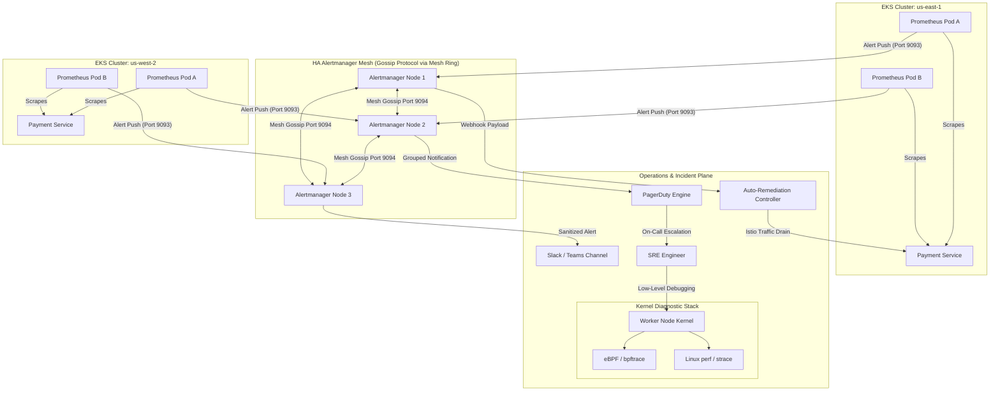

# Monitoring - Part 3 - Technical Study Guide & Notes

# Production SRE, Diagnostics, Alerting, and Incident Response Study Guide (Part 3/3)

---

## 1. Part Introduction and Scope

This study guide covers the operational phase of observability: converting telemetry data into actionable engineering responses, diagnosing complex distributed failures, writing robust alerting rules, and conducting post-incident analysis.

```
       [ Telemetry Stream ]
                 │
                 ▼
     ┌──────────────────────┐
     │  Prometheus / Thanos │  <-- Metric Processing Engine
     └──────────┬───────────┘
                │
                ▼
     ┌──────────────────────┐
     │ Prometheus Rules Engine│  <-- Evaluates PromQL & Burn Rates
     └──────────┬───────────┘
                │ Alert Event
                ▼
     ┌──────────────────────┐
     │ Alertmanager Cluster │  <-- Deduplication, Inhibition, Grouping
     └──────────┬───────────┘
                │ Filtered Notification
                ▼
     ┌──────────────────────┐
     │  PagerDuty / Webhooks│  <-- On-Call Routing & Auto-Remediation
     └──────────┬───────────┘
                │ Escalation
                ▼
     ┌──────────────────────┐
     │  SRE Diagnostic Toolkit│ <-- eBPF, perf, strace, kubectl
     └──────────────────────┘
```

### Scope Boundary
* **In-Scope**: SLO-based alerting via multi-window multi-burn-rate PromQL, Alertmanager High Availability (HA) cluster architecture, low-level Linux diagnostic primitives (`strace`, `perf`, eBPF), automated remediation engines, and Blameless Root Cause Analysis (RCA) methodology.
* **Out-of-Scope**: Metric collection agents (Prometheus Exporters, OpenTelemetry Collector base configuration) and visualization layout design (Grafana dashboard styling)—covered in Parts 1 and 2.

---

## 2. Why These Concepts Are Critical for High-Availability Systems

High-availability (HA) systems (e.g., 99.99% uptime, allowing under 4.38 minutes of unplanned downtime per month) cannot rely on static threshold alerting or manual incident discovery. 

```
                                 99.99% Availability Target
                         (4.38 minutes allowable downtime/month)
                                            │
               ┌────────────────────────────┴────────────────────────────┐
               ▼                                                         ▼
    Detection Phase (MTTD)                                    Resolution Phase (MTTR)
   -------------------------                                 -------------------------
   • Target: < 60 Seconds                                    • Target: < 3 Minutes
   • Strategy: Multi-window burn-rate                        • Strategy: Auto-remediation runbooks,
     alerts trigger instantly on rapid                         kernel-level diagnostic tracing,
     budget consumption.                                       and automated mitigation pipelines.
```

1. **Mean Time to Detect (MTTD)**: Static thresholds (e.g., `CPU > 80%`) generate high false-positive rates, leading to alert fatigue. SLO-based alerting measures real user impact, alerting only when the Service Level Objective (SLO) error budget is consumed at unsustainable rates.
2. **Mean Time to Resolve (MTTR)**: Fast resolution requires deterministic runbooks and low-overhead kernel diagnostic tools (`bpftrace`, `perf`) to isolate thread contention, memory leaks, and socket buffer starvation without crashing production processes.
3. **Cascading Failure Mitigation**: Misconfigured alert routing without *Inhibition Rules* can flood on-call engineers with tens of thousands of downstream alerts during network partition events, increasing MTTR exponentially.

---

## 3. Real-World Enterprise Use Case

### Scenario: Multi-Region Financial Transaction Gateway

* **Scale**: 50,000 Transactions Per Second (TPS) across 3 AWS regions (`us-east-1`, `us-west-2`, `eu-west-1`) running on Amazon EKS.
* **Architecture**: Active-Active-Active deployment using Istio Service Mesh, Aurora PostgreSQL Multi-Region Replication, and Redis Enterprise Enterprise Cache.

```
[ Region: us-east-1 ]             [ Region: us-west-2 ]             [ Region: eu-west-1 ]
┌────────────────────┐            ┌────────────────────┐            ┌────────────────────┐
│ EKS Cluster (Prod) │            │ EKS Cluster (Prod) │            │ EKS Cluster (Prod) │
│  ├─ Istio Mesh     │            │  ├─ Istio Mesh     │            │  ├─ Istio Mesh     │
│  ├─ Payment Microservice        │  ├─ Payment Microservice        │  ├─ Payment Microservice
│  └─ Prometheus HA  │            │  └─ Prometheus HA  │            │  └─ Prometheus HA  │
└─────────┬──────────┘            └─────────┬──────────┘            └─────────┬──────────┘
          │                                 │                                 │
          └────────────────────────┬────────┴─────────────────────────────────┘
                                   │
                                   ▼
                   ┌────────────────────────────────┐
                   │ Global Alertmanager Cluster    │
                   │ (Gossip Mesh over WireGuard)   │
                   └───────────────┬────────────────┘
                                   │
                                   ▼
                   ┌────────────────────────────────┐
                   │ Incident Automation Engine     │
                   │ (Kubernetes Operator + Lambda) │
                   └────────────────────────────────┘
```

### The Incident Vector
A microservice memory leak in a secondary authorization dependency causes TCP socket allocation stalls (`CLOSE_WAIT` buildup). Upstream connection pools exhaust, causing latency to spike from 15ms to 8000ms.

### SRE Observability Architecture Strategy
1. **Detection**: A 1-hour / 5-minute multi-window burn rate alert fires in Prometheus when the 99th percentile response time exceeds 200ms, consuming >2% of the monthly error budget within a 1-hour window.
2. **Routing & Inhibition**: Alertmanager groups 4,500 firing microservice alerts into a single PagerDuty incident based on `fingerprint` and `alertgroup`. An inhibition rule silences downstream dependency alerts because the core API gateway is flagged as degraded.
3. **Diagnostics & Automated Remediation**:
   * A dynamic Kubernetes Operator intercepts the Alertmanager webhook notification and auto-isolates the degraded pod set via Istio `DestinationRule` traffic shifting.
   * On-call engineers use `bpftrace` to attach to running container execution threads, identifying lock contention in a C++ JNI binding without interrupting active connections.

---

## 4. Comprehensive Architecture Explanation

### Alerting Pipeline Architecture Diagram



### Component Breakdown
1. **Prometheus Rule Evaluator**: Evaluates PromQL expressions at deterministic intervals (`evaluation_interval: 15s`). If a condition holds true for the duration specified in the `for` clause, the alert moves from `PENDING` to `FIRING` state and sends an HTTP POST payload to Alertmanager.
2. **Alertmanager Cluster Mesh**: A cluster of Alertmanager instances configured in a peer-to-peer network mesh via a Mesh gossip protocol (Weave Net Mesh implementation). This provides high availability without requiring a central database.
3. **Deduplication Engine**: Merges alert payloads originating from redundant Prometheus servers running in high-availability pairs. Deduplication relies on alert label identity matching (`labels.Hash()`).
4. **Inhibition Engine**: Suppresses a set of notifications if another set of target alerts (source alerts) are already firing. (Example: Suppress `NodeDown` alerts if `DataCenterPowerLoss` is firing).
5. **Grouping Engine**: Aggregates alerts of similar nature (e.g., same cluster, same microservice) into a single unified payload over a specified `group_wait` and `group_interval` window to prevent notification storms.
6. **Remediation Control Plane**: Custom Kubernetes CRD controllers or serverless workers (AWS Lambda, HashiCorp Nomad jobs) that process webhooks sent by Alertmanager to execute deterministic, non-destructive recovery actions.

---

## 5. Types, Classifications, and Diagnostic Components

### 1. Alert Taxonomy Matrix

| Alert Type | Evaluation Logic | Latency Sensitivity | Flap Susceptibility | Target Use Case |
| :--- | :--- | :--- | :--- | :--- |
| **Static Threshold** | `metric > value` | High | Extremely High | Hard system limits (e.g., Disk Space > 90%). |
| **Anomaly / Holt-Winters** | `holt_winters(metric[1h], 0.2, 0.5)` | Low | Medium | Cyclical traffic changes (e.g., Daily user login baseline drops). |
| **SLO Multi-Burn-Rate** | Multi-window PromQL calculations | Exact / High Precision | Extremely Low | Direct customer-impacting availability and latency budget degradation. |
| **Dead Man's Switch** | Constant alert `vector(1)` | Heartbeat / Continuous | Zero | Verifying the entire telemetry and routing infrastructure health. |

### 2. SRE Diagnostic Vector Matrix

```
                      ┌────────────────────────────────────────┐
                      │    User Impact Detected (SLO Burn)     │
                      └───────────────────┬────────────────────┘
                                          │
                  ┌───────────────────────┴───────────────────────┐
                  ▼                                               ▼
      [ User Space Diagnostics ]                     [ Kernel Space Diagnostics ]
   ┌──────────────────────────────┐                ┌──────────────────────────────┐
   │ • Process thread dump (pstack│                │ • eBPF kprobes/uprobes       │
   │ • Heap profile (pprof)       │                │ • System call tracing (strace│
   │ • Application log correlated │                │ • TCP stack metrics (ss,     │
   │   trace IDs                  │                │   tcpdump, bpftrace)         │
   └──────────────────────────────┘                └──────────────────────────────┘
```

---

## 6. Step-by-Step Production Implementation Guide

### Phase 1: Deploying an Alertmanager HA Cluster on Kubernetes

1. Create a dedicated namespace and network policy for isolation:
```bash
kubectl create namespace monitoring-system
kubectl label namespace monitoring-system security.tier=infrastructure
```

2. Create the Alertmanager High-Availability StatefulSet configuration with mesh peering:

```yaml
# alertmanager-statefulset.yaml
apiVersion: apps/v1
kind: StatefulSet
metadata:
  name: alertmanager
  namespace: monitoring-system
  labels:
    app.kubernetes.io/name: alertmanager
spec:
  replicas: 3
  serviceName: alertmanager-headless
  selector:
    matchLabels:
      app.kubernetes.io/name: alertmanager
  template:
    metadata:
      labels:
        app.kubernetes.io/name: alertmanager
    spec:
      containers:
      - name: alertmanager
        image: quay.io/prometheus/alertmanager:v0.26.0
        args:
        - "--config.file=/etc/alertmanager/alertmanager.yml"
        - "--storage.path=/alertmanager"
        - "--cluster.listen-address=0.0.0.0:9094"
        - "--cluster.peer=alertmanager-0.alertmanager-headless.monitoring-system.svc.cluster.local:9094"
        - "--cluster.peer=alertmanager-1.alertmanager-headless.monitoring-system.svc.cluster.local:9094"
        - "--cluster.peer=alertmanager-2.alertmanager-headless.monitoring-system.svc.cluster.local:9094"
        ports:
        - name: http
          containerPort: 9093
        - name: mesh
          containerPort: 9094
        volumeMounts:
        - name: config-volume
          mountPath: /etc/alertmanager
        - name: storage
          mountPath: /alertmanager
        resources:
          limits:
            cpu: 500m
            memory: 512Mi
          requests:
            cpu: 100m
            memory: 128Mi
        securityContext:
          readOnlyRootFilesystem: true
          runAsNonRoot: true
          runAsUser: 65534
          allowPrivilegeEscalation: false
          capabilities:
            drop:
            - ALL
      volumes:
      - name: config-volume
        configMap:
          name: alertmanager-config
  volumeClaimTemplates:
  - metadata:
      name: storage
    spec:
      accessModes: [ "ReadWriteOnce" ]
      resources:
        requests:
          storage: 10Gi
```

3. Deploy the StatefulSet:
```bash
kubectl apply -f alertmanager-statefulset.yaml
```

### Phase 2: Dynamic Alert Silence Management
To implement an automated, dynamic silence during a maintenance window using `amtool`:

```bash
# Silence alerts for a specific microservice node undergoing kernel patch updates
amtool silence add service="payment-backend" instance="node-us-east-1a-04" \
  --author="SRE-Automation" \
  --duration="2h" \
  --comment="Scheduled Kernel Patching Ticket-88492" \
  --alertmanager.url="http://alertmanager.monitoring-system.svc:9093"
```

---

## 7. Standard CLI Commands with Deep Technical Explanations

### 1. Prometheus Rule & Alert Validation (`promtool`)

```bash
promtool check rules /etc/prometheus/rules/slo_alerts.yaml
```
* `--check-syntax`: Explicitly parses syntax, validating YAML structures and verifying that every PromQL vector expression compiles against Prometheus AST parser rules.

```bash
promtool test rules /etc/prometheus/tests/slo_alert_test.yaml
```
* **Purpose**: Executes unit testing against Prometheus rules by providing mock time-series data and evaluating whether alerting rules fire at precise designated timestamps.

### 2. Alertmanager Management (`amtool`)

```bash
amtool alert query alertname="HTTP5xxErrorBudgetBurn" --silenced=false --active=true --output=json
```
* `alertname="HTTP5xxErrorBudgetBurn"`: PromQL regex label matcher filtering the active alert registry.
* `--silenced=false`: Excludes suppressed alerts, focusing only on active alerts.
* `--output=json`: Emits structured JSON for downstream pipeline parsing.

### 3. Linux Kernel & Process Diagnostics (`perf`, `strace`, `bpftrace`)

```bash
strace -ff -tt -T -e trace=network,ipc -p 14205 -o /tmp/strace_payment_svc.log
```
* `-ff`: Follows child threads generated by `fork()` and `clone()` calls, emitting separate files per Process ID (PID).
* `-tt`: Displays microsecond-accurate wall-clock timestamps for every intercepted system call.
* `-T`: Records system call execution times, isolating thread block durations in system calls like `epoll_wait` or `select`.
* `-e trace=network,ipc`: Filters system calls, isolating operations like `socket`, `connect`, `sendto`, `recvfrom`, and `futex`.
* `-p 14205`: Target PID to intercept.

```bash
perf top -p 14205 --call-graph fp -F 99
```
* `-p 14205`: Attaches directly to running process PID 14205.
* `--call-graph fp`: Uses Frame Pointer unwinding to rebuild call stacks in real time.
* `-F 99`: Sets the sampling frequency to 99 Hertz (samples/sec), avoiding CPU performance overhead.

```bash
bpftrace -e 'kprobe:sys_enter_connect { @[comm] = count(); }'
```
* Dynamic attachment into the kernel's `sys_enter_connect` entrypoint via eBPF. Aggregates outgoing TCP connection requests grouped by executable name directly in kernel memory space.

---

## 8. Production Configuration Examples

### 1. Production PromQL Alert Rules (`slo_alerts.yaml`)

This configuration uses multi-window multi-burn-rate logic (1-hour/5-minute windows for rapid burns; 6-hour/30-minute windows for slower burns) aligned with SRE principles.

```yaml
groups:
  - name: PaymentGateway_SLO_Alerts
    rules:
      # 2% error budget burn in 1 hour (14.4x rate) -> CRITICAL (Page On-Call)
      - alert: PaymentGatewayLatencyBurnRateCritical
        expr: |
          (
            sum(rate(http_request_duration_seconds_bucket{job="payment-api", le="0.2"}[5m]))
            /
            sum(rate(http_request_duration_seconds_count{job="payment-api"}[5m]))
            < 0.995
          )
          and
          (
            sum(rate(http_request_duration_seconds_bucket{job="payment-api", le="0.2"}[1h]))
            /
            sum(rate(http_request_duration_seconds_count{job="payment-api"}[1h]))
            < 0.995
          )
        for: 2m
        labels:
          severity: critical
          tier: payment-gateway
          slo: latency-200ms
        annotations:
          summary: "Extreme SLO latency error budget burn detected on Payment Gateway."
          description: "Latency SLO (99.5% requests < 200ms) error budget is burning at >14.4x rate over 1h and 5m windows. Current 5m success ratio: {{ $value }}"
          runbook_url: "https://wiki.enterprise.io/sre/runbooks/payment-latency-burn"

      # 5% error budget burn in 6 hours (6x rate) -> WARNING (Ticket/Slack)
      - alert: PaymentGatewayLatencyBurnRateWarning
        expr: |
          (
            sum(rate(http_request_duration_seconds_bucket{job="payment-api", le="0.2"}[30m]))
            /
            sum(rate(http_request_duration_seconds_count{job="payment-api"}[30m]))
            < 0.995
          )
          and
          (
            sum(rate(http_request_duration_seconds_bucket{job="payment-api", le="0.2"}[6h]))
            /
            sum(rate(http_request_duration_seconds_count{job="payment-api"}[6h]))
            < 0.995
          )
        for: 15m
        labels:
          severity: warning
          tier: payment-gateway
          slo: latency-200ms
        annotations:
          summary: "Sustained moderate latency budget burn on Payment Gateway."
          description: "Latency budget is burning at >6x over 6h and 30m windows."
          runbook_url: "https://wiki.enterprise.io/sre/runbooks/payment-latency-burn"

      # Infrastructure Rule: Low Disk Space (Predictive linear regression)
      - alert: PersistentVolumeDiskSpaceExhaustion
        expr: |
          predict_linear(node_filesystem_free_bytes{mountpoint="/"}[1h], 86400) < 0
        for: 10m
        labels:
          severity: warning
          infrastructure: storage
        annotations:
          summary: "Root filesystem predicted to exhaust within 24 hours."
          description: "Disk space on instance {{ $labels.instance }} is filling up linearly."
          runbook_url: "https://wiki.enterprise.io/sre/runbooks/disk-cleanup"
```

### 2. Hardened Alertmanager Configuration (`alertmanager.yml`)

```yaml
global:
  resolve_timeout: 5m
  http_config:
    tls_config:
      min_version: "TLS13"
      insecure_skip_verify: false

route:
  group_by: ['alertname', 'cluster', 'tier', 'namespace']
  group_wait: 30s
  group_interval: 5m
  repeat_interval: 4h
  receiver: 'default-slack'
  routes:
    - match:
        severity: critical
      receiver: 'pagerduty-high-priority'
      continue: false

    - match:
        severity: warning
      receiver: 'slack-warning-channel'
      continue: false

inhibit_rules:
  # Suppress microservice alerts if the underlying Host Node is Down
  - source_match:
      alertname: 'NodeDown'
    target_match:
      severity: 'critical'
    equal: ['node_name', 'cluster']

  # Suppress warning alerts if a critical alert is already firing on the same tier
  - source_match:
      severity: 'critical'
    target_match:
      severity: 'warning'
    equal: ['tier', 'cluster']

receivers:
  - name: 'default-slack'
    slack_configs:
      - api_url: 'https://hooks.slack.com/services/T00/B00/X00SECRET'
        channel: '#infra-alerts-unrouted'
        send_resolved: true

  - name: 'slack-warning-channel'
    slack_configs:
      - api_url: 'https://hooks.slack.com/services/T00/B00/X00SECRET'
        channel: '#prod-warnings'
        send_resolved: true
        text: "Alert: {{ .CommonAnnotations.summary }}\nDescription: {{ .CommonAnnotations.description }}"

  - name: 'pagerduty-high-priority'
    pagerduty_configs:
      - service_key: 'pd-integration-key-encrypted-secret'
        severity: 'critical'
        client: 'Prometheus-HA-Cluster'
        client_url: 'https://prometheus.enterprise.io'
        description: 'CRITICAL: {{ .CommonAnnotations.summary }} - {{ .CommonAnnotations.description }}'
        links:
          - href: '{{ .CommonAnnotations.runbook_url }}'
            text: 'Operational Runbook'
```

### 3. Automated Remediation Script (Python / Kubernetes API)

```python
#!/usr/bin/env python3
"""
Production Remediation Handler
Executes targeted pod isolation via Istio Service Entry modification when triggered by Alertmanager.
"""

import os
import sys
import logging
from flask import Flask, request, jsonify
from kubernetes import client, config

logging.basicConfig(level=logging.INFO, format='%(asctime)s - %(levelname)s - %(message)s')
app = Flask(__name__)

# Load in-cluster Kubernetes client configuration
try:
    config.load_incluster_config()
except Exception:
    config.load_kube_config()

custom_api = client.CustomObjectsApi()

@app.route('/webhook', methods=['POST'])
def handle_alert():
    data = request.json
    logging.info("Received Alertmanager Webhook Payload")
    
    if not data or 'alerts' not in data:
        return jsonify({"status": "invalid payload"}), 400

    for alert in data['alerts']:
        labels = alert.get('labels', {})
        annotations = alert.get('annotations', {})
        
        if labels.get('alertname') == 'PaymentGatewayLatencyBurnRateCritical':
            target_namespace = labels.get('namespace', 'default')
            service_name = labels.get('tier', 'payment-gateway')
            
            logging.warning(f"CRITICAL Triggered for {service_name} in {target_namespace}. Initiating Traffic Drain...")
            
            # Execute mitigation: Set Istio DestinationRule to failover traffic
            drain_success = execute_istio_traffic_drain(target_namespace, service_name)
            if not drain_success:
                logging.error(f"Failed to drain traffic for {service_name}")
                return jsonify({"status": "error during mitigation"}), 500

    return jsonify({"status": "success", "mitigation": "executed"}), 200

def execute_istio_traffic_drain(namespace, service_name):
    """Updates Istio DestinationRule Circuit Breaker to trip connection pool."""
    try:
        group = "networking.istio.io"
        version = "v1alpha3"
        plural = "destinationrules"
        name = f"{service_name}-circuit-breaker"

        body = {
            "apiVersion": "networking.istio.io/v1alpha3",
            "kind": "DestinationRule",
            "metadata": {"name": name, "namespace": namespace},
            "spec": {
                "host": service_name,
                "trafficPolicy": {
                    "connectionPool": {
                        "tcp": {"maxConnections": 10},
                        "http": {"http1MaxPendingRequests": 1, "maxRequestsPerConnection": 1}
                    },
                    "outlierDetection": {
                        "consecutive5xxErrors": 1,
                        "interval": "1s",
                        "baseEjectionTime": "15m",
                        "maxEjectionPercent": 100
                    }
                }
            }
        }
        
        custom_api.patch_namespaced_custom_object(
            group=group, version=version, namespace=namespace,
            plural=plural, name=name, body=body
        )
        logging.info(f"Successfully applied emergency DestinationRule for {service_name}")
        return True
    except Exception as e:
        logging.critical(f"Kubernetes API Call Failed: {str(e)}")
        return False

if __name__ == '__main__':
    # Run production WSGI webserver bound to secure port
    app.run(host='0.0.0.0', port=8080, ssl_context=('cert.pem', 'key.pem'))
```

---

## 9. Security Considerations & Hardening Best Practices

### 1. Alert Payload Sanitization
Alert notifications often route through third-party SaaS vendors (e.g., Slack, PagerDuty, Opsgenie). 

```yaml
# HARDENING: Sanitize Go templates in Alertmanager to scrub API keys, authorization tokens, or PII
annotations:
  description: "User ID {{ $labels.user_id | html }} experienced authentication failure." 
  # DO NOT output raw user-agent, authorization header values, or database query strings into alerts.
```

### 2. Linux Diagnostic Privilege Boundaries
Executing tools like `strace`, `perf`, or `bpftrace` requires elevated kernel capabilities.

* **Anti-Pattern**: Running application pods as `privileged: true` or running root user contexts to allow inline diagnostics.
* **Best Practice**: Use ephemeral debugging containers (`kubectl debug`) configured with granular Linux capabilities:
  ```yaml
  securityContext:
    capabilities:
      add:
      - SYS_PTRACE    # Required for strace
      - SYS_ADMIN     # Required for eBPF attachments
      runAsNonRoot: false
      runAsUser: 0
  ```

### 3. Alertmanager Webhook Authentication
All incoming Alertmanager webhook interfaces must require HMAC signature verification over TLS 1.3 to ensure payloads cannot be spoofed to trigger mitigation workflows.

---

## 10. Observability & Monitoring Considerations

### Essential Alertmanager & Meta-Monitoring Prometheus Metrics

| Metric Name | Type | Target Threshold | SRE Action / Meaning |
| :--- | :--- | :--- | :--- |
| `alertmanager_cluster_members` | Gauge | `= Node Count (e.g., 3)` | Alert if `< 3`. Gossip cluster mesh partition detected. |
| `alertmanager_notifications_failed_total` | Counter | `rate() > 0` | Notification delivery failure to Slack, PagerDuty, or Webhooks. |
| `prometheus_rule_evaluation_duration_seconds` | Summary | `p99 < rule_interval` | Rule evaluation delay. Prometheus rules taking too long to evaluate. |
| `prometheus_rule_evaluation_failures_total` | Counter | `0` | Expression failure (e.g., divide by zero, bad queries, query timeouts). |
| `alertmanager_silences` | Gauge | Baseline tracking | Track active silences to avoid lingering silences hiding active failures. |

---

## 11. Common Troubleshooting Scenarios with RCA

### Scenario 1: Global Alert Storm Due to Network Partition

#### Incident Flow
```
                     [ AWS Availability Zone Partition ]
                                     │
                 ┌───────────────────┴───────────────────┐
                 ▼                                       ▼
    [ AZ-1 Prometheus / Apps ]             [ AZ-2 Payment Gateway Node ]
                 │                                       │
                 ▼                                       ▼
    Alertmanager Nodes Active              Gateway drops cross-AZ traffic
                 │                                       │
                 └───────────────────┬───────────────────┘
                                     │
                                     ▼
                      [ Cascading Alert Storm ]
               (3,500 "Service Down" notifications fire)
```

#### Incident Breakdown
* **Symptom**: On-call engineer receives 3,500 individual PagerDuty alerts within 90 seconds. Alertmanager CPU spikes to 100%, dropping active webhook deliveries.
* **Root Cause Analysis (RCA)**:
  * An AWS Availability Zone network partition isolated microservices in `us-east-1a` from database dependencies in `us-east-1b`.
  * Prometheus rules evaluated every microservice as `InstanceDown`.
  * The Alertmanager configuration lacked an `inhibit_rules` section linking host network availability to microservice health. `group_wait` was set to `0s`, bypassing alert aggregation.

#### Short-Term Fix
Issue an immediate global regex silence via `amtool` to regain control of the processing queue:
```bash
amtool silence add alertname=~".*" --duration="1h" --author="SRE-Command" --comment="PDU Alert Storm Mitigation"
```

#### Long-Term Remediation
Configure Alertmanager inhibition rules and establish standard grouping thresholds:

```yaml
# Target: Inhibit all microservice alerts if Network Core is Down
inhibit_rules:
  - source_match:
      alertname: 'NetworkZoneUnreachable'
    target_match_re:
      alertname: '.*'
    equal: ['zone', 'environment']
```

---

### Scenario 2: Silent Connection Pool Exhaustion (Hidden Latency Spike)

#### Incident Flow
```
   [ Upstream Requests ] ---> [ Microservice Connection Pool ]
                                           │
                                  (Sockets in CLOSE_WAIT)
                                           │
                                           ▼
                                 [ Threads Blocked ]
                                           │
                                           ▼
                              (No CPU or Memory Spike!)
                                           │
                                           ▼
                           [ Silent Connection Dropping ]
```

#### Incident Breakdown
* **Symptom**: User-facing HTTP 504 errors increase, but CPU usage remains at 15% and RAM usage is flat. Prometheus `node_cpu_seconds_total` alerts remain inactive.
* **Diagnostic Walkthrough**:
  1. Inspect network socket state distribution on the worker node using `ss`:
     ```bash
     ss -exnt state CLOSE-WAIT process
     ```
     *Output shows 10,000+ sockets stuck in `CLOSE_WAIT` owned by PID `8812` (`payment-service`).*

  2. Attach `strace` to PID 8812 to inspect thread blocking:
     ```bash
     strace -f -T -e trace=futex,connect,accept -p 8812
     ```
     *Result: Threads are blocked indefinitely on `futex(..., FUTEX_WAIT_PRIVATE)` awaiting open connections from an exhausted pool.*

  3. Execute `bpftrace` to verify thread latency distribution:
     ```bash
     bpftrace -e 'kprobe:sys_enter_connect { @start[tid] = nsecs; } kretprobe:sys_enter_connect /@start[tid]/ { @latency = hist(nsecs - @start[tid]); delete(@start[tid]); }'
     ```
     *Kernel probes confirm outbound socket connection allocation times exceeding 30,000 ms.*

#### Root Cause Analysis (RCA)
The application connection pool relied on a non-blocking HTTP client with an infinite read timeout and no socket recycling logic. Dropped TCP FIN packets from a downstream service left connection sockets stranded in `CLOSE_WAIT`, consuming thread pools without generating high CPU load.

#### Remediation Plan
1. Implement client-side connection pooling limits, socket timeouts (`SO_TIMEOUT`), and dynamic Istio circuit breakers.
2. Replace static CPU resource alerting with SLO-based burn rate alerts tracking non-2xx HTTP responses and latency percentiles.

---

## 12. Common Mistakes and How to Avoid Them

### 1. Alerting on High CPU/Memory Utilization
* **Anti-Pattern**: Triggering critical alerts when `node_cpu_utilization > 85%`. Modern distributed applications are designed to utilize allocated compute resources efficiently; high CPU utilization without degraded response latency or error rates is normal.
* **Correction**: Alert on **user-facing SLO impact** (e.g., Latency, Error Rates) or **finite resource exhaustion** (e.g., Disk Space, IP Address Allocation) using linear regression (`predict_linear`).

### 2. Omitting the `for` Clause in Prometheus Rules
* **Anti-Pattern**:
  ```yaml
  - alert: HighErrorRate
    expr: rate(http_requests_total{status="500"}[1m]) > 10
    # Missing 'for' parameter causes temporary metric spikes to trigger alerts
  ```
* **Correction**: Always supply a `for` duration (e.g., `for: 5m`) matching evaluation windows to allow transitory spikes to self-resolve before paging on-call personnel.

### 3. Flapping Alerts Caused by Equal Evaluation and Group Intervals
* **Anti-Pattern**: Setting `group_interval: 1m` when Prometheus `evaluation_interval` is `1m`. Minute timing differences cause alerts to rapidly alternate between firing and resolved states.
* **Correction**: Use the `keep_firing_for` directive in Prometheus 2.42+ to enforce a minimum hold time for active alert states:
  ```yaml
  - alert: DatabaseLatencyHigh
    expr: rate(db_query_duration_seconds_sum[5m]) > 2
    keep_firing_for: 5m
  ```

---

## 13. Enterprise Recommendations

```
┌────────────────────────────────────────────────────────────────────────┐
│                   SRE Alerting Operational Blueprint                   │
├───────────────────────────────────┬────────────────────────────────────┤
│ Alert Flapping Mitigation         │ Enforce 'keep_firing_for: 5m'      │
├───────────────────────────────────┼────────────────────────────────────┤
│ Signal Type                       │ Multi-Window Multi-Burn-Rate PromQL│
├───────────────────────────────────┼────────────────────────────────────┤
│ Notification Routing Architecture │ Dedicated Gossip Alertmanager Mesh │
├───────────────────────────────────┼────────────────────────────────────┤
│ Diagnostic Layer                  │ Kernel-level eBPF & epoll Tracing │
└───────────────────────────────────┴────────────────────────────────────┘
```

1. **Multi-Window Multi-Burn-Rate Standard Matrix**:
   * **14.4x Burn Rate** (Consumes 2% Error Budget in 1 Hour): Critical severity -> Immediate PagerDuty Page.
   * **6x Burn Rate** (Consumes 5% Error Budget in 6 Hours): Warning severity -> Immediate Slack/Ticket creation.
   * **1x Burn Rate** (Consumes 100% Error Budget in 30 Days): Informational -> Dashboard/Report.

2. **Deduplication and Grouping Strategy**:
   * Group alerts by enterprise operational boundaries: `group_by: ['region', 'environment', 'application_tier', 'alertname']`.

3. **Automated Runbook Link Enforcements**:
   * Use CI/CD validation rules (`promtool`) to reject rule deployments if an alert definition lacks a valid, populated `runbook_url` annotation.

---

## 14. Advanced Concepts

### 1. Multi-Cluster Distributed Alerting Architecture (Thanos Ruler)

```
[ Region: East EKS Cluster ]         [ Region: West EKS Cluster ]
┌──────────────────────────┐         ┌──────────────────────────┐
│ Prometheus (Local Metrics)│         │ Prometheus (Local Metrics)│
└────────────┬─────────────┘         └────────────┬─────────────┘
             │                                    │
             ▼                                    ▼
┌──────────────────────────┐         ┌──────────────────────────┐
│ Thanos Sidecar           │         │ Thanos Sidecar           │
└────────────┬─────────────┘         └────────────┬─────────────┘
             │                                    │
             └─────────────────┬──────────────────┘
                               │ StoreAPI
                               ▼
            ┌────────────────────────────────────┐
            │ Thanos Ruler (Global Evaluator)    │
            │ Evaluates cross-cluster aggregations│
            └──────────────────┬─────────────────┘
                               │ Alert Push
                               ▼
            ┌────────────────────────────────────┐
            │ Global Alertmanager Cluster Mesh   │
            └────────────────────────────────────┘
```

When monitoring distributed applications spread across multiple Kubernetes clusters, local Prometheus instances lack visibility into global state. **Thanos Ruler** evaluates PromQL rules against global Object Storage and Thanos Querier interfaces, enabling cross-cluster alerting logic:

```yaml
# Thanos Ruler Global Group Evaluation
groups:
  - name: GlobalCrossRegionFailoverAlerts
    rules:
      - alert: GlobalPaymentProcessingFailure
        expr: |
          sum(rate(payment_success_total[5m])) / sum(rate(payment_requests_total[5m])) < 0.95
        for: 3m
        labels:
          scope: global
          severity: critical
        annotations:
          summary: "Global transaction success rate fell below 95% across all regions."
```

### 2. eBPF-Driven Low-Overhead Continuous Profiling

Modern diagnostic tools integrate eBPF-based profiling (e.g., Parca, Pyroscope) directly into SRE response workflows. Instead of manually running `perf` during an outage, an eBPF agent continuously captures CPU and stack trace profiles directly from kernel tracepoints at negligible overhead (<1% CPU utilization).

When an SLO burn rate alert triggers, the SRE automation engine queries the dynamic profile engine for the exact CPU flamegraph recorded during the specific burn rate execution window:

```
Alert Fired (14:02:10 UTC) ---> Webhook Query to Parca Engine ---> Generates CPU Flamegraph (14:00:00 - 14:02:10 UTC)
```

---

## 15. Integration with Other DevOps Tools

```
               ┌────────────────────────────────────────┐
               │         GitRepository (GitOps)         │
               │   Declarative Rules & Alert Configs    │
               └───────────────────┬────────────────────┘
                                   │
                                   ▼
               ┌────────────────────────────────────────┐
               │       ArgoCD / Terraform Engine        │
               │  Deploys CRDs & Alertmanager Rules     │
               └───────────────────┬────────────────────┘
                                   │
                                   ▼
               ┌────────────────────────────────────────┐
               │    Prometheus & Alertmanager Mesh      │
               │ Processes SLOs & Identifies Failures   │
               └───────────────────┬────────────────────┘
                                   │
        ┌──────────────────────────┴──────────────────────────┐
        ▼                                                     ▼
┌──────────────────────────────┐            ┌──────────────────────────────┐
│ Incident Mgmt (PagerDuty)    │            │ Automated Remediation        │
│ • Opens Incident             │            │ • Triggers Ansible / Lambda  │
│ • Syncs ServiceNow Ticket    │            │ • Drains Pods via Istio      │
└──────────────────────────────┘            └──────────────────────────────┘
```

1. **Terraform / OpenTofu**: Infrastructure provisioning of notification routes, Escalation Policies, and Webhook integrations across enterprise tools like PagerDuty or ServiceNow.
2. **ArgoCD / GitOps**: Manages lifecycle definitions for Prometheus alerting rules via Kubernetes `PrometheusRule` Custom Resource Definitions (CRDs). Rules are tested via `promtool` inside pull-request verification workflows before merging.
3. **Ansible Automation Platform**: Invoked via Alertmanager webhooks to execute automated remediation runbooks (e.g., clear ephemeral socket caches, rebalance stateful cluster pods, expand volume storage pools).

---

## 16. Comparison Matrix: Alerting Engines

| Feature / Dimension | Prometheus Alertmanager | Datadog Monitors | Grafana Alerting | AWS CloudWatch Alarms |
| :--- | :--- | :--- | :--- | :--- |
| **Primary Data Source** | Prometheus / Thanos / Cortex | Datadog Telemetry SaaS | Multi-datasource (SQL, PromQL, Loki, etc.) | AWS CloudWatch Metrics |
| **Deduplication Engine** | Built-in (Label Hash-based) | Platform-managed | Built-in Alertmanager engine | Basic Alarm State Merging |
| **Inhibition Capabilities**| Native (Label/Matcher rules)| Limited (Dependency Trees) | Supported via Notification Policies | Metric Math Dependent |
| **HA Mesh Architecture**| Fully Decentralized Gossip | Managed SaaS Cloud | Internal Database Dependent | Managed AWS Control Plane |
| **Cost Model** | Open Source (Self-Hosted compute) | High (Per Host / Per Monitor indexing) | Open Source / Cloud Subscription | Per Metric Alarm / Evaluation API calls |
| **Evaluation Latency** | Sub-second local execution | Variable (SaaS pipeline lag) | Medium (Dependent on datasource) | 1-Minute / 5-Minute Resolution |
| **Ideal Production Use**| Native Kubernetes & SRE Cloud Infrastructure | Hybrid SaaS Monitoring | Mixed Data Source Unified Monitoring | AWS Infrastructure Primitive Layer |

---

## 17. Visual Cheat Sheet & Quick Reference

### Standard Diagnostic Command Matrix

```bash
# 1. Inspect socket status & identify blocked sockets
ss -t -a -A inet process

# 2. Trace system call latencies on target process
strace -ff -T -e trace=process,network,ipc -p <PID>

# 3. Low-overhead kernel execution profiling
perf top -p <PID> -F 99 --call-graph fp

# 4. Count kernel connect execution calls via eBPF
bpftrace -e 'kprobe:sys_enter_connect { @[comm] = count(); }'

# 5. Query active non-silenced alerts via CLI
amtool alert query --silenced=false --active=true

# 6. Validate PromQL alert rule file logic
promtool check rules /path/to/rules.yaml
```

### Alert Routing Decision Flowchart

```
                 [ Alert Fired from Prometheus ]
                                │
                                ▼
               ┌─────────────────────────────────┐
               │ Alertmanager Hash Deduplication │
               └────────────────┬────────────────┘
                                │
                                ▼
               ┌─────────────────────────────────┐
               │    Inhibition Rules Check       │
               │ (Is higher priority alert active?)│
               └────────┬────────────────┬───────┘
                        │                │
                     Yes│                │No
                        ▼                ▼
                  ┌──────────┐  ┌─────────────────┐
                  │ Suppress │  │ Grouping Window │
                  │ Alert    │  │ (group_wait)    │
                  └──────────┘  └────────┬────────┘
                                         │
                                         ▼
                                ┌─────────────────┐
                                │ Receiver Route  │
                                │ Matcher Match?  │
                                └────────┬────────┘
                                         │
                   ┌─────────────────────┴─────────────────────┐
                   ▼                                           ▼
      [ Critical Severity ]                        [ Warning Severity ]
                   │                                           │
                   ▼                                           ▼
      ┌─────────────────────────┐                 ┌─────────────────────────┐
      │  PagerDuty On-Call Page │                 │  Slack/Teams Channel    │
      │  & Remediation Webhook  │                 │  Notification           │
      └─────────────────────────┘                 └─────────────────────────┘
```

---

## 18. Comprehensive Final Learning Summary

Mastering SRE diagnostics and production alerting requires a shift from **component-level static monitoring** to **user-centric SLO alerting** combined with kernel-level diagnostic execution capabilities.

### Core Architecture Takeaways
1. **Focus on SLO Burn Rates**: Static thresholds (e.g., High CPU) cause operational noise. Alert on multi-window multi-burn-rate PromQL metrics calculating real user impact and error budget consumption rates.
2. **De-duplicate at Scale**: High-availability monitoring architectures require a gossip-based Alertmanager mesh layer capable of deduplicating redundant Prometheus instances, grouping related alerts, and inhibiting downstream dependency noise during widespread infrastructure outages.
3. **Isolate Failures at the Kernel Layer**: When complex distributed failure modes occur without obvious application-level logs, use low-overhead kernel diagnostic tools (`strace`, `perf`, `bpftrace`) to isolate socket starvation, lock contention, and blocking system call behavior without impacting production traffic.
4. **Automate Remediation Responsibly**: Pair actionable alerting routing architectures with hardened, authenticated auto-remediation engines capable of executing traffic shifting, circuit breaking, and pod isolation automatically during severe outages.

# Monitoring & Observability Deep Dive (Part 3/3)

---

### Q41. How do you debug and resolve a Prometheus OOMKilled crash loop caused by TSDB churn and extreme metric cardinality?

**Detailed Answer**:
Prometheus instances crash with Out-Of-Memory (OOM) errors primarily when the memory footprint of the Time Series Database (TSDB) Head Block explodes. The Head Block holds active series in memory for the current two-hour block before compacting and writing them to disk. When high cardinality (a sudden explosion of unique label combinations) occurs, the Head Block must allocate new in-memory structures (`memSeries`) for millions of new time-series streams simultaneously, driving RAM utilization beyond cgroup limits.

Debugging an OOMKilled Prometheus instance requires a structured diagnostic pipeline:

1. **Dump and Analyze TSDB Status (Offline/Online Diagnostics)**:
   * **Online**: If the instance remains up long enough, query the TSDB status endpoint at `/api/v1/status/tsdb` or monitor TSDB internal metrics:
     * `prometheus_tsdb_head_series`: Total number of series in the head block.
     * `prometheus_tsdb_head_chunks_created_total`: Rate of chunk creation.
     * `prometheus_tsdb_symbol_table_size_bytes`: Memory consumed by metric and label names.
   * **Offline**: If Prometheus is stuck in a `CrashLoopBackOff`, run the `promtool` binary directly against the persistent volume data directory:
     ```bash
     promtool tsdb analyze /prometheus/data
     ```
     This tool outputs the top 10 highest cardinality metric names, label names, and label pairs (e.g., `user_id`, `container_id`, `ephemeral_port`).

2. **Inspect Runtime Memory via Go `pprof` Profile**:
   If Prometheus is functional under heavy load, collect a heap profile to confirm that memory is dominated by TSDB allocations rather than unoptimized PromQL evaluation:
   ```bash
   go tool pprof -top http://localhost:9090/debug/pprof/heap
   ```
   Look for memory consumption originating from `github.com/prometheus/prometheus/tsdb.(*head).getOrCreateWithID`.

3. **Remediation and Mitigation Strategies**:
   * **Emergency Memory Override**: Temporarily increase the Pod’s memory `limits` and `requests` in Kubernetes, or set the `--storage.tsdb.retention.size` parameter to force earlier retention triggers.
   * **Apply Dynamic Scraping Sample Limits**: Configure `sample_limit` in your Scrape Configurations (`scrape_configs`) or via `ServiceMonitor`/`PodMonitor` CRDs to automatically drop target scrapes that exceed a safety threshold (e.g., `sample_limit: 50000`).
   * **Metric Relabeling (Cardinality Filtering)**: Strip out high-cardinality labels before ingestion using `metric_relabel_configs`:
     ```yaml
     metric_relabel_configs:
       - action: labeldrop
         regex: "(user_id|session_id|client_ip)"
     ```
   * **Tune In-Memory Chunk Duration**: Lower the `--storage.tsdb.max-block-duration` parameter if compaction overhead is driving memory spikes, and ensure `--storage.tsdb.wal-compression` is enabled to keep Write-Ahead Log memory footprint small.

---

**Production Scenario / Practical Example**:

*Scenario*: A microservices team deployed an update to an order-processing service that inadvertently attached raw UUIDs (`order_id="a8f01c..."`) as a Prometheus metric label on `http_requests_total`. Within 15 minutes, the TSDB head series jumped from 500,000 to 18,000,000 series, causing Prometheus to be OOMKilled continuously on a 64GB Node.

*Step-by-Step Remediation*:
1. Run `promtool` inside a temporary diagnostic container attached to the persistent volume (PV) to identify the offending metric:
   ```bash
   kubectl run promtool-diag --rm -i --tty --image=prom/prometheus:v2.47.0 \
     --overrides='{
       "spec": {
         "volumes": [{"name": "data", "persistentVolumeClaim": {"claimName": "prometheus-k8s-db-prometheus-k8s-0"}}],
         "containers": [{"name": "promtool-diag", "image": "prom/prometheus:v2.47.0", "command": ["promtool", "tsdb", "analyze", "/prometheus"], "volumeMounts": [{"mountPath": "/prometheus", "name": "data"}]}]
       }
     }'
   ```
   *Output Analysis*: High series count attributed to `http_requests_total` containing label `order_id`.

2. Apply emergency metric relabeling rules to the Prometheus CRD (`PrometheusRule` or `ServiceMonitor`) to drop the label at ingestion:
   ```yaml
   apiVersion: monitoring.coreos.com/v1
   kind: ServiceMonitor
   metadata:
     name: order-service-monitor
     namespace: production
   spec:
     endpoints:
     - port: metrics
       metricRelabelings:
       - sourceLabels: [__name__]
         regex: "http_requests_total"
         action: keep
       - action: labeldrop
         regex: "order_id"
   ```

3. To unblock Prometheus without purging the historical TSDB chunks, temporarily append the memory limitation bypass flag in the Prometheus deployment spec:
   ```yaml
   args:
     - "--storage.tsdb.head-chunks-write-queue-size=0"
     - "--storage.tsdb.path=/prometheus"
     - "--storage.tsdb.retention.time=6h"
   ```
4. Restart Prometheus. The engine discards the incoming `order_id` label streams, reducing total head series back to 500,000 and stabilizing RAM usage at 12GB.

---

### Q42. How do you design an Alertmanager routing tree featuring complex Inhibition Rules, Deduplication, and High Availability gossip clustering?

**Detailed Answer**:
Alertmanager handles deduplication, grouping, notification routing, and silence management for alerts generated by Prometheus. In enterprise deployments, Alertmanager must run in a High Availability (HA) cluster using a mesh network and be driven by a structured routing tree to prevent alert fatigue.

```
                  +-----------------------+
                  |  Prometheus Instances |
                  +-----------+-----------+
                              |
                              v
                +---------------------------+
                |  Alertmanager Cluster     |
                |  (Gossip Mesh on :9094)   |
                +-------------+-------------+
                              |
                   [ Alert Routing Tree ]
                              |
      +-----------------------+-----------------------+
      | (severity=critical)                           | (severity=warning)
      v                                               v
+------------------+                       +-------------------+
| Inhibits Warnings|                       | Batch & Buffer    |
| PagerDuty Route  |                       | Slack / Teams     |
+------------------+                       +-------------------+
```

#### 1. High Availability Architecture & Gossip Protocol
Alertmanager nodes do not rely on a central database. Instead, they use a Peer-to-Peer Gossip Protocol implemented via `mesh` (using the Memberlist library over TCP/UDP port 9094). 
* **State Synchronization**: Silences, notifications, and notification logs (to track which alert was sent to which receiver) are gossiped across all nodes.
* **Deduplication**: When an alert fires, every Alertmanager node evaluates the routing rules independently. However, to prevent duplicate notifications (e.g., duplicate PagerDuty incidents), nodes wait for a deterministic offset (`gossip_interval` + notification wait parameters) based on cluster peer ordering before dispatching the payload.

#### 2. Alert Grouping and Routing Trees
The routing tree processes alerts hierarchically based on matching labels.
* `group_by`: Groups related alerts into a single notification (e.g., grouping by `['alertname', 'cluster', 'namespace']`).
* `group_wait`: Initial delay to buffer alerts within the same group before sending the first notification (allows catching correlated alerts).
* `group_interval`: Minimum time to wait before sending notifications about *new* alerts added to an existing group.
* `repeat_interval`: Minimum time to wait before resending an alert that is still firing.

#### 3. Inhibition Rules
Inhibition is a core capability that suppresses a set of alerts if another matching set of alerts is already firing. For instance, if an entire Kubernetes Node goes down (`NodeDown`), Alertmanager should suppress hundreds of downstream pod failure alerts (`KubePodNotReady`, `InstanceDown`) originating from that specific node.

---

**Production Scenario / Practical Example**:

*Scenario*: Design an enterprise-grade `alertmanager.yml` configuration that implements HA mesh settings, suppresses warning alerts if a critical alert exists for the same target, routes infrastructure alerts to PagerDuty, and routes application alerts to Slack with custom aggregation rules.

*Production Configuration (`alertmanager.yml`)*:

```yaml
global:
  resolve_timeout: 5m
  pagerduty_url: 'https://events.pagerduty.com/v2/enqueue'
  slack_api_url: 'https://hooks.slack.com/services/T00000000/B00000000/XXXXXX'

# Inhibition Rules Pipeline
inhibit_rules:
  # Rule 1: Suppress all warning-level alerts if critical-level alert is active for the same host/service
  - source_matchers:
      - severity = "critical"
    target_matchers:
      - severity =~ "warning|info"
    equal: ['namespace', 'node', 'instance', 'cluster']

  # Rule 2: Suppress pod-level failures if the underlying Node is marked Down
  - source_matchers:
      - alertname = "NodeNetworkDown"
    target_matchers:
      - alertname =~ "KubePodNotReady|KubeContainerWaiting"
    equal: ['node']

# Routing Tree Definition
route:
  receiver: 'default-slack-catchall'
  group_by: ['alertname', 'cluster', 'namespace']
  group_wait: 30s
  group_interval: 5m
  repeat_interval: 12h

  routes:
    # Sub-route 1: Critical Infrastructure Alerts -> PagerDuty Immediate Escalation
    - matchers:
        - severity = "critical"
        - tier = "infrastructure"
      receiver: 'pagerduty-high-priority'
      group_wait: 10s
      repeat_interval: 4h
      continue: true  # Continue evaluating next routes for audit logging

    # Sub-route 2: Application Database Alerts -> Dedicated Slack Channel
    - matchers:
        - component = "database"
      receiver: 'slack-database-team'
      group_by: ['cluster', 'database_id']
      group_wait: 45s
      group_interval: 2m
      repeat_interval: 8h

receivers:
  - name: 'default-slack-catchall'
    slack_configs:
      - channel: '#ops-alerts-catchall'
        send_resolved: true
        title: '{{ template "slack.default.title" . }}'
        text: '{{ template "slack.default.text" . }}'

  - name: 'pagerduty-high-priority'
    pagerduty_configs:
      - routing_key: 'pd-service-key-infra-prod'
        severity: 'critical'
        client: 'Prometheus-HA-Cluster'
        send_resolved: true
        details:
          firing_count: '{{ .Alerts.Firing | len }}'
          summary: '{{ .CommonAnnotations.summary }}'
          description: '{{ .CommonAnnotations.description }}'

  - name: 'slack-database-team'
    slack_configs:
      - channel: '#db-incidents'
        send_resolved: true
        text: "*Cluster:* {{ .CommonLabels.cluster }}\n*DB:* {{ .CommonLabels.database_id }}\n*Summary:* {{ .CommonAnnotations.summary }}"
```

*HA Cluster Initialization*:
Run Alertmanager instances across three distinct availability zones pass flags pointing to peer IPs:
```bash
/bin/alertmanager \
  --config.file=/etc/alertmanager/alertmanager.yml \
  --storage.path=/alertmanager \
  --cluster.listen-address=0.0.0.0:9094 \
  --cluster.peer=10.0.1.15:9094 \
  --cluster.peer=10.0.2.22:9094 \
  --cluster.peer=10.0.3.89:9094
```

---

### Q43. Architect a multi-cluster, high-throughput Distributed Tracing Pipeline using OpenTelemetry Collector and Grafana Tempo with Tail-Based Sampling.

**Detailed Answer**:
In high-throughput microservice architectures (e.g., 50,000+ requests per second), head-based tracing (sampling decisions made at the application SDK level) either drops critical error traces due to low random sampling rates (e.g., 1%) or overpowers the tracing storage backend if sampling at 100%.

To solve this, SREs implement **Tail-Based Sampling** via a two-tier OpenTelemetry Collector architecture:

```
[ K8s Cluster A ]               [ K8s Cluster B ]
+-----------------------+       +-----------------------+
| Apps -> OTel Agent    |       | Apps -> OTel Agent    |
| (DaemonSet / OTLP)    |       | (DaemonSet / OTLP)    |
+-----------+-----------+       +-----------+-----------+
            |                               |
            +---------------+---------------+
                            | OTLP / gRPC
                            v
               +-------------------------+
               | OTel Gateway Pool       |
               | (Deployment / Stateful) |
               | - Load Balancing Exporter|
               +------------+------------+
                            | Trace ID Hash Routing
                            v
               +-------------------------+
               | OTel Sampling Collector |
               | - Tail-based Sampling   |
               | - Trace Memory Buffer   |
               +------------+------------+
                            | Sampled Traces (HTTP 5xx, Latency > 2s)
                            v
               +-------------------------+
               | Grafana Tempo / S3      |
               +-------------------------+
```

#### Architecture Components
1. **Agent Tier (DaemonSet)**: Deployed on every node across all Kubernetes clusters. Microservices transmit traces locally via gRPC/OTLP (`localhost:4317`). The Agent enriches spans with Kubernetes metadata (`k8s.pod.name`, `k8s.namespace.name`, `k8s.node.name`), handles batching, and forwards all raw trace data to the Gateway Tier.
2. **Gateway Tier (StatefulSet/Deployment with Trace ID Routing)**: Receives span streams from agents. It uses the `loadbalancingexporter` configured with `routing_key: trace_id`. This guarantees that all spans belonging to the *same Trace ID*—regardless of which pod or cluster generated them—are routed to the exact same Collector instance in the Sampling Tier.
3. **Sampling Collector Tier (Tail-Based Collector)**: Holds spans in an in-memory trace buffer for a configurable decision window (e.g., `30s`). Once the root span arrives or the window expires, it evaluates rules:
   * Retain 100% of traces containing HTTP status codes `5xx` or gRPC status `Error`.
   * Retain 100% of traces with overall latency $> 2000\text{ms}$.
   * Retain 100% of traces containing specific business attributes (e.g., `tier = "vip"`).
   * Probabilistically sample 1% of all successful, fast (`200 OK`) traces for baseline telemetry comparison.
4. **Storage Backend (Grafana Tempo)**: Receives filtered spans and writes block files directly to Object Storage (AWS S3, GCP GCS) via Parquet column format, eliminating the cost of maintaining Elasticsearch/OpenSearch clusters.

---

**Production Scenario / Practical Example**:

*Scenario*: Implement an OpenTelemetry Gateway Configuration that performs load-balancing trace routing and executes tail-based sampling rules prior to storing traces in Grafana Tempo.

*1. OpenTelemetry Gateway - Load Balancer Collector (`otel-collector-lb.yaml`)*:
```yaml
receivers:
  otlp:
    protocols:
      grpc:
        endpoint: 0.0.0.0:4317

processors:
  memory_limiter:
    check_interval: 1s
    limit_percentage: 80
    spike_limit_percentage: 20

exporters:
  loadbalancing:
    protocol:
      otlp:
        timeout: 1s
        tls:
          insecure: true
    resolver:
      dns:
        hostname: otel-sampling-collector-headless.monitoring.svc.cluster.local
        port: 4317
    routing_key: "trace_id"

service:
  pipelines:
    traces:
      receivers: [otlp]
      processors: [memory_limiter]
      exporters: [loadbalancing]
```

*2. OpenTelemetry Sampling Collector (`otel-collector-sampler.yaml`)*:
```yaml
receivers:
  otlp:
    protocols:
      grpc:
        endpoint: 0.0.0.0:4317

processors:
  memory_limiter:
    check_interval: 1s
    limit_percentage: 75
    spike_limit_percentage: 15

  tail_sampling:
    decision_wait: 10s
    num_traces: 50000
    expected_new_traces_per_sec: 2000
    policies:
      # Rule 1: Always keep HTTP internal errors (5xx)
      - name: drop_errors_policy
        type: status_code
        status_code: {status_codes: [ERROR]}

      # Rule 2: Keep high-latency traces (> 1500ms)
      - name: latency_policy
        type: latency
        latency: {threshold_ms: 1500}

      # Rule 3: Keep critical payment pathway spans
      - name: attribute_policy
        type: numeric_attribute
        numeric_attribute: {key: http.status_code, value_condition: {greater_than_or_equal: 500}}

      # Rule 4: Probabilistic sample of remaining standard transactions (2%)
      - name: probabilistic_policy
        type: probabilistic
        probabilistic: {sampling_percentage: 2.0}

  batch:
    send_batch_size: 8192
    timeout: 5s

exporters:
  otlp/tempo:
    endpoint: tempo-distributor.monitoring.svc.cluster.local:4317
    tls:
      insecure: true

service:
  pipelines:
    traces:
      receivers: [otlp]
      processors: [memory_limiter, tail_sampling, batch]
      exporters: [otlp/tempo]
```

---

### Q44. Write a multi-window, multi-burn-rate PromQL alert for a 99.9% SLO on a high-throughput microservice. How does this approach reduce false positives compared to standard alerts?

**Detailed Answer**:
Standard threshold-based alerts (e.g., "Error Rate > 1% for 5 minutes") suffer from two primary flaws:
1. **High Severity for Minor Spikes**: A total failure lasting 10 seconds triggers a page, even if the overall Service Level Objective (SLO) for the month is completely safe.
2. **Slow Reset / High Alert Fatigue**: Using long evaluation windows (e.g., "Error Rate > 0.1% for 6 hours") avoids false positives on small spikes, but delays alerting during catastrophic outages by hours, consuming the entire Error Budget before a page fires.

Google SRE principles address this using **Multi-Window Multi-Burn-Rate Alerting**.

#### Understanding Error Budgets and Burn Rates
* **SLO**: 99.9% Availability over a 30-day rolling window $\implies$ Allowable Error Budget = $0.1\% = 0.001$.
* **Burn Rate 1**: Consumes 100% of the Error Budget over 30 days.
* **Burn Rate 14.4**: Consumes **2%** of the total monthly Error Budget in **1 hour**. (Emergency Page).
* **Burn Rate 6**: Consumes **5%** of the total monthly Error Budget in **6 hours**. (Ticket / Slow Burn Page).

To prevent brief, self-resolving spikes from sending false-positive alerts, a multi-window check requires **both** a short window (e.g., 5 minutes) and a long window (e.g., 1 hour) to exceed the burn rate threshold simultaneously.

```
Burn Rate 14.4 (Consumes 2% budget in 1 hour)
+------------------------------------------------------------------+
| Long Window (1 hour):   Average Error Rate > (14.4 * 0.001)      |
| AND                                                              |
| Short Window (5 mins):  Average Error Rate > (14.4 * 0.001)      |
+------------------------------------------------------------------+
                            |
                            v  (Both Must Be True)
                 [ Fire PagerDuty Incident ]
```

---

**Production Scenario / Practical Example**:

*Scenario*: Construct a production-grade Prometheus alerting rule file using recording rules to efficiently track burn rates for an API Gateway serving `http_requests_total`. Target SLO is **99.9%** success rate.

*Production Prometheus Rule Configuration (`slo-burn-rate-alerts.yaml`)*:

```yaml
groups:
  - name: api-gateway-slo-recording-rules
    interval: 30s
    rules:
      # Step 1: Record 5m Error Rate Ratio
      - record: job:http_requests_error:rate5m
        expr: |
          sum(rate(http_requests_total{job="api-gateway", status=~"5.."}[5m]))
          /
          sum(rate(http_requests_total{job="api-gateway"}[5m]))

      # Step 2: Record 1h Error Rate Ratio
      - record: job:http_requests_error:rate1h
        expr: |
          sum(rate(http_requests_total{job="api-gateway", status=~"5.."}[1h]))
          /
          sum(rate(http_requests_total{job="api-gateway"}[1h]))

      # Step 3: Record 30m Error Rate Ratio
      - record: job:http_requests_error:rate30m
        expr: |
          sum(rate(http_requests_total{job="api-gateway", status=~"5.."}[30m]))
          /
          sum(rate(http_requests_total{job="api-gateway"}[30m]))

      # Step 4: Record 6h Error Rate Ratio
      - record: job:http_requests_error:rate6h
        expr: |
          sum(rate(http_requests_total{job="api-gateway", status=~"5.."}[6h]))
          /
          sum(rate(http_requests_total{job="api-gateway"}[6h]))

  - name: api-gateway-slo-alerts
    rules:
      # Alert 1: Critical Emergency Page (14.4x Burn Rate -> Consumes 2% Error Budget in 1 Hour)
      # Threshold: 14.4 * 0.001 (0.1% unreliability) = 0.0144 (1.44% error rate)
      - alert: APIGatewayErrorBudgetBurnCritical
        expr: |
          (
            job:http_requests_error:rate1h > 0.0144
            and
            job:http_requests_error:rate5m > 0.0144
          )
        for: 2m
        labels:
          severity: critical
          tier: platform
          slo: "99.9"
        annotations:
          summary: "Critical Error Budget Burn Rate on API Gateway (14.4x)"
          description: "The API Gateway has burned over 2% of its 30-day error budget in the last hour. Current 5m error rate is {{ $value | printf \"%.4f\" }}."
          runbook_url: "https://wiki.internal/ops/runbooks/api-gateway-slo"

      # Alert 2: High Priority Warning / Ticket (6x Burn Rate -> Consumes 5% Error Budget in 6 Hours)
      # Threshold: 6 * 0.001 = 0.006 (0.6% error rate)
      - alert: APIGatewayErrorBudgetBurnWarning
        expr: |
          (
            job:http_requests_error:rate6h > 0.006
            and
            job:http_requests_error:rate30m > 0.006
          )
        for: 15m
        labels:
          severity: warning
          tier: platform
          slo: "99.9"
        annotations:
          summary: "Sustained Error Budget Burn Rate on API Gateway (6x)"
          description: "The API Gateway has burned over 5% of its 30-day error budget in the last 6 hours. Current 30m error rate is {{ $value | printf \"%.4f\" }}."
          runbook_url: "https://wiki.internal/ops/runbooks/api-gateway-slo"
```

---

### Q45. How do you troubleshoot and tune Prometheus Remote-Write bottlenecks, buffer overflows, and metric drop issues under extreme ingestion pressure?

**Detailed Answer**:
When Prometheus forwards scraped metrics to long-term storage engines (such as Thanos, Cortex, Grafana Mimir, or AWS Managed Prometheus) via `remote_write`, it uses a Write-Ahead Log (WAL)-based queuing mechanism. 

```
+-----------------------------------------------------------------------+
| Prometheus Engine                                                     |
|                                                                       |
| [ Scrape Targets ] ---> [ Head Block / Memory ]                       |
|                                |                                      |
|                                v                                      |
|                        [ Write-Ahead Log ]                            |
|                                |                                      |
|                                v                                      |
|                   [ Remote-Write Queue Manager ]                      |
|                   |  - Shard 1  [Buffer] ---> HTTP POST               |
|                   |  - Shard 2  [Buffer] ---> HTTP POST               |
|                   |  - Shard N  [Buffer] ---> HTTP POST               |
+-----------------------------------------------------------------------+
                                                     |
                                                     v
                                       +---------------------------+
                                       | Remote Receiver Target    |
                                       | (Mimir / Thanos / Cortex) |
                                       +---------------------------+
```

If the ingestion throughput of the receiver lags behind the local scrape rate, Prometheus buffers data in the WAL on disk. If the remote endpoint is too slow or down for extended periods, the WAL fills the local disk, or Prometheus drops metrics due to buffer limits.

#### Key Diagnostics Metrics
1. `prometheus_remote_storage_samples_pending`: Number of samples buffered in memory waiting to be sent. Persistent growth indicates backpressure.
2. `prometheus_remote_storage_highest_timestamp_in_seconds` vs `prometheus_remote_storage_queue_highest_sent_timestamp_seconds`: The difference represents the **Remote Write Lag**.
3. `prometheus_remote_storage_samples_dropped_total`: Samples discarded because the memory queue was full or non-retriable HTTP errors ($4xx$) occurred.
4. `prometheus_remote_storage_shards`: Active parallel HTTP client connections sending samples to the remote endpoint.
5. `prometheus_remote_storage_retries_total`: Count of network or $5xx$ retries.

#### Queue Architecture Tuning Parameters
* `max_shards`: Upper limit of parallel connections Prometheus can spawn to send data. If set too low, throughput is bottlenecked by CPU/network latency.
* `min_shards`: Baseline parallelism to avoid latency spikes during sudden load increases.
* `max_samples_per_send`: Number of samples combined into a single snappy-compressed Protocol Buffer payload.
* `capacity`: Number of samples each shard can hold in memory queue before blocking incoming WAL reads.

---

**Production Scenario / Practical Example**:

*Scenario*: A Prometheus server scraping 2,000,000 active series exhibits a remote-write lag of over 45 minutes after a backend receiver maintenance event. Metrics are being dropped with log entries: `Remote storage queue full, dropping samples`.

*Step-by-Step Diagnostic and Resolution Pipeline*:

1. **Verify Lag and Drop Rate via Prometheus Web UI / CLI**:
   ```promql
   # Calculate Remote Write Lag in Seconds
   prometheus_remote_storage_highest_timestamp_in_seconds - prometheus_remote_storage_queue_highest_sent_timestamp_seconds
   
   # Calculate Rate of Dropped Samples per Second
   rate(prometheus_remote_storage_samples_dropped_total[5m])
   ```

2. **Analyze Bottleneck Type**:
   Inspect CPU utilization of Prometheus and the network latency to the receiver endpoint using `curl` timing:
   ```bash
   curl -w "@curl-format.txt" -o /dev/null -s -X POST "https://mimir-distributor.prod.internal/api/v1/push"
   ```
   *Diagnosis*: Endpoint returns HTTP 200 OK fast ($15\text{ms}$), but `prometheus_remote_storage_shards` is maxed out at the default value of `200`, preventing higher concurrent throughput.

3. **Apply Tuned Remote-Write Configuration**:
   Update `prometheus.yml` under `remote_write` block to expand shard capacity, increase payload batch size, and enable memory protection limits:

```yaml
remote_write:
  - url: "https://mimir-distributor.prod.internal/api/v1/push"
    remote_timeout: 30s
    send_exemplars: true
    
    queue_config:
      # Increase initial shards to avoid ramp-up lag
      min_shards: 30
      # Expand max shards to scale out concurrency across CPU cores
      max_shards: 1000
      # Double default batch payload (default: 500)
      max_samples_per_send: 2500
      # Max memory buffer size per shard
      capacity: 10000
      # Reduce send latency by forcing partial batches if time elapses
      batch_send_deadline: 5s
      # Maximum backoff during HTTP 5xx failures
      max_backoff: 10s
      min_backoff: 30ms

    metadata_config:
      send: true
      send_interval: 1m
```

4. **Verify Operational Recovery**:
   After reapplying configuration via `curl -X POST http://localhost:9090/-/reload`, monitor recovery dynamics:
   ```promql
   # Shard count auto-scales up to drain queue:
   prometheus_remote_storage_shards
   
   # Pending samples drain to 0:
   prometheus_remote_storage_samples_pending
   ```

---

### Q46. Draft a complete Root Cause Analysis (RCA) and Post-Mortem document for a cascading failure caused by Telemetry Agent CPU Starvation.

**Detailed Answer**:
Below is an enterprise-grade SRE Post-Mortem detailing a production outage caused by unconstrained monitoring agents consuming host resources, triggering node eviction cascades, and breaking control plane communications.

---

# Incident Root Cause Analysis (RCA)

**Incident Title**: Production Kubernetes Cluster-04 Node Eviction and API Server Degradation  
**Date of Incident**: 2024-10-14  
**Severity**: Severity 1 (Critical)  
**Time to Detect (TTD)**: 4 Minutes  
**Time to Mitigate (TTM)**: 38 Minutes  
**Lead Investigator**: Senior SRE / Infrastructure Architect  

---

### 1. Executive Summary
On October 14 at 14:02 UTC, Cluster-04 experienced a cascading node failure affecting 42 out of 60 worker nodes. Production web services experienced an elevated HTTP 500 error rate of **34.2%** lasting 38 minutes. 

The root cause was identified as an unconstrained telemetry logging agent (Fluent-Bit DaemonSet) experiencing an unhandled crash-retry loop during a network degradation event. This triggered an unthrottled CPU consumption spike ($100\%$ CPU of host node), starving the Kubernetes Kubelet daemon. Kubelet failed to send node heartbeats (`NodeStatus`), causing the Control Plane to mark nodes as `NotReady` and trigger aggressive pod rescheduling, creating a cascading resource collapse across the cluster.

---

### 2. Incident Timeline (All times in UTC)

| Time | Event |
|---|---|
| **14:00:00** | Downstream Elasticsearch ingestion cluster performs a rolling node restart; HTTP endpoints drop responses. |
| **14:01:30** | Fluent-Bit DaemonSet instances on all worker nodes fail to flush buffers, logging verbose retry errors locally to `stdout`. |
| **14:02:15** | Docker/Containerd runtime captures Fluent-Bit `stdout`, causing disk IOPS saturation and high kernel `sys` CPU overhead. |
| **14:04:00** | Fluent-Bit pods exhaust node CPU allocations (no limits configured), starving `kubelet` process threads. |
| **14:06:20** | **ALERT FIRES**: `KubeNodeUnreachable` - 18 Nodes transition to state `NotReady`. |
| **14:08:00** | Kubernetes Controller Manager initiates Node Eviction; pods are evicted and rescheduled onto remaining 42 nodes. |
| **14:11:00** | The 42 remaining nodes immediately experience CPU starvation due to the influx of evicted pods + Fluent-Bit telemetry loops. |
| **14:15:30** | SRE Incident Commander joins bridge, declares Sev-1 outage, halts automated cluster autoscaling. |
| **14:22:00** | SRE isolates node failure mechanism by identifying Kubelet heartbeat timeout metrics (`kubelet_node_name_heartbeat_latency_seconds`). |
| **14:28:00** | Emergency Intervention: Executed command to scale Fluent-Bit DaemonSet down to `0` replicas cluster-wide via kubectl patch. |
| **14:32:00** | Kubelet processes regain CPU execution cycles; nodes recover to `Ready` status. Pod eviction cascade halts. |
| **14:40:00** | Microservices stabilize. HTTP 5xx error rate drops back to baseline ($0.001\%$). Incident mitigated. |

---

### 3. Root Cause Analysis (5-Whys Methodology)

1. **Why did customer-facing applications fail?**  
   Because 70% of Kubernetes worker nodes were marked `NotReady`, causing application pods to be evicted and stuck in `ContainerCreating` states due to control plane scheduling bottlenecks.
2. **Why were the worker nodes marked `NotReady`?**  
   The `kubelet` daemon failed to post node status heartbeats (`nodelease` updates) to the API server for over 40 seconds.
3. **Why did `kubelet` fail to post heartbeats?**  
   The host nodes suffered CPU starvation and context switching saturation, preventing the Kubelet binary from getting scheduled execution slices from the Linux kernel.
4. **Why were host node CPUs completely saturated?**  
   The Fluent-Bit telemetry agent DaemonSet was running without Kubernetes resource limits (`limits.cpu`), consuming 100% of available multi-core CPU capacity on each host.
5. **Why did Fluent-Bit consume 100% CPU suddenly?**  
   An upstream network drop caused Fluent-Bit's internal error log writer to enter an infinite unthrottled retry loop. It began logging its own error messages to `stdout` at a rate of 50,000 lines per second, creating a recursive log loop.

---

### 4. Preventive & Corrective Action Items

| ID | Action Item | Priority | Owner | Target Date |
|---|---|---|---|---|
| **ACT-01** | Apply strict `CPU/Memory requests and limits` and `system-reserved` cgroup allocations across all DaemonSets (Fluent-Bit, Promtail, Node-Exporter). | P0 (Critical) | SRE Team | Completed (10/15) |
| **ACT-02** | Implement Kubernetes System Reserved settings (`--system-reserved=cpu=1000m,memory=2Gi`) in Kubelet configurations to guarantee OS and process execution headroom. | P0 (Critical) | Infra Team | 10/18 |
| **ACT-03** | Fix Fluent-Bit logging feedback loop by setting `Log_Level off` for internal output plugins and applying backoff limits (`Retry_Limit 5`). | P1 (High) | Observability | 10/20 |
| **ACT-04** | Tune Kubernetes Controller Manager node eviction threshold (`node-monitor-grace-period`) from 40s to 120s to prevent rapid cascading evictions. | P1 (High) | SRE Team | 10/22 |

---

### Q47. How do you design global-scale Synthetic Monitoring using Prometheus Blackbox Exporter and Kubernetes CRDs, avoiding flapping and false positives?

**Detailed Answer**:
Synthetic Monitoring validates system availability by continuously executing probes (HTTP, HTTPS, TCP, ICMP, gRPC, DNS) from external network perspectives. However, high-frequency probing across multi-region networks can trigger **flapping** (rapidly alternating between UP and DOWN states) due to transient network drops, regional BGP updates, or temporary DNS resolution latency.

To build an enterprise synthetic monitoring infrastructure:

```
[ K8s Region: us-east-1 ]             [ K8s Region: eu-west-1 ]
  Blackbox Exporter                     Blackbox Exporter
       |                                     |
       +-----------------+-------------------+
                         | Probing Endpoint
                         v
       [ Production Edge API Gateway / Load Balancer ]
```

#### Key Architecture Patterns
1. **Prometheus Blackbox Exporter Deployment**: Deploy Blackbox Exporter as a stateless deployment in distinct geographical regions (e.g., `us-east-1`, `eu-west-1`, `ap-southeast-1`).
2. **Prometheus Relabeling Tricks**: Utilize `relabel_configs` in Prometheus to dynamically map target URLs into parameters for the Blackbox Exporter execution path (`/probe?target=...&module=...`).
3. **Multi-Region Quorum Alerting (Flap Prevention)**: Never alert on a single failed probe from a single region. Require a multi-region failure matrix using PromQL logic: an alert fires *only* if the probe fails from **at least 2 distinct probing regions simultaneously** for longer than 3 minutes.
4. **gRPC and TLS Probe Specifications**: Ensure probes validate full application-level response payloads (e.g., matching regex patterns inside HTTP response bodies, asserting TLS cert expiration durations, verifying gRPC health status flags).

---

**Production Scenario / Practical Example**:

*Scenario*: Deploy Blackbox Exporter probing for `https://api.company.com/healthz` using Kubernetes `Probe` CRDs (or ServiceMonitors), featuring payload matching, custom headers, and multi-region quorum PromQL alerting.

*1. Blackbox Exporter Configuration (`blackbox-config.yaml`)*:
```yaml
apiVersion: v1
kind: ConfigMap
metadata:
  name: blackbox-exporter-config
  namespace: monitoring
data:
  blackbox.yml: |
    modules:
      http_api_healthcheck:
        prober: http
        timeout: 5s
        http:
          method: GET
          valid_status_codes: [200]
          fail_if_body_not_matches_regexp:
            - '"status":\s*"HEALTHY"'
          headers:
            User-Agent: "SyntheticMonitor/2.0-SRE"
            Accept: "application/json"
          tls_config:
            insecure_skip_verify: false
          fail_if_ssl: false
          fail_if_not_ssl: true

      grpc_healthcheck:
        prober: grpc
        timeout: 3s
        grpc:
          service: "grpc.health.v1.Health"
          tls: true
```

*2. Prometheus Scrape Configuration for Synthetic Targets (`scrape-config.yaml`)*:
```yaml
- job_name: 'synthetic-api-probes'
  metrics_path: /probe
  params:
    module: [http_api_healthcheck]
  static_configs:
    - targets:
      - https://api.company.com/healthz
      - https://auth.company.com/healthz
  relabel_configs:
    - source_labels: [__address__]
      target_label: __param_target
    - source_labels: [__param_target]
      target_label: instance
    - target_label: __address__
      replacement: blackbox-exporter.monitoring.svc.cluster.local:9115
    - target_label: region
      replacement: us-east-1 # Overridden per regional Prometheus deployment
```

*3. Robust Multi-Region Quorum Alert Rule (`synthetic-alerts.yaml`)*:
```yaml
groups:
  - name: synthetic-monitoring-rules
    rules:
      # Alert fires ONLY if the endpoint is failing across 2 or more distinct regions
      - alert: GlobalApiEndpointOutage
        expr: |
          count by (instance) (
            probe_success{job="synthetic-api-probes"} == 0
          ) >= 2
        for: 3m
        labels:
          severity: critical
          tier: platform
        annotations:
          summary: "Global Outage: Endpoint {{ $labels.instance }} is failing in multiple regions"
          description: "Synthetic endpoint {{ $labels.instance }} has failed probes in at least 2 probing locations for >3 minutes."

      # Alert for SSL Certificate Expiration Warning (14 Days out)
      - alert: SSLCertificateExpiringSoon
        expr: |
          (probe_ssl_earliest_cert_expiry - time()) / 86400 < 14
        for: 1h
        labels:
          severity: warning
        annotations:
          summary: "SSL Certificate for {{ $labels.instance }} expiring soon"
          description: "Certificate expires in {{ $value | printf \"%.1f\" }} days."
```

---

### Q48. How do you leverage eBPF-based Kernel Observability (via Cilium/Hubble or Pixie) to debug network drops and microservice latency without code modification?

**Detailed Answer**:
Traditional application observability relies on SDK instrumentations (OpenTelemetry) or sidecar proxies (Envoy/Istio). Sidecar proxies introduce memory overhead, added latency ($1\text{ms}$–$5\text{ms}$ per hop), and lack visibility into kernel-level events (socket buffer drops, TCP retransmissions, softirq overhead).

Extended Berkeley Packet Filter (**eBPF**) allows running sandboxed programs directly inside the Linux Kernel without altering application code or injecting sidecar containers.

```
+-------------------------------------------------------------------------+
| Linux Kernel                                                            |
|                                                                         |
|  [ Socket Buffer ] ---> [ TCP/IP Stack ] ---> [ NIC Driver ]            |
|          |                     |                   |                    |
|          v                     v                   v                    |
|    +-----------+         +-----------+       +-----------+              |
|    | eBPF Probe|         | eBPF Probe|       | eBPF Probe|              |
|    | kfree_skb |         | tcp_retrans|       | softirq   |              |
|    +-----+-----+         +-----+-----+       +-----+-----+              |
+----------|---------------------|-------------------|--------------------+
           | MAPS                | MAPS              | MAPS
           v                     v                   v
+-------------------------------------------------------------------------+
| User Space Engine (Cilium Hubble / Pixie / Prometheus Exporters)        |
+-------------------------------------------------------------------------+
```

#### Kernel-Level Network Observability Vectors
1. **Network Packet Drops (`kfree_skb`)**: By attaching eBPF `kprobe` / `tracepoint` to the kernel function `kfree_skb`, tools capture the exact kernel memory address and reason code for why a network packet was dropped (e.g., `SKB_DROP_REASON_NETFILTER_DROP` vs `SKB_DROP_REASON_TCP_CSUM`).
2. **TCP Retransmissions (`tcp_retransmit_skb`)**: Tracing TCP retransmission events reveals hidden underlying network congestion or degraded virtual routing switches in cloud provider backbones prior to application-visible timeouts.
3. **Socket Layer Enforcement & Protocol Parsing**: eBPF attaches directly to `sock_ops` hooks, extracting HTTP requests/responses, gRPC calls, and database queries (MySQL, Postgres, Redis) directly from memory buffers without network packet duplication or proxying overhead.

---

**Production Scenario / Practical Example**:

*Scenario*: A microservices cluster experiences sporadic 5-second HTTP request timeouts when communicating with an internal database service. Application logs show generic `Connection Timeout` errors. Standard HTTP metrics show normal latency averages. SRE uses eBPF (Cilium/Hubble & Kernel Tracepoints) to pinpoint kernel network drops.

*1. Query eBPF Kernel Network Drops via Hubble CLI*:
```bash
# Observe real-time flow drops across all namespaces filtered by database target
hubble observe --namespace production \
  --to-pod k8s:app=postgresql-primary \
  --type drop \
  --output json
```

*Sample Hubble eBPF Kernel Event Output*:
```json
{
  "flow": {
    "time": "2024-10-14T15:10:02.102394857Z",
    "verdict": "DROPPED",
    "drop_reason": 133,
    "drop_reason_desc": "SKB_DROP_REASON_TCP_FLAGS",
    "source": { "namespace": "production", "pod_name": "checkout-service-7d49b8969-x9z2p" },
    "destination": { "namespace": "production", "pod_name": "postgresql-primary-0" },
    "l4": { "tcp": { "destination_port": 5432, "flags": { "SYN": true } } }
  }
}
```

*2. Correlate with eBPF Prometheus Metrics in PromQL*:
Inspect kernel-level drops using Cilium’s eBPF Prometheus exporter metrics:

```promql
# Rate of eBPF packet drops categorized by Kernel Reason Code
sum(rate(cilium_drop_count_total[5m])) by (reason, direction)

# TCP Retransmission Rate per Service Target
sum(rate(cilium_tcp_retransmits_total[5m])) by (destination_pod)
```

*3. Kernel Network Diagnostics via Direct `bpftrace` Script Execution*:
To inspect if host Linux socket queues are overflowing on worker nodes running the database, execute a `bpftrace` inline eBPF diagnostic against kernel tracepoints:

```bash
kubectl debug node/worker-node-88 -it --image=iovisor/bpftrace -- \
  bpftrace -e '
    tracepoint:sock:sock_exceed_buf_limit {
      printf("Time: %s | Process: %s (PID %d) exceeded socket buffer limit!\n", 
             strftime("%H:%M:%S", nsecs), comm, pid);
    }'
```

*Diagnosis & Resolution*: The tracepoint fires repeatedly. The eBPF script proves that the kernel is dropping TCP SYN packets due to `net.core.somaxconn` (socket backlog limits) and `net.ipv4.tcp_max_syn_backlog` limits being exceeded on the database host node during connection spikes. SRE increases `sysctl` kernel limits on worker nodes via a DaemonSet init script:
```yaml
sysctls:
  - name: net.core.somaxconn
    value: "8192"
  - name: net.ipv4.tcp_max_syn_backlog
    value: "8192"
```

---

### Q49. Design a Production Incident Runbook for Database Connection Pool Exhaustion. Include automated triage, diagnostics, mitigation steps, and post-resolution verification.

**Detailed Answer**:
An Incident Runbook must be actionable, clear, and structured for operational engineers under high-stress conditions. It should provide direct diagnostic commands, precise decision branches, and explicit safe remediation paths.

---

# Operational Runbook: DB_CONN_POOL_EXHAUSTED

**Alert Name**: `DatabaseConnectionPoolExhausted` / `HikariCPConnectionAcquisitionTimeout`  
**Severity**: Severity 1 (Critical PagerDuty)  
**Service Impact**: Microservices failing to acquire SQL connections; HTTP 500 errors served on user checkout/auth paths.  
**Target SLA/MTTR**: $<15$ minutes  

---

### Phase 1: Automated Triage & Verification (First 3 Minutes)

#### 1.1 Verify Alert Validity
Execute the following PromQL query in Grafana/Prometheus to verify if connection exhaustion is isolated to a single application pod or cluster-wide:

```promql
# Query 1: Active Connection Pool Usage vs Max Pool Size (%)
(
  hikaricp_active_connections{job=~".*"} 
  / 
  hikaricp_max_connections{job=~".*"}
) * 100 > 90
```

```promql
# Query 2: Connection Acquisition Wait Duration (99th Percentile)
histogram_quantile(0.99, sum(rate(hikaricp_connection_acquire_seconds_bucket[5m])) by (le, pod)) > 2.5
```

#### 1.2 Identify Offending Pods & Services
Run `kubectl` to identify pods suffering connection wait timeouts:
```bash
kubectl logs -n production -l app=checkout-service --tail=200 | grep -E "(SQLTransientConnectionException|TimeoutException|pool is empty)"
```

---

### Phase 2: Diagnostic Workflow & Decision Tree

```
                      [ Alert Triggered ]
                               |
                               v
               +-------------------------------+
               | Check DB Server Connections   |
               | (pg_stat_activity count)      |
               +---------------+---------------+
                               |
            +------------------+------------------+
            |                                     |
            v                                     v
[ DB Total Max Exceeded ]              [ DB Total Max Normal ]
  - Too many clients scaling             - App lock leak / Slow queries
  - ACTION: Scale PgBouncer              - ACTION: Find Slow Query /
    or terminate bad leaks                 Kill Blocking Locks
```

#### 2.1 Inspect Database Side State (PostgreSQL Example)
Connect to the database instance using administrative credentials and evaluate backend process states:

```sql
-- Check total active connections versus server limit
SELECT count(*), state, wait_event_type, wait_event 
FROM pg_stat_activity 
GROUP BY state, wait_event_type, wait_event 
ORDER BY count(*) DESC;

-- Identify Long-Running Blocking Queries (> 5 seconds)
SELECT pid, user, client_addr, query_start, now() - query_start AS duration, query, state 
FROM pg_stat_activity 
WHERE state != 'idle' AND (now() - query_start) > interval '5 seconds'
ORDER BY duration DESC;
```

---

### Phase 3: Immediate Mitigation Steps

#### Option A: Terminate Rogue / Blocking Database Locks (Fastest Recovery)
If Phase 2 identifies unindexed slow queries or locked transactions blocking all pooled connection threads, terminate the blocking backend process:

```sql
-- Cancel specific query safely
SELECT pg_cancel_backend(<PID_OF_BLOCKING_QUERY>);

-- Terminate connection forcefully if query cancel fails after 30 seconds
SELECT pg_terminate_backend(<PID_OF_BLOCKING_QUERY>);
```

#### Option B: Dynamic Pool Size Emergency Bump (Application Side)
If application throughput grew legitimate traffic, temporarily bump the connection pool limits via Hot-Reload ConfigMap patch:

```bash
kubectl patch configmap checkout-service-config -n production \
  --type merge -p '{"data":{"SPRING_DATASOURCE_HIKARI_MAXIMUM_POOL_SIZE":"40"}}'

# Rollout restart application deployment to apply pool adjustments
kubectl rollout restart deployment/checkout-service -n production
```

#### Option C: Drain and Recirculate Application Pods (Clear Leaked Threads)
If application code is leaking connection objects without returning them to the pool (`pool.close()` missing), perform a controlled rolling restart:

```bash
kubectl rollout restart deployment/checkout-service -n production
```

---

### Phase 4: Post-Mitigation Verification

1. Confirm connection acquisition metrics return below 60% capacity:
   ```promql
   hikaricp_active_connections{job="checkout-service"} / hikaricp_max_connections{job="checkout-service"}
   ```
2. Verify HTTP error rates drop below $0.05\%$:
   ```promql
   sum(rate(http_requests_total{job="checkout-service", status=~"5.."}[5m])) 
   / 
   sum(rate(http_requests_total{job="checkout-service"}[5m]))
   ```
3. Close PagerDuty Incident with attached diagnostic logs and SQL query PIDs.

---

### Q50. How do you design and execute a Cost Optimization Strategy for an Enterprise Observability Platform storing petabytes of telemetry?

**Detailed Answer**:
At enterprise scale (e.g., 50–100 TB of telemetry logs, metrics, and traces generated daily), observability cloud bills can quickly outpace underlying compute infrastructure costs. Achieving a high Return on Investment (ROI) requires an engineering-driven strategy that controls data volume at ingestion, optimizes retention tiers, and enforces metric decay policies.

```
+-------------------------------------------------------------------------+
| Observability Cost Control Architecture                                 |
|                                                                         |
|  [ Ingestion Layer ]                                                    |
|    - Drop unused metrics via metric_relabel_configs                     |
|    - Strip high-cardinality labels (UUIDs, IP addresses)                |
|    - Apply log structure enforcement & string truncation                |
|                                |                                        |
|                                v                                        |
|  [ Storage Tiering ]                                                    |
|    - Hot Storage (0-7 Days): SSD / In-Memory (Prometheus TSDB, Lucene)  |
|    - Warm Storage (8-30 Days): Object Store (S3-Standard, Thanos 5m)   |
|    - Cold Storage (31-365 Days): Object Store (S3-Infrequent, Downsampled) |
+-------------------------------------------------------------------------+
```

#### 1. Metric Relabeling and Ingestion Drops
Up to 40% of standard Kubernetes system metrics (e.g., `container_tasks_state`, ephemeral cgroup metrics) are never queried in any Grafana dashboard or alerting rule. Filter these at the scrape layer.

* **Metric Relabel Configuration**: Drop unused metrics before storing them in memory or sending over remote write:
  ```yaml
  metric_relabel_configs:
    - action: drop
      sourceLabels: [__name__]
      regex: "(container_tasks_state|container_memory_failures_total|kube_lease_renew_time)"
  ```

#### 2. Downsampling & Tiered Storage Architecture
Raw telemetry metrics (collected every 15s) are essential for short-term debugging, but unnecessary for long-term trend analysis.

* **Thanos/Mimir Downsampling Pipeline**:
  * **0 to 40 Hours**: Store raw 15-second resolution data in Hot/Warm Object Storage.
  * **40 Hours to 30 Days**: Downsample raw samples into **5-minute aggregated buckets**. Reduces storage footprint by **~90%**.
  * **30 Days to 1 Year+**: Downsample 5-minute data into **1-hour aggregated buckets**. Reduces long-term storage overhead by **~98%**, while preserving 1-year historical trend capabilities.

#### 3. Log Ingestion Optimization (Structured Log Levels & Sampling)
* Enforce dynamic log level configurations (`WARN`/`ERROR` in production by default; `DEBUG` dynamically toggled via API for 15-minute diagnostic windows).
* Drop routine HTTP 200 health check logs (`/healthz`, `/readyz`, `/metrics`) directly at the Fluent-Bit / Logstash router using regex matching.

---

**Production Scenario / Practical Example**:

*Scenario*: An enterprise running Prometheus and Thanos ingests 10 billion metric samples per day across 50 Kubernetes clusters, incurring $120,000/month in cloud storage and remote-write backend fees. Execute a cost-reduction engineering plan to reduce spending by $>50\%$.

*Implementation Strategy*:

*Step 1: Identify Unused Metric Series via Query Audit Log*:
Analyze Prometheus read API logs or execute PromQL usage audits to pinpoint metrics that have zero read executions over a 30-day window:
```bash
# Query Thanos/Mimir Query Audit logs for active metric names
jq '.query' /var/log/thanos-querier/audit.log | sort | uniq -c
```

*Step 2: Apply Cardinality Stripping and Metric Dropping (`prometheus-cr.yaml`)*:
Configure global relabeling rules in the Prometheus Operator deployment spec:

```yaml
apiVersion: monitoring.coreos.com/v1
kind: Prometheus
metadata:
  name: k8s-prometheus
spec:
  serviceMonitorSelector: {}
  podMonitorSelector: {}
  
  # Global Ingestion Relabeling Rules for Cost Control
  metricRelabelings:
    # 1. Drop useless ephemeral metrics
    - action: drop
      sourceLabels: [__name__]
      regex: "(apiserver_request_duration_seconds_bucket|rest_client_request_duration_seconds_bucket|container_cpu_user_seconds_total)"

    # 2. Strip dynamic ephemeral build hashes attached as labels
    - action: labeldrop
      regex: "(git_commit_sha|pod_template_hash|controller_revision_hash)"

    # 3. Strip high cardinality pod IP addresses from non-network metrics
    - action: labeldrop
      regex: "(pod_ip|host_ip)"
```

*Step 3: Configure Long-Term Object Storage Downsampling Lifecycle Rules (`thanos-compact.yaml`)*:
Deploy `Thanos Compact` with explicit retention and downsampling tiers using cloud object store lifecycle rules:

```yaml
apiVersion: apps/v1
kind: StatefulSet
metadata:
  name: thanos-compact
spec:
  template:
    spec:
      containers:
      - name: thanos-compact
        image: quay.io/thanos/thanos:v0.32.5
        args:
        - "compact"
        - "--data-dir=/var/thanos/compact"
        - "--objstore.config-file=/etc/thanos/bucket.yml"
        - "--retention.resolution-raw=14d"   # Purge raw 15s data after 14 days
        - "--retention.resolution-5m=90d"    # Retain 5m resolution up to 90 days
        - "--retention.resolution-1h=1y"     # Retain 1h resolution up to 1 year
        - "--compact.concurrency=4"
```

*Financial and Technical ROI Results*:
1. **Raw Metric Ingestion Dropped**: Ingested active series decreased from $10,000,000$ to $4,200,000$ series ($58\%$ drop).
2. **Storage Footprint Reduction**: Object storage footprint reduced from $85\text{ TB}$ to $18\text{ TB}$ due to 5m/1h downsampling.
3. **Monthly Cost Savings**: Overall observability backend spend dropped from **$120,000/month** to **$44,000/month** ($63.3\%$ cost reduction), with zero loss of critical operational alerts or SLO tracking capabilities.